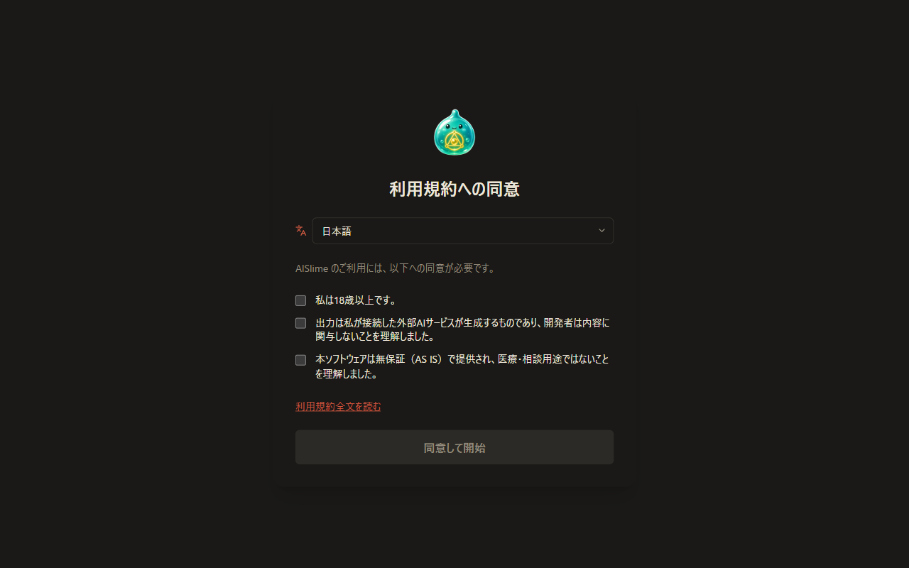
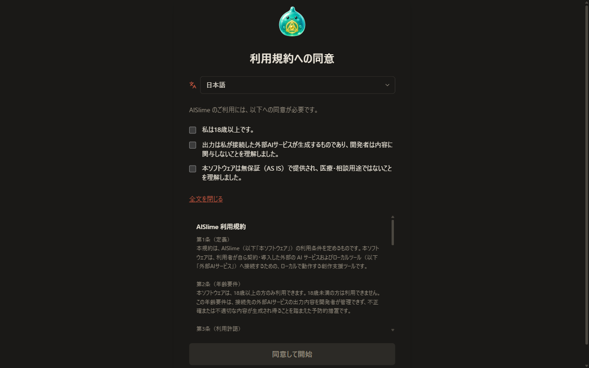
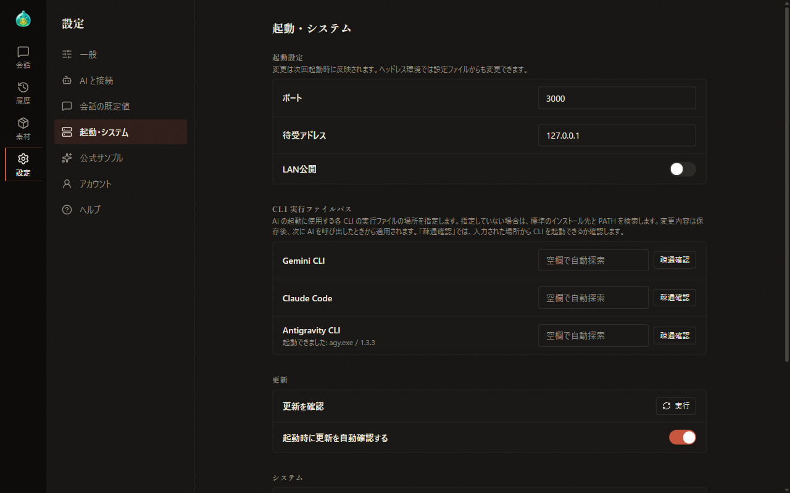

# 01 Installation and Startup

[Back to Contents](index.md)

Next chapter: [02 Understanding the Screen](02-screen.md)

This chapter explains how to install and start AlSlime, how to make the initial settings, and how to quit the app.

## What This Chapter Covers

1. System requirements
2. Getting AlSlime
3. Starting AlSlime and opening the screen
4. Agreeing to the Terms of Use
5. The first screen
6. Importing the official samples
7. Specifying where the CLIs are
8. Changing the startup settings
9. Quitting AlSlime

Supplement: If AlSlime quits right after starting

## 1. System Requirements

- **OS**: Windows / Linux
- **Browser**: A common browser such as Chrome, Edge, or Firefox
- **AI**: One of the following
  - An AI CLI (Antigravity CLI, Gemini CLI, or Claude Code)
  - An AI service that provides an OpenAI-compatible API

### Preparing an AI

AlSlime uses one of the following AI services for conversations. Prepare a subscription to the service and the matching CLI or API key, then start AlSlime.

| AI to use | Subscription | What to prepare |
| --- | --- | --- |
| Gemini (Google), personal | Google AI Pro / Ultra subscription | **Antigravity CLI** (command `agy`) |
| Gemini (Google), business | Gemini Code Assist for businesses (Standard, etc.) | **Gemini CLI** (command `gemini`) |
| Claude (Anthropic) | An eligible paid Claude plan (Max, etc.) | **Claude Code** (command `claude`) |
| An AI service provided through an API | An API subscription with OpenRouter, OpenAI, DeepSeek, OpenCode Go, etc. | The API key of each service |

- After installing a CLI, start it once in a terminal and complete the sign-in before using it. ~~The steps from getting a CLI to signing in are explained on the AlSlime website.~~ (currently in preparation)
- To use an API, register the connection after starting AlSlime ([08 Settings](08-settings.md)). API usage fees are charged under your contract with each service.
- Eligible plans and prices may be revised at the provider's discretion.
- The personal sign-in methods of Gemini CLI (Google AI Pro / Ultra and Gemini Code Assist for individuals) ended on June 18, 2026. To use Google's AI with a personal subscription, use its successor, Antigravity CLI.

## 2. Getting AlSlime

Download the file for your OS from GitHub Releases and extract it.

- **Windows**: Extract `alslime-X.Y.Z-windows-amd64.zip`. It contains the app itself, `alslime.exe`, and `start-alslime.bat` for starting it.
- **Linux**: Extract `alslime-X.Y.Z-linux-amd64.tar.gz` (`tar xzf alslime-X.Y.Z-linux-amd64.tar.gz`). The execute permission is already set, so you can start it right after extracting.

Both files include the Terms of Use, the license, and README files (in Japanese and English). The modules for supporters are downloaded separately after starting AlSlime ([09 Supporter Features](09-sponsor.md)).

## 3. Starting AlSlime and Opening the Screen

### Where to start AlSlime

AlSlime saves conversation records and settings in its data folder. How to check where they are saved is explained in [13 Data Location and Backups](13-data.md). We recommend placing the extracted files in a dedicated folder.

### Steps to start

When you start AlSlime, the app runs only inside your own PC and gets ready to show its screen in your browser.

- **Windows**: Double-click `start-alslime.bat`. The app starts, and after about 3 seconds the screen appears in your browser.
- **Linux**: Run `./alslime`. In a desktop environment, the browser opens automatically and shows the screen.

While the app is running, the console shows the address of the screen.

> **If the screen does not appear**
>
> - If a connection error page appears, the browser may have opened before the app finished starting. Wait a moment and reload the page to show the screen.
> - If the browser does not open, enter the address shown in the console (usually `http://127.0.0.1:3000`) directly in your browser to show the screen.
> - On Windows, starting `alslime.exe` directly does not open the browser automatically. In this case too, enter the address directly to show the screen.
> - If these steps do not solve the problem, see [14 Troubleshooting](14-troubleshooting.md).

## 4. Agreeing to the Terms of Use

The first time you start AlSlime, the "Agree to the Terms of Use" screen appears.

1. In the field below the heading, you can switch the display language (日本語 / English).
2. Read the following three items, and if you agree, select each check box.
   - I am 18 years of age or older.
   - I understand that all output is generated by the external AI services I connect, and the developer is not involved in its content.
   - I understand that this software is provided AS IS without warranty and is not intended for medical or counseling use.
3. Select "Read the full Terms of Use" to show the full text right there. When the display language is not Japanese, a note stating that the Japanese version is the authoritative text is also shown.

   

4. When all three check boxes are selected, "Agree and start" becomes available. Select "Agree and start".

The consent screen appears again when the Terms of Use are revised or when the folder where data is saved changes.

## 5. The First Screen

When you have agreed, the conversation screen appears. The first time, the "Setup" panel, where you prepare a conversation, is shown on the right.

The layout of the screen is explained in [02 Understanding the Screen](02-screen.md), and how to start a conversation in [03 Your First Conversation](03-first-chat.md).

## 6. Importing the Official Samples

The official samples contain a set of characters, templates, and presets. Once imported, you are ready to start a conversation without creating any settings files.

1. Select "Settings" on the left edge of the screen (when the screen is narrow, "Settings" is in the tabs at the bottom of the screen).
2. Select "Official samples".
3. Under "Sample settings", select "Run" for "Download and import".

   

   

The samples are downloaded from GitHub and imported. Existing files are not changed. The templates for setting generation can also be imported on the same screen. Details are explained in [08 Settings](08-settings.md).

## 7. Specifying Where the CLIs Are

AlSlime normally detects the AI CLIs automatically. If an error appears when you send a message, or if you installed a CLI in a location other than the default, specify the location of the executable file.

1. In "Settings", go to "Startup & system".
2. Under "CLI executable paths", enter the location of the executable file in the field for the CLI you use. CLIs whose fields are left empty continue to be detected automatically.
3. Select "Test" next to the field to check whether the CLI starts from the entered location. The result is shown below the CLI name. You can check the entered value even before saving it.

   

   | Message | Meaning |
   | --- | --- |
   | Started successfully | The CLI was confirmed to start. The CLI name and version are also shown |
   | Not found in the default install locations or PATH. | The CLI does not exist in the locations checked by automatic detection |
   | No executable file exists at the specified path. | There is no executable file at the entered location |
   | Failed to start. | The executable file exists, but it stopped while starting |
   | No response within the time limit. | The CLI did not respond in time |

4. Select "Save" at the bottom of the screen. The saved values take effect the next time an AI is called. You do not need to restart the app.

## 8. Changing the Startup Settings

In "Startup settings" under "Startup & system" in "Settings" (the upper part of the screen in the previous section), you can change the address used to show the screen and other settings. **Changes take effect the next time AlSlime starts.**

- **Port**: The port number of the address used to show the screen. The default is 3000.
- **Bind address**: By default, only connections from this PC are allowed.
- **LAN access**: Allows connections from other devices on the same network, such as smartphones.

> **Before turning on LAN access**
>
> AlSlime is designed to be used on your own PC, so it shows its screen without a sign-in. When LAN access is turned on, anyone connected to the same network can view your conversation records and settings and use the AI. LAN access is intended for use on a trusted network, such as your home network.

- If you change the port on Windows, also change the address in `start-alslime.bat` to the same port number. Otherwise, the browser opens the old address.
- ~~More detailed startup settings, such as running on Linux without a display, are explained on the AlSlime website.~~ (currently in preparation)

## 9. Quitting AlSlime

The AlSlime app keeps running even after you close the browser. To quit, do the following.

- **Windows**: Close the console window, or press Ctrl + C in the console.
- **Linux**: Press Ctrl + C in the terminal where you started it.

If there is work in progress, the app waits briefly for it to finish before quitting.

## If AlSlime Quits Right After Starting

If AlSlime quits immediately after starting, the following causes are possible.

- Another application is using the same port
- The startup settings are corrupted
- Writing to the folder where AlSlime was started is not allowed

On Windows, the console window may close immediately, making it hard to read what was shown. How to check the cause is explained in [14 Troubleshooting](14-troubleshooting.md).

---

Next chapter: [02 Understanding the Screen](02-screen.md)

[Back to Contents](index.md)
