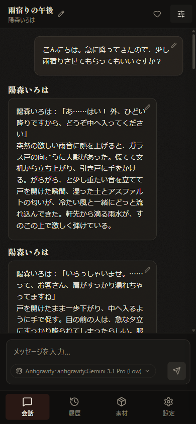
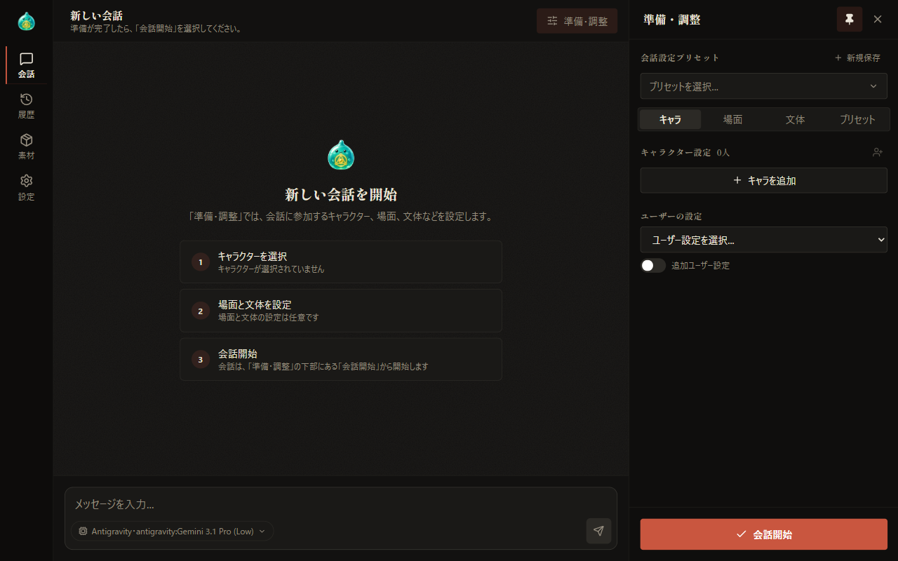
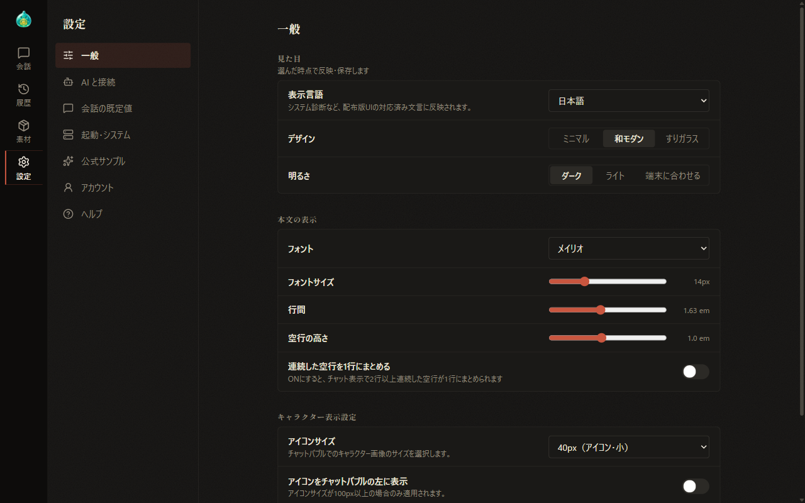

# 02 Understanding the Screen

[Back to Contents](index.md)

Previous chapter: [01 Installation and Startup](01-setup.md) / Next chapter: [03 Your First Conversation](03-first-chat.md)

This chapter explains the layout of the AlSlime screen and the role of each part.

## What This Chapter Covers

1. The overall layout and the navigation bar
2. The display on narrow screens
3. The buttons in the header of the conversation screen
4. Changing the design and brightness

## 1. The Overall Layout

The screen consists of three main areas.

- **The navigation bar on the left edge**: A bar for switching between four screens.
- **The center**: The area where the selected screen is shown. Right after startup, the conversation screen is shown.
- **The right side**: The "Setup" panel, where you prepare a conversation. Show or hide it with "Setup" in the header of the conversation screen.

The four buttons on the navigation bar have the following roles.

| Button | Role | Details |
| --- | --- | --- |
| Chat | The screen for conversations with characters | [03 Your First Conversation](03-first-chat.md) |
| History | The screen for searching past conversations and resuming them | [06 Continuing a Conversation](06-continue.md) |
| Materials | The screen for creating and editing the materials used in conversations, such as settings files for characters and scenes | [07 Materials](07-material.md) |
| Settings | The screen for changing the settings of the whole application | [08 Settings](08-settings.md) |

- When you select "Materials", the "Settings files" tab is always shown first.
- When you select "Settings", the "General" section is always shown first.
- If you try to move to another screen while the Settings screen has unsaved changes, a confirmation appears where you choose "Save", "Discard", or "Back".

## 2. The Display on Narrow Screens

On narrow screens, such as smartphones, tabs appear at the bottom of the screen instead of the navigation bar. The tabs have the same roles as the navigation bar.

- While you are typing, the tabs at the bottom of the screen are temporarily hidden.
- The buttons in the header are shown as icons only, without text.
- The "Setup" panel is shown over the conversation, and on even narrower screens it fills the whole screen.

## 3. The Header of the Conversation Screen

At the top of the conversation screen are the conversation title and the following buttons.

| Item / button | Role | When it is shown |
| --- | --- | --- |
| Title | The title of the conversation. Before a conversation starts, "New conversation" is shown. Below the title, the names of the characters taking part in the conversation are shown | Always |
| Pencil icon | Changes the title. Press the Enter key or select "Save" to confirm, and press the Esc key or select "Cancel" to discard | After the conversation is saved. On wide screens, it appears when you hover the mouse over the title |
| ○ running | The number of jobs in progress. Select it to show "Job progress" ([06 Continuing a Conversation](06-continue.md)) | While there are jobs in progress |
| Quick settings | Shows settings shared by all conversations, such as image generation and text-to-speech ([10 Image Generation](10-image-generation.md), [11 Text-to-Speech](11-tts.md)) | When the image generation or text-to-speech supporter feature is enabled |
| Status | Shows the panel for checking the characters' status and the time within the conversation ([06 Continuing a Conversation](06-continue.md)) | After the conversation is saved |
| Setup | Shows or hides the panel for setting characters, scene, style, and more ([04](04-prepare-characters.md), [05](05-prepare-scene.md)) | Always |

- On wide screens, the "Setup" panel is shown to the right of the conversation, so you can keep it open while you talk. Select the pin in the panel header to keep the panel open even when you select outside it; it will also be open the next time you start AlSlime.
- The "Quick settings" and "Status" panels slide in over the screen from the right. Select outside the panel or × to close it.

### The screen before a conversation starts

Before a conversation starts, "Let's start a conversation" and the three steps to start a conversation are shown in the center of the screen. Selecting any of the steps shows the "Setup" panel, and when you choose a character, the number of the first step is highlighted.

If no default conversation preset is set, the "Setup" panel opens automatically at startup. Set the default conversation preset in "AI & connections" in "Settings" ([08 Settings](08-settings.md)).

## 4. Changing the Design and Brightness

In "Appearance" under "General" in "Settings", you can change the design and brightness of the screen. Your choice is saved as soon as you make it and is applied to the screen immediately.

- **Design**: Choose from three designs: "Minimal", "Japanese modern", and "Frosted glass".
- **Brightness**: Choose from "Dark", "Light", and "Match device". The brightness setting is kept even when you change the design.

The screenshots in this manual were taken with "Japanese modern" and "Dark".

## If the Screen Could Not Be Loaded

After you update AlSlime to a new version, selecting "Materials" or "Settings" in a browser that was already open may show "Could not load this screen. The app may have been updated. Please reload." In that case, select "Reload" to load the latest screen.

If the old screen is still shown after reloading, see [14 Troubleshooting](14-troubleshooting.md).

---

Previous chapter: [01 Installation and Startup](01-setup.md) / Next chapter: [03 Your First Conversation](03-first-chat.md)

[Back to Contents](index.md)
