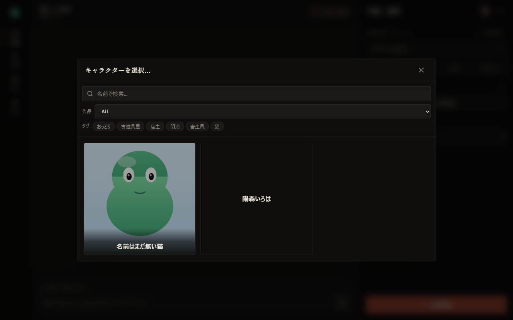
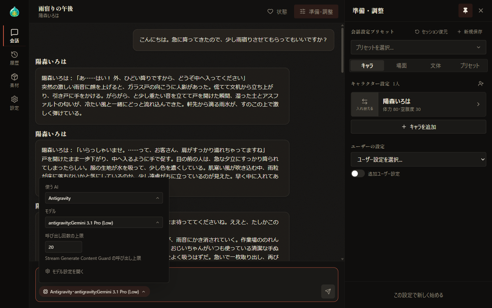
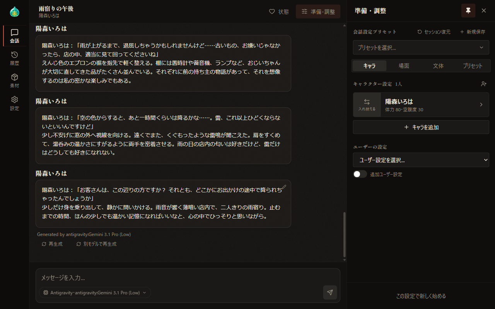
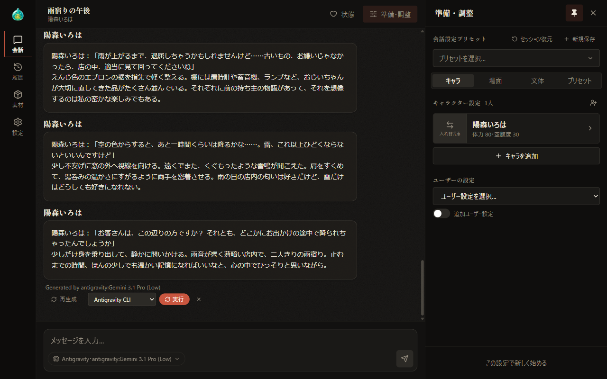

# 03 Your First Conversation

[Back to Contents](index.md)

Previous chapter: [02 Understanding the Screen](02-screen.md) / Next chapter: [04 Setup: Characters](04-prepare-characters.md)

This chapter explains the steps from choosing a character and starting a conversation to receiving a response, and the main operations on the conversation screen.

## What This Chapter Covers

1. Steps to start a conversation
2. Entering and sending messages
3. Choosing the AI and model
4. Operations on responses

## 1. Steps to Start a Conversation

Start a conversation in the following three steps.

1. On the "Characters" tab of the "Setup" panel, select "Add character".
2. In the "Select character..." dialog that appears, select the character you want to talk with.

   

   - Use the search field at the top to filter characters by name.
   - Use "Work" to filter by work. Select "Unclassified" to show characters with no work set.
   - When you select several tags, the list is narrowed to characters that have all the selected tags.
   - Characters already added to the same conversation are not shown in the list.

3. Select "Start conversation" at the bottom of the panel.

When the conversation starts, "Send a message in chat to start the conversation." appears in the center of the screen. Then type a message in the input field at the bottom of the screen and send it.

- Up to five characters can take part in one conversation.
- Setting the scene and style is optional. How to set them is explained in [05 Setup: Scene, Style, and Presets](05-prepare-scene.md).
- Detailed settings for each character are explained in [04 Setup: Characters](04-prepare-characters.md).

## 2. Entering and Sending Messages

Select the send button at the lower right of the input field to send the message. The height of the input field adjusts automatically to the number of lines you type. When no message is entered and no action choice is selected, the send button is disabled.

### Send key

To send with the keyboard, use the key combination selected in "Chat send key" under "General" in "Settings".

- There are three choices: "Enter key", "Shift + Enter key", and "Ctrl + Enter key". The default is "Shift + Enter key".
- Enter key presses other than the selected combination insert a line break.
- Pressing the Enter key while converting text with a Japanese input method does not send the message.
- On touch devices such as smartphones, the Enter key always inserts a line break.

### Stopping generation

While a response is being generated, the send button changes to a stop button. Select the stop button to stop the generation.

## 3. Choosing the AI and Model

The names of the AI and model in use are shown at the lower left of the input field. Select this display to open the "AI and model" popup. Use this popup to switch the AI and model used for the conversation.

| Item | Description | When it is shown |
| --- | --- | --- |
| AI | Choose from "Antigravity", "Claude", "Gemini", and "API (OpenAI-compatible)". When you switch, the default model is selected automatically | Always |
| API connection | Choose the API connection to use | When the AI is "API (OpenAI-compatible)" |
| Model | Choose the model to use | Always |
| Claude effort | Choose how deeply Claude thinks when generating a response. Your choice is kept after the next startup | When the AI is "Claude" |
| Antigravity thinking | Choose how deeply Antigravity thinks when generating a response. Your choice is kept after the next startup | When the AI is "Antigravity" and a supported model is selected |
| Open model settings | Shows "AI & connections" in "Settings" | Always |

- When the AI is "Antigravity", "Call limit" is also shown. ~~This item is explained in detail on the AlSlime website.~~ (currently in preparation)
- Select outside the popup or press the Esc key to close the popup.
- Right after startup, the default AI and model specified in "AI & connections" in "Settings" are selected.
- When you resume a conversation from the history, the AI and model last used in that conversation are selected.
- With "API (OpenAI-compatible)", the action choices of the supporter features are not generated.
- How to register API connections and models is explained in [08 Settings](08-settings.md).

## 4. Operations on Responses

A character's response is shown in a chat bubble for each line of speech.

- If expression images are registered for the character, an icon matching the expression is shown next to the name.
- If the date and time are included in the conversation, the date and time within the conversation are shown for each line of speech.
- Below the response, the name of the model used to generate it is shown after "Generated by".

### Editing a line of speech

Select the pencil icon at the upper right of a chat bubble to show a field for editing the text. You can edit both the characters' lines and your own.

- Select "Save" to save the edited text. Saving does not regenerate the response.
- Select "Cancel" to discard the edit.
- On wide screens, the pencil icon appears when you hover the mouse over the chat bubble. On narrow screens, it is always shown.

### Regenerate

Select "Regenerate" below the latest response to generate a new response from the same input and replace the original response.

### Regenerate with another model

Select "Regenerate with another model" below the latest response to show a model selector and "Run". Choose a model and select "Run" to regenerate the response with that model and replace the original response. Select × to close the selector.

Select "Advanced..." in the selector to specify the provider, model, Claude effort, and Antigravity thinking individually. The selector shows only providers that have available models registered.

### Action choices (supporter feature)

When the "action choices" supporter feature is enabled, candidates for your next action are shown below the latest response.

- When you select a candidate, you can send even if the input field is empty. If the input field contains text, both the selected candidate and the text are sent.
- Select the selected candidate again to deselect it.
- Select "Other (free input)" to switch to normal input without using a candidate.
- The candidates are not saved, so they disappear when you reload the screen.

Supporter features are explained in [09 Supporter Features](09-sponsor.md).

### If no response comes back

If getting a response fails, "Error:" followed by the details is shown where the response would be. If the AI does not respond for 10 minutes, it is treated as a timeout. In either case, select "Regenerate" to get the response again.

Other things to check are described in [14 Troubleshooting](14-troubleshooting.md).

---

Previous chapter: [02 Understanding the Screen](02-screen.md) / Next chapter: [04 Setup: Characters](04-prepare-characters.md)

[Back to Contents](index.md)
