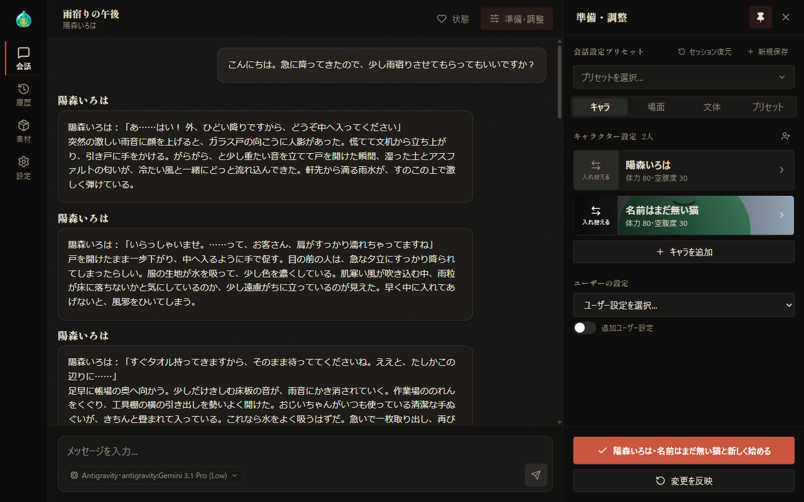
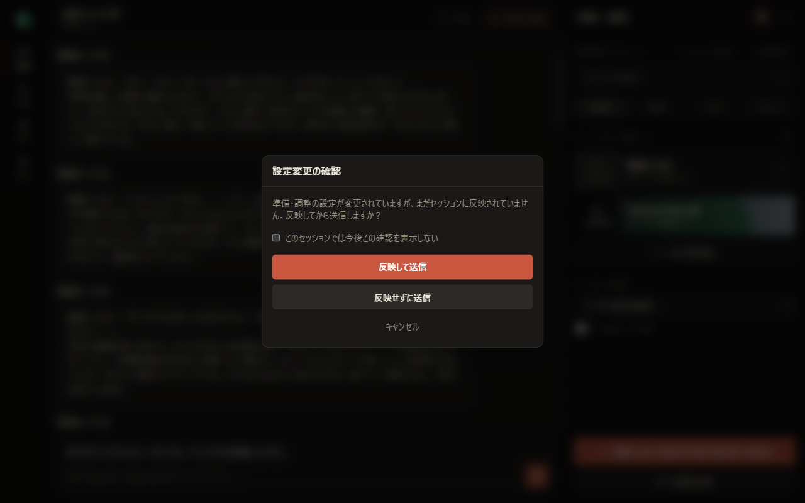
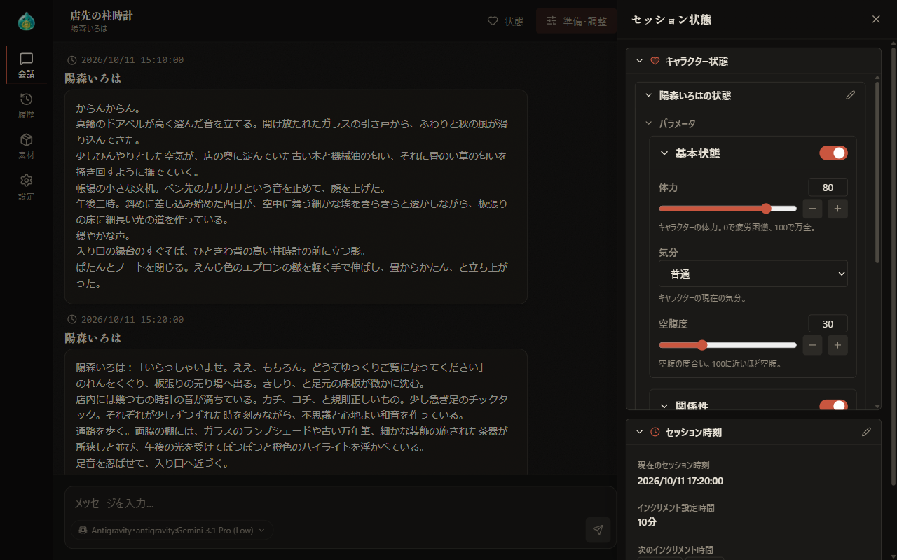
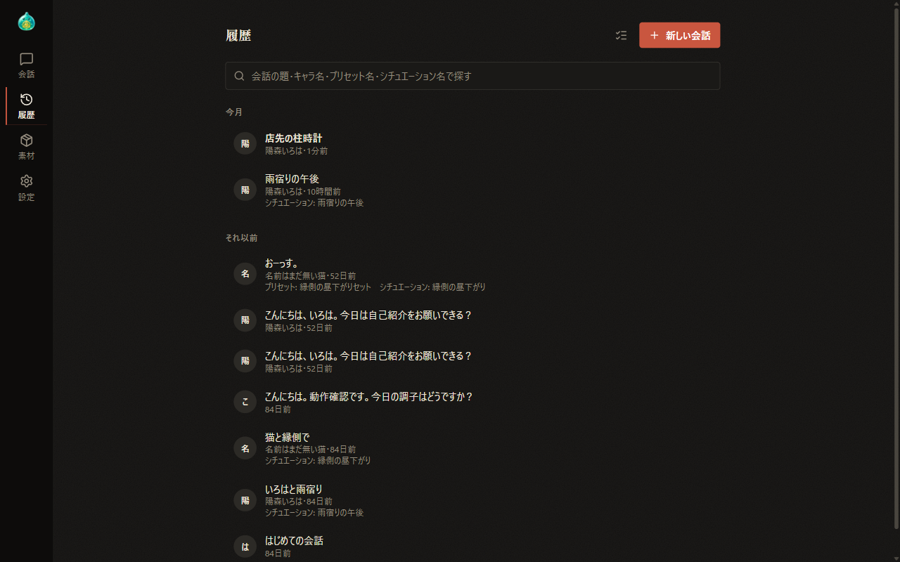
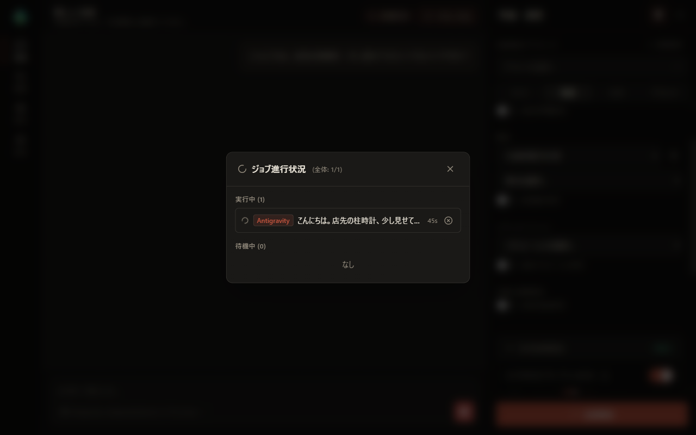

# 06 Continuing a Conversation

[Back to Contents](index.md)

Previous chapter: [05 Setup: Scene, Style, and Presets](05-prepare-scene.md) / Next chapter: [07 Materials](07-material.md)

This chapter explains the operations you use after starting a conversation: applying changed settings, starting a new conversation, the status panel, the history, and job progress.

## What This Chapter Covers

1. Saving settings for each conversation
2. The buttons at the bottom of the panel
3. The settings change confirmation when sending
4. The status panel
5. History
6. Job progress

## 1. Saving Settings for Each Conversation

The settings of the "Setup" panel are saved for each conversation. When you resume a conversation from the history, the settings saved in that conversation are restored to the panel.

If you change the panel settings during a conversation, the changes are saved to the conversation when you select "Apply changes". If you send a message while there are changes that have not been applied, "Confirm settings change" appears.

## 2. The Buttons at the Bottom of the Panel

At the bottom of the panel, the following buttons are shown depending on the state of the conversation.

| Button | Description | When it is shown |
| --- | --- | --- |
| Start conversation | Starts a conversation with the panel settings | Before a conversation starts |
| Apply changes | Saves the changes made in the panel to the current conversation. When saving is complete, "Applied" is shown for about two seconds | During a conversation, when there are changes that have not been applied |
| Start a new conversation with these settings | Starts a new conversation with the panel settings | During a conversation, when the set of characters taking part has not changed |
| Start new with 〈names〉 | Starts a new conversation with the panel settings. The button shows the names of the characters taking part, separated by commas | During a conversation, when the set of characters taking part has changed |

- When you change the set of characters taking part, "Start new with 〈names〉" is shown prominently. In this case too, selecting "Apply changes" below it saves the character changes to the current conversation.
- Changing only the order of the characters is not treated as a change to the set of characters.
- Even after you start a new conversation, the previous conversation remains saved in the history.

## 3. The Settings Change Confirmation When Sending

If you send a message during a conversation while there are setting changes that have not been applied, "Confirm settings change" appears. Changes in both the Setup panel and the status panel are covered.

| Button | Description |
| --- | --- |
| Apply and send | Saves the changes to the current conversation and then sends the message. If saving fails, "Failed to apply to the session" is shown and sending is canceled |
| Send without applying | Sends the message with the settings saved in the conversation. The changes in the panel remain unapplied |
| Cancel | Cancels sending |

- If you send with "Don't ask again in this session" selected, this confirmation is no longer shown in that conversation. Save changes with "Apply changes".
- How a conversation preset loaded during a conversation is handled is explained in [05 Setup: Scene, Style, and Presets](05-prepare-scene.md).

## 4. The Status Panel

After the conversation is saved, select "Status" in the header of the conversation screen to show the "Session status" panel. The panel has two sections, "Character status" and "Session time". Select a section's heading to show or hide its contents. Select outside the panel or ×, or press the Esc key, to close the panel.

### Character status

For each character, "〈name〉's status" shows the individual personality, individual outfit and hairstyle, individual background, the parameters, and the relationships (target, relation, affection, and details).

Select the pencil icon in the "〈name〉's status" heading to edit the parameters and relationships (relation, affection, and details).

- Select "Save" to apply the edits to the Setup panel. Select "Cancel" to discard them.
- You can edit only one character at a time.
- The individual personality, individual outfit and hairstyle, and individual background are display only. Change them in the character details of the Setup panel ([04 Setup: Characters](04-prepare-characters.md)).

### Session time

In conversations with the date and time enabled, "Current session time", "Increment setting", "Next increment", and "Elapsed" are shown.

- Select the pencil icon to the right of the section heading to edit the session time and the increment setting. In detailed-mode conversations, also specify years, months, days, and seconds.
- "Next increment" can be changed without switching to editing. It specifies the time to advance at the next message, and when the response arrives, the value replaces the increment setting.

How the date and time work is explained in [05 Setup: Scene, Style, and Presets](05-prepare-scene.md).

### Applying changes

Changes made in the status panel are also not saved to the conversation until they are applied, just like in the Setup panel. When there are changes that have not been applied, a save icon ("Apply to current session") is shown to the right of each section heading. Select this icon to save the changes to the conversation.

## 5. History

Select "History" on the navigation bar to show the list of past conversations.

- Conversations are listed under "This month" and "Earlier". Each row shows the conversation title, the names of the characters taking part, and the elapsed time. On wide screens, the preset name and situation name are also shown.
- Use the search field at the top to filter by conversation title, character name, preset name, or situation name.
- Select a row to switch to the conversation screen and resume that conversation. The Setup panel settings and the AI and model also switch to those of that conversation. A conversation whose response is being generated continues to wait for the response.
- Select "New conversation" to the right of the heading to clear the Setup panel settings and start preparing a new conversation on the conversation screen.

### Deleting conversations

To delete one at a time, select the trash icon ("Delete session") on the right of a row, and select "Delete" in the confirmation dialog. On wide screens, the icon appears when you hover the mouse over the row.

To delete several conversations at once, follow these steps.

1. Select the "Bulk delete mode" icon to the right of the heading.
2. Select the rows of the conversations to delete.
3. Select "Delete" next to "Selected: ○" at the bottom of the screen, and select "Delete" in the confirmation dialog.

- As the confirmation dialog says, deletion cannot be undone.
- If you delete the conversation currently shown, the screen switches to a new conversation.
- Conversations that could not be deleted in a bulk deletion remain selected.
- Select "Cancel" to leave bulk delete mode.

## 6. Job Progress

Jobs such as AI responses, image generation, and text-to-speech are run in order by the AlSlime app. They continue even if you close the browser.

While there are jobs in progress, "○ running" is shown in the header of the conversation screen. Select it to show the "Job progress" dialog.

- Next to the heading, the number in use and the limit of the overall concurrency are shown in the form "Global: in use/limit".
- Jobs are listed under "Running" and "Pending". Stop running jobs with the "Stop" icon, and cancel pending jobs with the "Cancel" icon.
- Up to three recently failed jobs are shown.
- The display is updated every 1.5 seconds.
- Select × or outside the dialog to close it.

Change the concurrency limits in "Concurrency settings" in [08 Settings](08-settings.md).

---

Previous chapter: [05 Setup: Scene, Style, and Presets](05-prepare-scene.md) / Next chapter: [07 Materials](07-material.md)

[Back to Contents](index.md)
