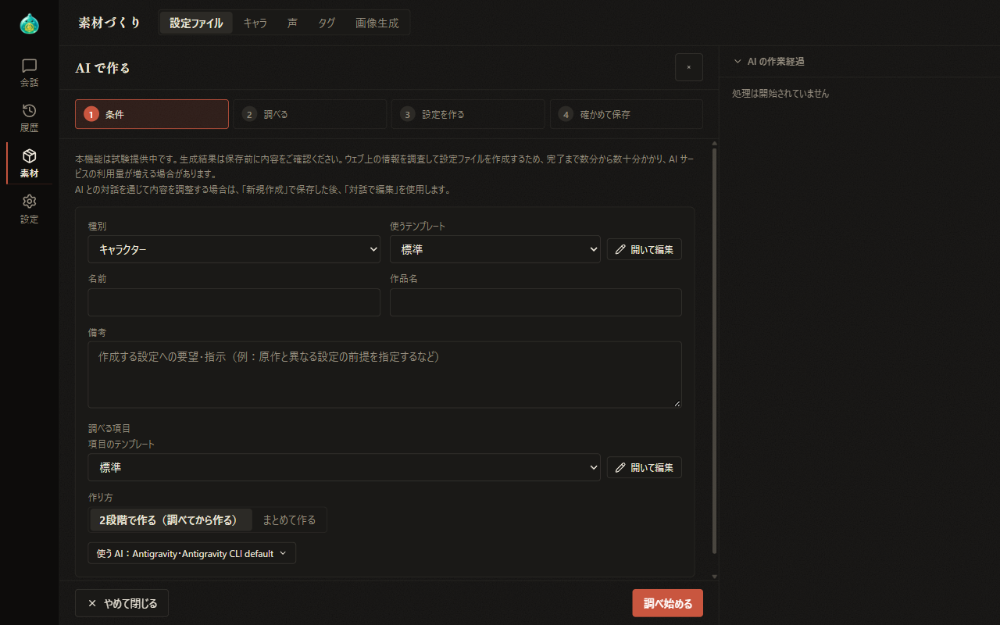
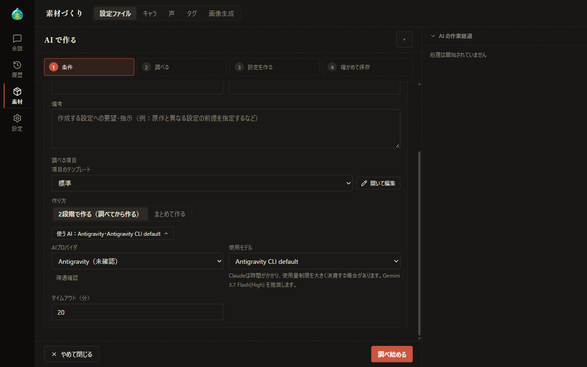
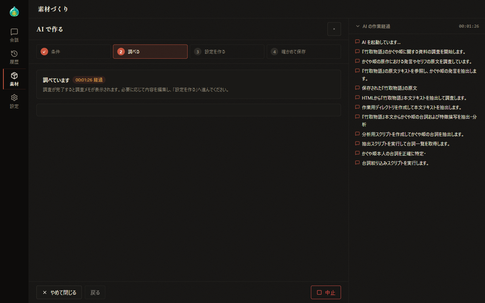
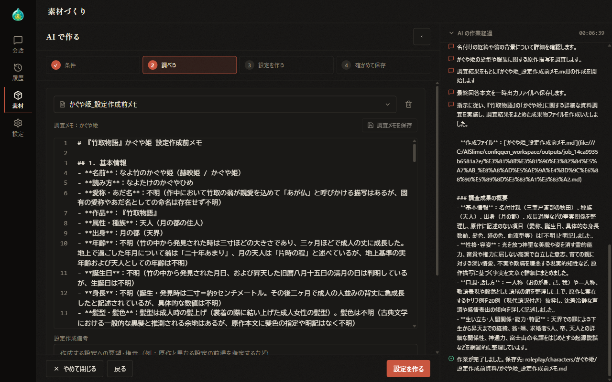
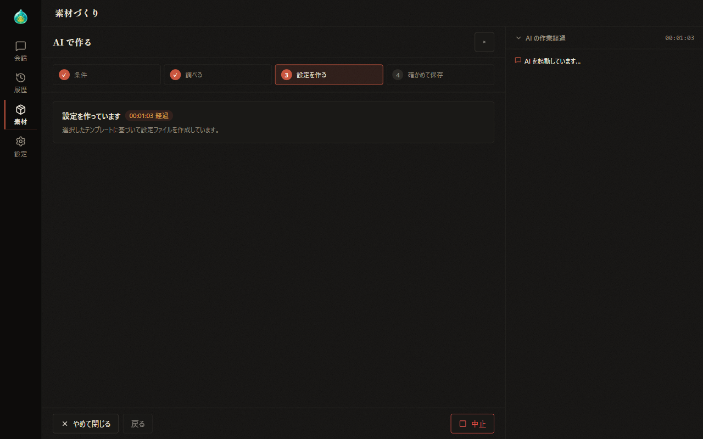
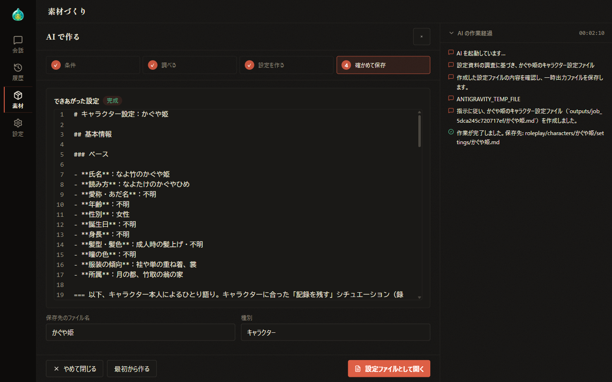

# 07-2 Materials: Create with AI

[Back to Contents](index.md) / [07 Materials](07-material.md)

Previous chapter: [07-1 Materials: Settings Files](07-material-files.md) / Next chapter: [07-3 Materials: Characters](07-material-characters.md)

This chapter explains "Create with AI", in which the AI creates settings files while researching information on the web.

> **Note**
>
> This feature is experimental. Because it researches information on the web to create settings files, it can take from several minutes to several tens of minutes to finish, and it may increase your usage of the AI service. Check and edit the created contents on the screen after completion.

## What This Chapter Covers

1. The creation flow
2. Specifying the conditions
3. The AI to use
4. Research
5. Create settings
6. Review and save
7. While a run is in progress

## 1. The Creation Flow

On the "Settings files" tab of Materials, select "Create with AI" at the top of the list to show the "Create with AI" screen.

- At the top, the steps "1 Conditions", "2 Research", "3 Create settings", and "4 Review and save" are shown, and finished steps are marked with ✓. For types other than characters, and when "All at once" is chosen as the method, there are three steps without "Research".
- On the left of the bar at the bottom are "Cancel and close" and "Back" (hidden in the Conditions step), and on the right is the button that moves to the next step. While a step is running, the right button changes to "Cancel". The × to the right of the heading works the same as "Cancel and close".
- On the right side, "AI progress" shows how the AI's work is progressing, line by line. Select the heading to show or hide it.

To refine the contents through a conversation with the AI, save the settings file and then use "Edit by chat" in [07-1 Materials: Settings Files](07-material-files.md).

## 2. Specifying the Conditions

In the "Conditions" step, specify the conditions of the settings file to create.

| Item | Description |
| --- | --- |
| Category | Choose the type of settings file to create |
| Template | Choose the template that defines the format of the settings file to create. "(default)" is the default template |
| Name | Enter the character's name. For types other than characters, it becomes "File name", where you enter the name of the file to save. Both are required |
| Work title | Enter the name of the work the character appears in. Shown only for the character type, and required |
| Notes | Write requests or directions for the settings to create (for example, specifying a premise that differs from the original work), up to 2,000 characters |
| Items to research / Items to fill in | Choose the item template that defines the items to research (when creating in two steps) or the items to fill in |
| Method | Choose "Two steps (research, then create)" or "All at once". Shown only for the character type |

- Select "Open and edit" next to "Template" or "Item template" to show the contents of the template in a popup. Select "Save" in the popup to overwrite the template with those contents. If you select "Cancel" or ×, the edits are discarded. Selecting outside the popup does not close it.
- If you try to switch to another template while the item template has been edited, a replacement confirmation is shown.
- The method and the AI to use are set to the values from the previous run.

When the conditions are set, select "Start research" (when creating in two steps) or "Create settings" on the right of the bar. If a required item is empty, a message asking you to enter it is shown, and processing does not start.

If research notes (when creating in two steps) or a settings file (when creating all at once) with the same name already exists, an overwrite confirmation is shown before processing starts.

If there are saved research notes, "Start from saved notes" is also shown. Select it to move to the "Research" step without doing new research.

## 3. The AI to Use

At the bottom of the conditions, normally only "AI: (provider) (model)" is shown. Select this display to show the field for choosing the AI to use.

| Item | Description |
| --- | --- |
| AI provider | Choose from Antigravity, Claude, and Gemini. Providers whose CLI is not detected and those whose connectivity check failed cannot be chosen |
| Connectivity check | Checks whether the CLI of the selected provider can be started |
| Model | Choose the model to use. Below the field, a note about the recommended model is shown |
| Effort | Choose how deeply Claude thinks when generating a response. Shown when the provider is Claude |
| Thinking | Choose how deeply supported Antigravity models think |
| Timeout (minutes) | Specify the time limit for processing in the range from 1 to 60 minutes |

## 4. Research

When creating "in two steps", the AI first researches information on the web and summarizes the results in research notes.

- During research, "Researching" and the elapsed time are shown. When it is complete, the research notes are shown and saved in the folder of the character being created.

- You can edit the research notes on the spot. They are saved with "Save research memo" or Ctrl+S, and the save state is shown with a "Saved" or "Unsaved changes" badge.
- If there are saved research notes, choose them in the searchable popup from "Use saved research notes…". The selected research notes can be deleted with the trash icon next to them after a confirmation.
- Below the research notes, you can add "Generation notes", choose and edit the template again, and choose the AI to use again.

When you have checked the contents, select "Create settings" on the right of the bar. If a settings file with the same name already exists, an overwrite confirmation is shown before creation starts.

## 5. Create Settings

In the "Create settings" step, the AI creates the settings file based on the selected template. During processing, "Creating settings" and the elapsed time are shown.

If creation fails, the reason is shown. Choose the AI again if needed and select "Run again with the same settings" on the right of the bar to run the processing again from the same step. If the research step fails, run it again in the same way.

## 6. Review and Save

When creation is complete, "Created settings" is shown with a "Done" badge. At the bottom, the file name and type of the save destination are shown. The created settings file is saved at the moment it is completed.

- You can edit the shown contents on the spot.
- Select "Open as config file" or press Ctrl+S to switch to the editing screen of the "Settings files" tab. If you edited the contents, they are saved before switching.
- Select "Start over" on the left of the bar to return to the "Conditions" step with the type, template, and AI kept and with the name and result cleared.

## 7. While a Run Is in Progress

- Processing continues even if you move to another tab or screen while it is running. Completion and failure are shown in a notification at the bottom of the screen. If notifications are allowed in the browser's site settings, a browser notification is also shown.
- While there is a run in progress, no new creation can be started, and "Another run is in progress. Wait for it to finish or stop it." is shown.
- Runs in progress are also shown in Job progress ([06 Continuing a Conversation](06-continue.md)).

---

Previous chapter: [07-1 Materials: Settings Files](07-material-files.md) / Next chapter: [07-3 Materials: Characters](07-material-characters.md)

[Back to Contents](index.md)
