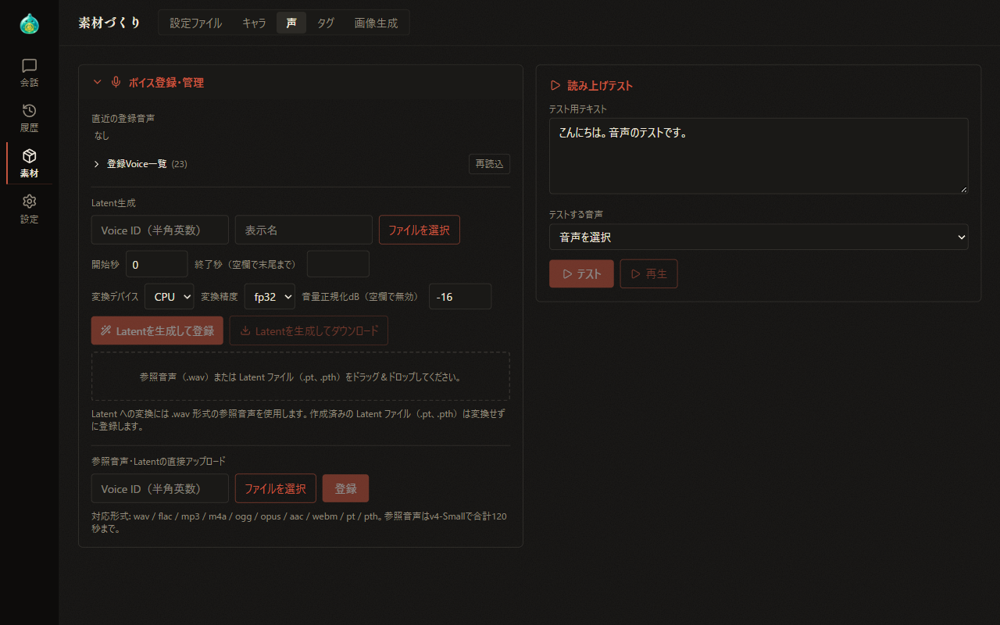

# 07-4 Materials: Voices

[Back to Contents](index.md) / [07 Materials](07-material.md)

Previous chapter: [07-3 Materials: Characters](07-material-characters.md) / Next chapter: [07-5 Materials: Tags and Image Generation](07-material-image.md)

This chapter explains how to register voices and test the reading on the "Voices" tab of Materials. The "Voices" tab is shown when the text-to-speech supporter feature is enabled. Text-to-speech is available only when the display language is Japanese.

## What This Chapter Covers

1. The screen layout
2. Registered voices
3. Latent generation
4. Uploading reference audio or latents directly
5. Reading test

## 1. The Screen Layout

On wide screens, "Voice registration & management" is on the left and "Reading test" is on the right. On narrow screens, they are stacked vertically. Select the "Voice registration & management" heading to show or hide its contents.

## 2. Registered Voices

- **Recently registered voice**: Shows the voice you just registered, so you can preview it right away.
- **Registered voices**: Select the heading to show the list of voices registered on the text-to-speech server. The number of voices is shown next to the heading.

  In the list, you can search by Voice ID, preview, and delete voices. When you delete a voice, the characters linked to that voice are shown.

  Use "Reload" to update the list to the latest state.

## 3. Latent Generation

In "Latent generation", create a file (latent) that represents the characteristics of the voice in reference audio (.wav) and register it as a voice. This feature is available when a text-to-speech server that supports latent generation is connected.

1. Enter a Voice ID (alphanumeric) and a display name, and specify the reference audio with "Choose file". You can also specify the reference audio by dragging and dropping it onto the dotted frame.
2. If needed, specify the range to use (start and end seconds), the conversion device, the conversion precision, and volume normalization.
3. Select "Generate latent and register" to register it as a voice. Select "Generate latent and download" to save the created file to your PC.

If you drag and drop an existing latent file (.pt or .pth) onto the frame, it is registered without conversion.

## 4. Uploading Reference Audio or Latents Directly

Enter a Voice ID, specify reference audio or a latent file with "Choose file", and select "Register" to register it as a voice.

- Supported formats are wav, flac, mp3, m4a, ogg, opus, aac, and webm. On text-to-speech servers that support direct latent registration, pt and pth can also be specified.
- The maximum length of reference audio is 120 seconds in total (when the text-to-speech model is v4-Small).

~~Details of the supported formats and limits, and the differences between types of text-to-speech servers, are explained on the AlSlime website.~~ (currently in preparation)

## 5. Reading Test

In "Reading test", read text aloud with a registered voice and check the result.

1. In "Test text", enter the text to read. This text is also used for previews in the list of registered voices.
2. In "Voice to test", choose a character with a linked voice or a registered voice. When you choose a character, the text is read with that character's link settings.
3. Select "Test" to start creating the audio. While it is being created, stop it with "Cancel".
4. When the audio is created, play it with "Play".

How to link a voice to a character is explained in [07-3 Materials: Characters](07-material-characters.md), and the text-to-speech settings in [11 Text-to-Speech](11-tts.md).

---

Previous chapter: [07-3 Materials: Characters](07-material-characters.md) / Next chapter: [07-5 Materials: Tags and Image Generation](07-material-image.md)

[Back to Contents](index.md)
