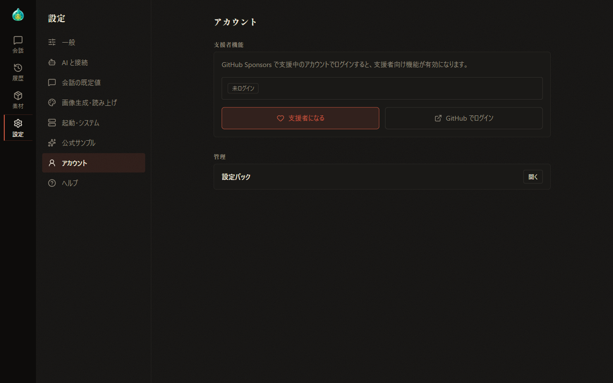
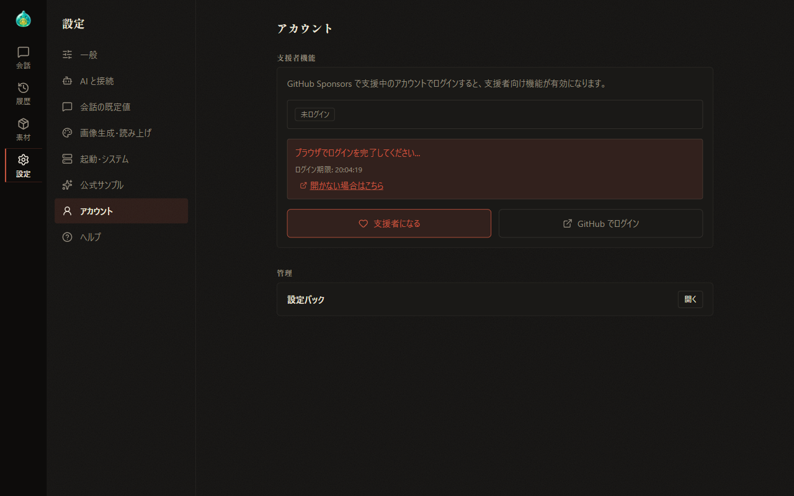
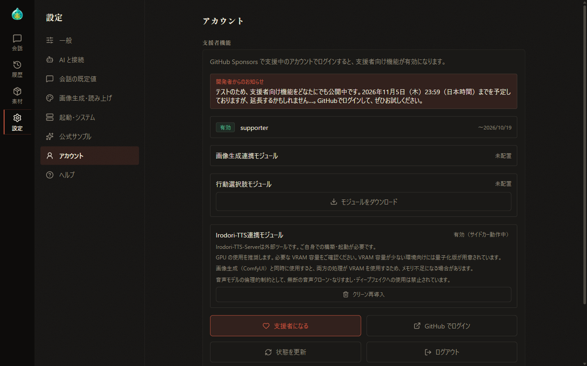

# 09 Supporter Features

[Back to Contents](index.md)

Previous chapter: [08 Settings](08-settings.md) / Next chapter: [10 Image Generation](10-image-generation.md)

This chapter explains the features for users who support AlSlime through GitHub Sponsors, including how to sign in and how to manage the feature modules.

## What This Chapter Covers

1. Overview of the supporter features
2. Signing in
3. The screen after signing in
4. Getting and managing modules
5. Signing out

## 1. Overview of the Supporter Features

When you sign in with an account that sponsors AlSlime through GitHub Sponsors, the following features become available.

| Feature | Description | Details |
| --- | --- | --- |
| Image generation | Generates images of conversation scenes and expression images with ComfyUI or an API service | [10 Image Generation](10-image-generation.md) |
| Action choices | Shows candidates for your next action below a response | [03 Your First Conversation](03-first-chat.md) |
| Text-to-speech | Reads the characters' lines aloud with voices (when the display language is Japanese) | [11 Text-to-Speech](11-tts.md) |

Operate the supporter features in the "Supporter features" field under "Account" in Settings.

## 2. Signing In

1. Show "Account" in Settings.
2. Select "Sign in with GitHub". The GitHub page opens in another browser tab.
3. On the GitHub page, sign in with the sponsoring account and authorize the AlSlime integration.

While the sign-in is in progress, the AlSlime screen shows "Complete the sign-in in your browser..." and the deadline for the procedure.

- If the GitHub page does not open, select "Open manually". To sign in with another browser, copy the address of this link and open it there.
- When the procedure is complete, it is reflected on the AlSlime screen automatically.
- If the deadline has passed, select "Sign in with GitHub" again.

Select "Become a sponsor" to show the GitHub Sponsors page.

## 3. The Screen After Signing In

- The status badge shows the state, such as "Active", together with the plan name and the expiration date.
- If there is a notice from the developer, its contents are shown.
- Select "Refresh status" to get the sponsorship state again. Use it right after you start sponsoring or after changing your plan.

## 4. Getting and Managing Modules

Some supporter features run with additional programs called modules. Each module shows its state ("Not installed", "Installed", "Active", and so on).

| Module | Description |
| --- | --- |
| Image generation integration module | Provides the image generation features. When you get it, the included sample workflows are also placed |
| Action choice module | Provides the action choices feature |
| Irodori-TTS integration module | Provides the text-to-speech features. Shown when the display language is Japanese |

- **Download module**: Gets and installs the module. In most cases, it becomes active as soon as it is installed. If it does not become active, restart AlSlime.
- **Update**: Shown when a new version of the module is available. Select it to update the module.
- **Clean reinstall**: Deletes the module and the distributed sample workflows and then installs them again. Use it when the module does not work reliably. If you edited templates with the same names as the distributed files, those contents are also deleted.

When you get the image generation integration module, the JSON files of the included sample workflows are also saved to your browser's downloads. If they could not be saved, save them again with "Export" on the "Image generation" tab of Materials ([07-5 Materials: Tags and Image Generation](07-material-image.md)).

> **Notes on text-to-speech**
>
> - Irodori-TTS-Server is an external tool that you need to set up and run yourself.
> - A GPU is recommended. The amount of VRAM required depends on the model used. Quantized versions are available for environments with little VRAM. Check the models and quantized versions on the [Irodori-TTS-v4-Small distribution page](https://huggingface.co/Aratako/Irodori-TTS-v4-Small).
> - Using it at the same time as image generation (ComfyUI) may cause out-of-memory errors, because both processes use VRAM.
> - As an ethical constraint of the voice model, using it for unauthorized voice cloning, impersonation, or deepfakes is prohibited.

You can also check for module updates with "Check for updates" under "Startup & system" in Settings ([12 Settings Packs and Updates](12-settings-pack-update.md)).

## 5. Signing Out

Select "Sign out" to sign out of the supporter features and return to the signed-out state.

---

Previous chapter: [08 Settings](08-settings.md) / Next chapter: [10 Image Generation](10-image-generation.md)

[Back to Contents](index.md)
