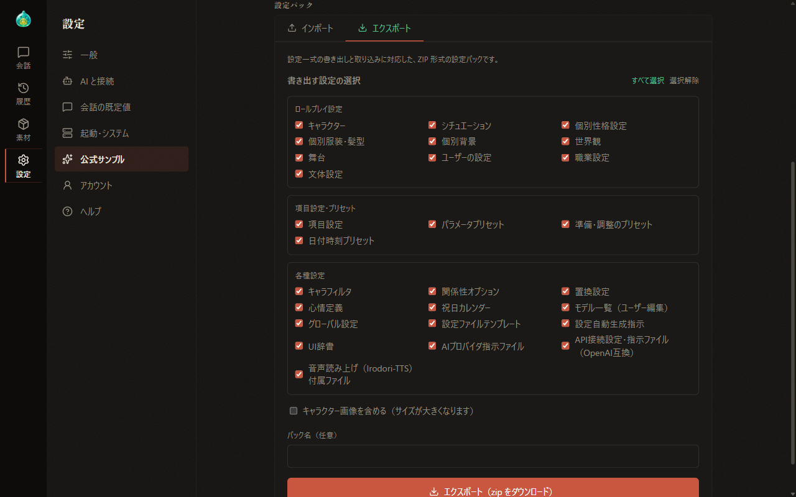
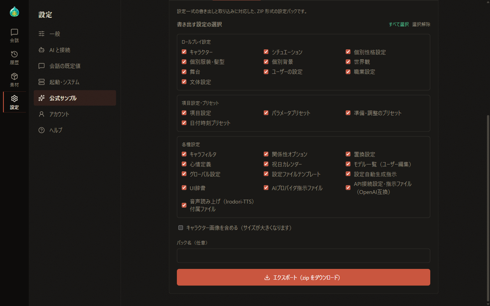
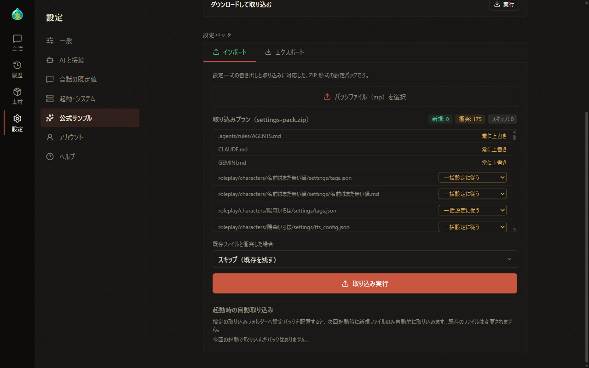
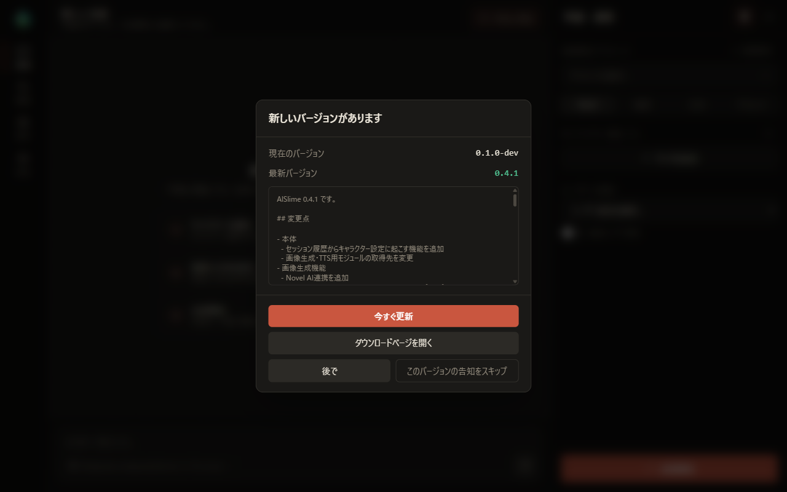

# 12 Settings Packs and Updates

[Back to Contents](index.md)

Previous chapter: [11 Text-to-Speech](11-tts.md) / Next chapter: [13 Data Location and Backups](13-data.md)

This chapter explains settings packs, which are used to export and import whole sets of settings, and how to update the AlSlime app.

## What This Chapter Covers

1. Overview of settings packs
2. Exporting a settings pack
3. Importing a settings pack
4. The official samples and template packs
5. Updating the app

## 1. Overview of Settings Packs

A settings pack is a single ZIP file containing settings files such as characters, templates, and presets. Use it to move to another PC or to share settings.

Operate settings packs in "Settings pack" under "Official samples" in Settings. The same operations are also available in the dialog shown with "Open" for "Settings pack" under "Management" in "Account" in Settings.

Settings packs do not include the following settings.

- Display settings such as the appearance
- The connection settings of ComfyUI and text-to-speech, and the LoRA folder settings
- The startup settings
- The API keys of API connections (the connection information itself is included)

Settings packs exported in a newer format may not be importable into older versions of AlSlime. ~~Details such as the size limit of settings packs are explained on the AlSlime website.~~ (currently in preparation)

## 2. Exporting a Settings Pack

1. In "Settings pack", select "Export".
2. Under "Select settings to export", choose the types to export. Use "Select all" and "Clear" to switch them all at once.

   

3. If needed, turn on "Include character images (increases size)" and enter a "Pack name (optional)". Including character images makes the file larger.
4. Select "Export (download zip)". The settings pack is saved to your browser's downloads.

   

The image generation setting types are shown when the image generation supporter feature is enabled.

## 3. Importing a Settings Pack

1. In "Settings pack", select "Import".
2. Select "Select a pack file (zip)" and choose the settings pack. You can also drag and drop a ZIP file onto the frame.
3. "Import plan" shows the list of files to import and the numbers of new, conflicting, and skipped files. Check the contents.

   

4. In "When a file conflicts with an existing one", choose what to do when a file with the same name already exists.

   | Choice | Description |
   | --- | --- |
   | Skip (keep existing) | Keeps the existing file and does not import it |
   | Overwrite | Replaces the existing file with the contents of the settings pack |
   | Add with a new name | Adds it as a separate file with a different name |

   To handle files differently, choose for each row in the list. Rows set to "Follow the bulk setting" follow the choice in "When a file conflicts with an existing one".

5. Select "Import".

Files shown as "Always overwritten" in the list (AI provider instruction files and API connection settings / instruction files) are overwritten regardless of the choice for conflicts.

### Automatic import at startup

If you save a settings pack in `roleplay/import_inbox/` in the data folder, only new files are imported automatically at the next startup. Existing files are not changed. Settings packs imported at that startup are shown in "Startup import (import_inbox)" under "Import".

## 4. The Official Samples and Template Packs

- **Official samples**: A set of characters, templates, and presets. Import it with "Sample settings" under "Official samples" in Settings. Selecting "Download and import samples" under "Official samples" in "Import" of the settings pack dialog imports the same set. Existing files are not changed. The steps are explained in [01 Installation and Startup](01-setup.md).
- **Template packs**: A set of settings file templates and instructions for automatic settings generation. Import them with "Templates for setting generation" under "Official samples" in Settings ([08 Settings](08-settings.md)), or on the "Settings files" tab of Materials ([07-1 Materials: Settings Files](07-material-files.md)).

## 5. Updating the App

### Checking for updates

AlSlime checks whether a new version is available at startup. You can also check at any time with "Check for updates" under "Startup & system" in Settings. To stop checking at startup, turn off "Check for updates automatically at startup" ([08 Settings](08-settings.md)).

### The update notice

When a new version is available, the current version, the latest version, and the update details are shown.

| Button | Description |
| --- | --- |
| Update now | Updates inside AlSlime. Shown on Windows |
| Open the download page | Shows the distribution page. On Linux, get the new version from the distribution page |
| Later | Does not show the notice for the rest of the day |
| Skip this version's notice | No longer shows the notice for this version |

When you select "Update now", the new version is downloaded and replaces the current one, and AlSlime restarts automatically. The screen reconnects automatically. If there are jobs in progress, such as a conversation response, the update does not start. Select it again after the jobs are finished.

### Updating the supporter feature modules

When there are also updates for the supporter feature modules, rows for the modules are added to the notice, and "Update everything" and "Update the app only" are shown.

- **Update everything**: The modules are also updated at the startup after the app update. During the update, a notice bar is shown at the top of the screen. You can keep using the screen while the bar is shown.
- **Update the app only**: Updates only the app.

For each module row, choose "Update", "Later", or "Skip this update's notice". When only modules have updates, the title of the notice becomes "Module updates are available".

If the screen is not shown correctly after an update, see "If the Screen Could Not Be Loaded" in [02 Understanding the Screen](02-screen.md).

---

Previous chapter: [11 Text-to-Speech](11-tts.md) / Next chapter: [13 Data Location and Backups](13-data.md)

[Back to Contents](index.md)
