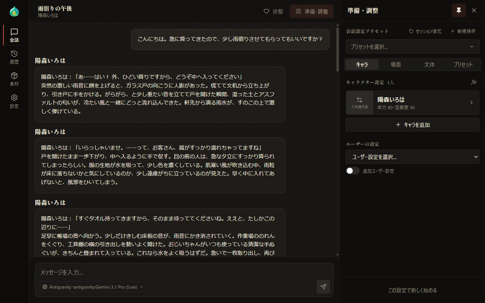
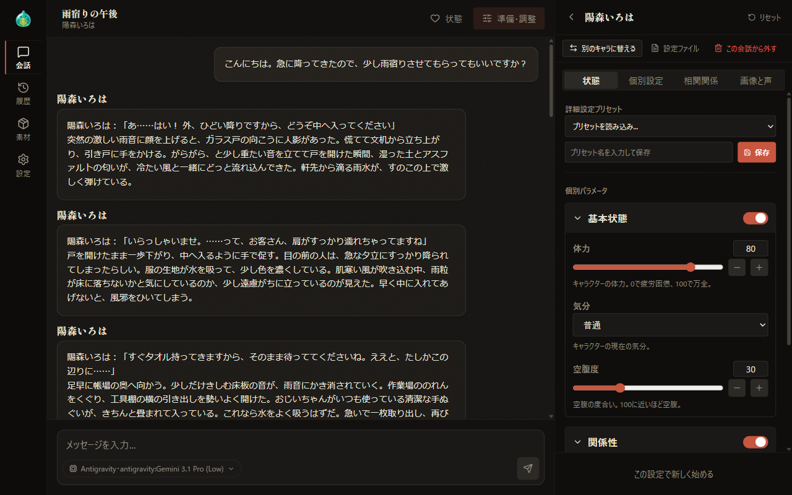
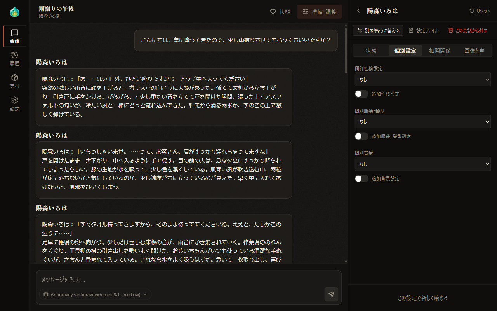
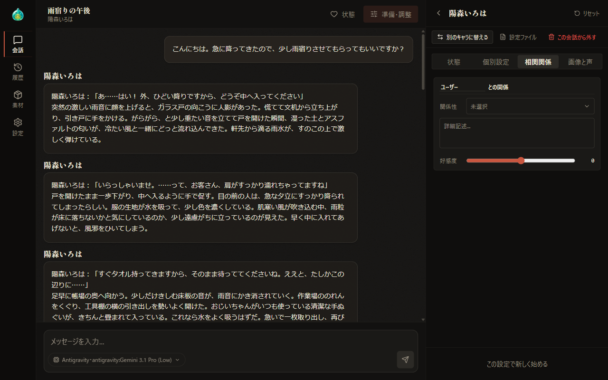
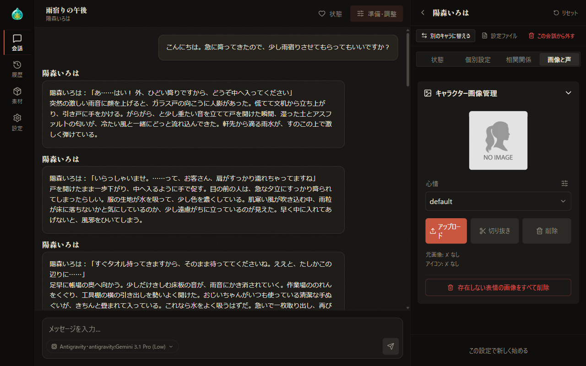
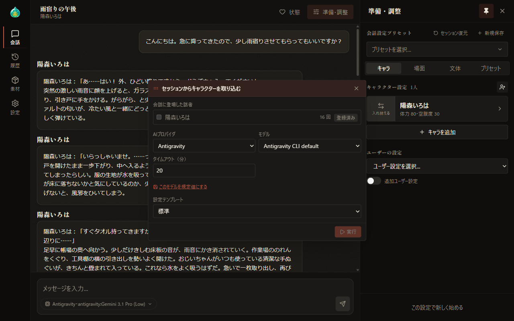

# 04 準備・調整：キャラクター

[目次に戻る](../index.md)

前章: [03 はじめての会話](03-first-chat.md) ／ 次章: [05 準備・調整：場面・文体・プリセット](05-prepare-scene.md)

本章では、「準備・調整」の欄の「キャラ」タブで行うキャラクターの選択と詳細な設定についてご案内いたします。

## この章の内容

1. キャラのタブの構成
2. キャラクターの追加と入れ替え
3. キャラ詳細
4. 会話からのキャラクターの取り込み
5. 一時キャラ
6. ユーザーの設定

## 1. キャラのタブの構成

「準備・調整」の欄の「キャラ」タブには、会話に参加するキャラクターがカードの形で並びます。

- カードには、キャラクターの名前と主な状態（個別パラメータの先頭の 2 項目）が表示されます。「default」の表情の画像が登録されている場合は、その画像がカードの背景となります。
- カードの左端には「入れ替える」があります。それ以外の部分を選択すると、そのキャラクターの「キャラ詳細」が表示されます。
- 見出しの「キャラクター設定」の横には、参加しているキャラクターの人数が表示されます。

## 2. キャラクターの追加と入れ替え

### キャラクターの追加

「キャラを追加」を選択すると、「キャラクターを選択...」の窓が表示されます。窓の使い方は、[03 はじめての会話](03-first-chat.md) にてご案内しております。1 つの会話に参加するキャラクターは最大 5 人で、5 人に達すると「キャラを追加」は表示されなくなります。

### キャラクターの入れ替え

カードの左端にある「入れ替える」の区画を選択すると、「キャラクターを選択...」の窓が現在のキャラクターを選択した状態で表示されます。別のキャラクターを選択すると、その場で入れ替わります。

- 入れ替えの際、前のキャラクターに設定していた個別パラメータや相関関係などは、新しいキャラクターに引き継がれます。
- キャラ詳細を表示したまま入れ替えた場合は、新しいキャラクターのキャラ詳細に切り替わります。

### 紐づけた設定の自動適用

キャラクターに個別性格・服装・背景のファイルが紐づけられている場合、キャラクターを追加または入れ替えた時点で、それらのファイルが個別設定に自動的に反映されます。会話設定プリセットの読み込みやセッション復元では、自動適用は行われません。

紐づけの設定方法は、[07-1 素材づくり：設定ファイル](07-material-files.md) にてご案内いたします。

## 3. キャラ詳細

カードを選択すると、そのキャラクターの「キャラ詳細」が表示されます。キャラ詳細は欄の下部のボタンより上の範囲に重なって表示されるため、表示中も「会話開始」などのボタンを選択することが可能です。

### 見出しと操作

見出しの左端の矢印を選択すると、キャラクターの一覧の表示に切り替わります。見出しの右側にある「リセット」を選択すると、そのキャラクターの個別設定・相関関係・個別パラメータが既定の状態に復元され、追加設定も無効になります。

見出しの下には、次の操作が並びます。

| 操作 | 内容 | 表示される条件 |
| --- | --- | --- |
| 別のキャラに替える | 「キャラクターを選択...」の窓を表示し、キャラクターを入れ替えます。カードの「入れ替える」と同じ操作です | 常に表示 |
| 設定ファイル | 素材づくりの「設定ファイル」タブで、このキャラクターの設定ファイルを表示します | 通常のキャラクター |
| 画像の設定 | 素材づくりの「キャラ」タブで、このキャラクターの画像の設定を表示します | 支援者機能の画像生成が有効な場合 |
| 声の設定 | 素材づくりの「キャラ」タブで、このキャラクターの声の紐づけを表示します | 支援者機能の読み上げが有効な場合 |
| この会話から外す | キャラクターを会話から外します。一時キャラの場合は、本文も削除されます | 常に表示 |
| 本文を編集 | 一時キャラの本文を編集し、保存します | 一時キャラ |
| キャラ設定に登録 | 一時キャラを、設定ファイルを持つ通常のキャラクターとして登録します | 会話中で、未登録の一時キャラ |

その下の「状態」「個別設定」「相関関係」「画像と声」の切り替えで、表示する内容を選択します。

### 状態

**詳細設定プリセット**では、キャラクターの状態をまとめて保存し、呼び出すことが可能です。

- 「プリセットを読み込み...」で保存済みのプリセットを選択すると、内容が反映されます。プリセットに保存されたユーザー名も復元されます。
- 保存済みのプリセットがある場合は「削除...」の欄も表示されます。この欄でプリセットを選択すると削除されます。
- 名前の入力欄にプリセット名を入力し、「保存」を選択するか Enter キーを押すと、現在の状態が保存されます。

**個別パラメータ**には、パラメータ項目設定で定義された項目が、グループごとに表示されます。

- グループの見出しで、内容の表示と会話に使用するかどうかを切り替えます。会話に常に使用するグループには、「常に有効」と表示されます。
- 項目の形式には、スライダー・選択肢・一行の文・複数行の文・オンとオフの切り替え・年月日があります。年月日の項目には、「初対面」から「2 年」までの期間を選択する「クイック設定」があります。
- 値に応じて表示が切り替わる項目もあります。

パラメータ項目設定の変更は、[05 準備・調整：場面・文体・プリセット](05-prepare-scene.md)、項目の定義の管理は [08 設定](08-settings.md) にてご案内いたします。

### 個別設定

「個別性格設定」「個別服装・髪型」「個別背景」では、それぞれ最大 5 件のファイルを選択します。選択肢のうち［個別］はそのキャラクター専用のファイル、［共通］はすべてのキャラクターで共有するファイルです。

各項目の下にある「追加性格設定」「追加服装・髪型設定」「追加背景設定」を有効にすると、自由記述の欄が表示されます。キャラクター側に追加設定が登録されている場合は「キャラ側：追記」または「キャラ側：置換」の札が表示されます。札にマウスを重ねると登録内容の冒頭が表示されます。

### 相関関係

ユーザーと会話に参加しているほかのキャラクターのそれぞれについて、このキャラクターとの関係を設定します。

- **ユーザー名**: ユーザーとの関係の欄では、ユーザーの名前を入力します。入力した名前は、すべてのキャラクターの相関関係と AI へ渡す内容に反映されます。
- **関係性**: 選択すると「関係性を選択」の窓が表示され、一覧から関係性を選択します。「未選択」を選択すると、設定が解除されます。
- **詳細**: 関係について、自由に記述します。
- **好感度**: −100 から 100 までの範囲で設定します。

### 画像と声

| 項目 | 内容 | 表示される条件 |
| --- | --- | --- |
| 素材づくりで開く | 素材づくりの「キャラ」タブで、このキャラクターを表示します | 支援者機能の画像生成または読み上げが有効な場合 |
| 自動画像生成の対象にする | 無効にすると、応答時の自動画像生成で、このキャラクターの発言に画像が生成されなくなります | 支援者機能の画像生成が有効な場合 |
| 音声設定 | 声の選択と試聴、VoiceDesign キャプション、キャラクター単位の cfg の上書きを設定します。設定はキャラクター本体に保存され、すべての会話に適用されます。その下の「会話設定側VoiceDesign」には、この会話設定に限った声の指示を追記または置換の形で記述します | 支援者機能の読み上げが有効な場合 |
| キャラクター画像管理 | 表情ごとの画像を登録・削除します | 常に表示 |

「音声設定」と「キャラクター画像管理」は、見出しを選択すると内容が表示される形式です。画像生成と読み上げの詳細は、[10 画像生成](10-image-generation.md)・[11 読み上げ](11-tts.md)・[07-3 素材づくり：キャラ](07-material-characters.md) にてご案内いたします。

#### 表情ごとの画像の登録

「キャラクター画像管理」では、表情ごとにキャラクターの画像を登録します。

1. 心情の選択欄で、画像を登録する表情を選択します。
2. 「アップロード」を選択し、画像ファイルを指定します。画像をプレビューの枠へドラッグして登録することも可能です。対応する形式は JPEG・PNG・WebP で、ファイルの大きさは 5MB までです。
3. 画像の指定後に表示される切り抜きの窓で、表示に使用する範囲を正方形で切り抜きます。ドラッグで位置を、スライダーまたはマウスのホイールで拡大率（1〜3 倍）を調整し、「保存」を選択します。

登録済みの画像は、「切り抜き」で範囲を調整し直すことや、「削除」で削除することが可能です。心情の選択欄の横にあるアイコンを選択すると、表情の種類を管理する「表情種別管理」の窓が表示されます（[08 設定](08-settings.md)）。~~下部の「存在しない表情の画像をすべて削除」については、AlSlime のホームページにてご案内しております。~~（現在鋭意作成中）

## 4. 会話からのキャラクターの取り込み

会話の中に登場した人物を分析し、一時キャラとして会話に加えることが可能です。キャラのタブの「キャラクター設定」の見出しの右にある人の形のアイコンを選択すると、「セッションからキャラクターを取り込む」の小窓が表示されます。このアイコンは、会話中で AI の応答が 1 件以上ある場合に選択可能となります。

1. 「会話に登場した話者」で、取り込む話者のチェックボックスを選択します。話者ごとに登場回数と登録の状況が表示され、選択の対象は未登録の話者に限られます。
2. 分析に使用する AI プロバイダ・モデル・タイムアウト（1〜60 分、初期値は 20 分）を選択します。Claude では Effort、Antigravity の対応モデルでは Thinking もあわせて選択します。「このモデルを規定値にする」を選択すると、次回以降の初期値として保存されます。
3. 「設定テンプレート」で、一時キャラの本文の形式とするテンプレートを選択します。
4. 「実行」を選択し、表示される「取り込みの確認」で内容を確認し、「はい」を選択します。

話者は 1 人ずつ分析され、分析が完了した話者から一時キャラとして会話設定に登録されます。

- 小窓の表示を終了しても、分析は継続します。
- 分析中は、メッセージの送信が停止された状態となります。
- 分析中は「中止」、失敗した話者には「分析を再試行」、登録済みの話者には「再分析」が表示されます。
- 画面の幅が広い場合、小窓はドラッグで移動することが可能です。

## 5. 一時キャラ

一時キャラは、設定ファイルを持たず、会話設定の中に本文を保持するキャラクターです。会話からの取り込みで作成されます。

- カードの枠の色と「一時」の札で、通常のキャラクターと区別されます。
- 設定ファイルとしての表示、画像の設定、声の設定は、いずれも対象外となります。
- 会話設定プリセットを保存すると、一時キャラも本文とともに保存されます。
- キャラ詳細の「本文を編集」で、本文を編集します。
- キャラ詳細の「キャラ設定に登録」を選択すると、確認の後、設定ファイルを持つ通常のキャラクターとして登録されます。

## 6. ユーザーの設定

キャラのタブの下部にある「ユーザーの設定」では、会話の中でのユーザー自身の人物像を記したファイルを最大 5 件まで選択します。「追加ユーザー設定」を有効にすると、自由記述の欄が表示されます。

支援者機能の画像生成が有効な場合は、その下に「この会話の画像生成」が表示されます。内容は [10 画像生成](10-image-generation.md) にてご案内いたします。

---

前章: [03 はじめての会話](03-first-chat.md) ／ 次章: [05 準備・調整：場面・文体・プリセット](05-prepare-scene.md)

[目次に戻る](../index.md)
