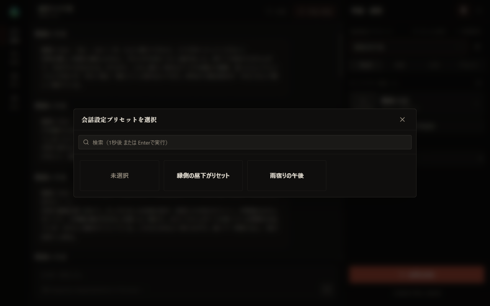
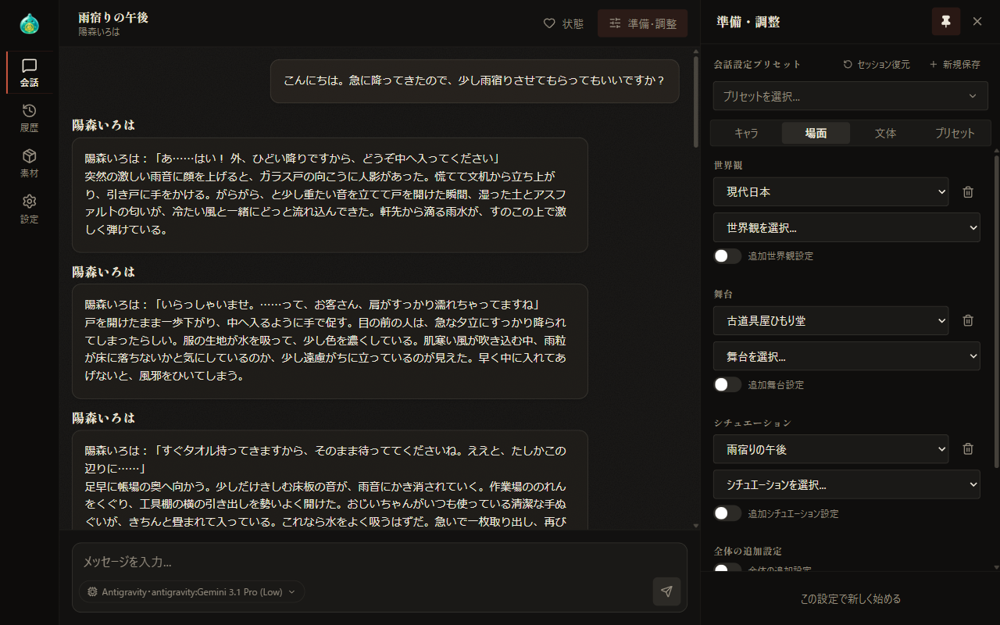
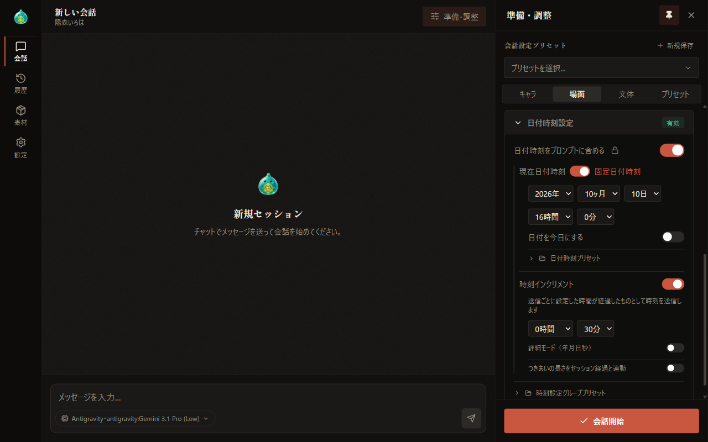
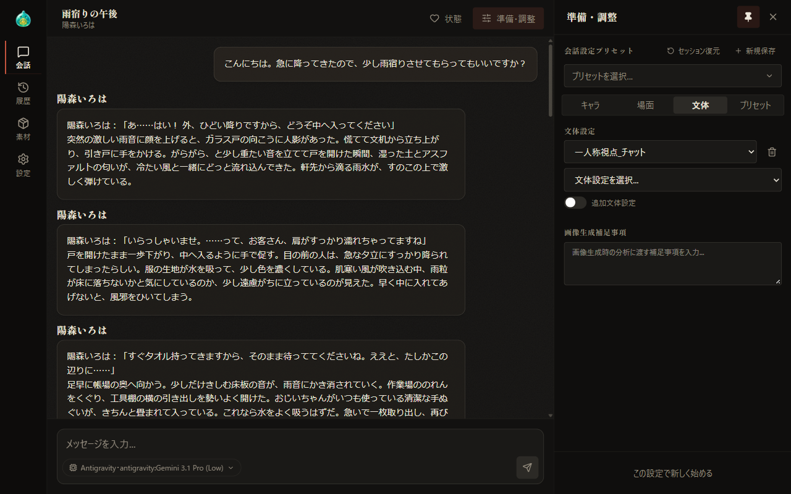
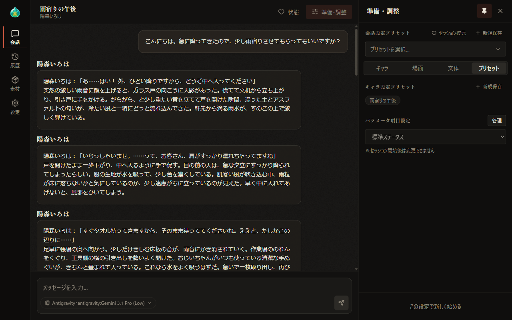

# 05 準備・調整：場面・文体・プリセット

[目次に戻る](../index.md)

前章: [04 準備・調整：キャラクター](04-prepare-characters.md) ／ 次章: [06 会話を続ける](06-continue.md)

本章では、「準備・調整」の欄の上部にある会話設定プリセットと「場面」「文体」「プリセット」の各タブで行う設定についてご案内いたします。

## この章の内容

1. 会話設定プリセット
2. 設定ファイルの選択と追加設定
3. 場面のタブ
4. 日付時刻設定
5. 文体のタブ
6. プリセットのタブ
7. プリセットの種類

## 1. 会話設定プリセット

欄の上部にある「会話設定プリセット」では、欄の設定一式に名前を付けて保存し、必要な際に呼び出します。会話設定プリセットの欄は、どのタブでも表示されます。

### プリセットの読み込み

1. 「プリセットを選択...」を選択します。
2. 表示された「会話設定プリセットを選択」の窓で、読み込むプリセットを選択します。

欄の設定が選択したプリセットの内容にまとめて切り替わります。

- 窓の検索欄では、プリセット名による絞り込みが可能です。絞り込みは、入力の 1 秒後または Enter キーを押した時点で実行されます。
- 「未選択」を選択した場合、欄の設定はそのまま維持され、プリセット名の選択のみが解除されます。

### プリセットの保存

1. 「新規保存」を選択し、名前の入力欄を表示します。
2. プリセット名を入力し、「保存」を選択するか、Enter キーを押します。

- 保存の対象は、参加するキャラクターとキャラ詳細、場面と文体の設定、追加設定の記述、日付時刻設定、ユーザー名など、欄の設定のほぼすべてです。一時キャラも本文とともに保存されます。~~保存される項目の一覧は、AlSlime のホームページにてご案内しております。~~（現在鋭意作成中）
- プリセットを選択中の場合、入力欄にはそのプリセット名があらかじめ入力されています。既存のプリセットと同じ名前で保存すると、確認の表示を経ずに内容が上書きされます。
- 保存の後は、保存したプリセットが選択された状態となります。

### プリセットの削除

プリセットを選択中は、「プリセットを選択...」の欄の右にゴミ箱のアイコンが表示されます。アイコンを選択し、確認の表示で「OK」を選択すると、選択中のプリセットが削除されます。

### 会話中の扱い

会話中に読み込んだプリセットの内容は、欄の下部にある「変更を反映」を選択した時点で、会話に適用されます。反映の前にメッセージを送信した場合は、会話に保存されている設定が使用され、設定変更の確認も表示されません。「変更を反映」については、[06 会話を続ける](06-continue.md) にてご案内いたします。

会話中は、「新規保存」の左に「セッション復元」が表示されます。「セッション復元」を選択した時点で、欄で変更した内容は破棄され、会話に保存されている設定が欄に復元されます。

## 2. 設定ファイルの選択と追加設定

場面と文体のタブでは、設定ファイルの選択欄と追加設定の切り替えが同じ形式で並びます。キャラのタブの「ユーザーの設定」も同じ形式です。

- 選択欄で設定ファイルを選択すると、その下に次の選択欄が追加されます。1 つの項目で選択するファイルは、最大 5 件です。
- 選択欄の右にあるゴミ箱のアイコンを選択すると、その欄の選択が解除されます。
- 同じ項目の中で選択済みのファイルは、ほかの選択欄では選択不可となります。
- 「追加世界観設定」などの切り替えを有効にすると、自由記述の欄が表示されます。設定ファイルに記していない補足を会話ごとに記述する際に用います。

選択肢となる設定ファイルの作成と編集は、[07-1 素材づくり：設定ファイル](07-material-files.md) にてご案内いたします。

## 3. 場面のタブ

「場面」のタブでは、会話の舞台となる世界・場所・状況を設定します。

| 項目 | 内容 |
| --- | --- |
| 世界観 | 時代や社会の仕組みなど、会話の背景となる世界の設定ファイルを選択します。「追加世界観設定」では、自由記述の補足を加えます |
| 舞台 | 店や学校など、会話が行われる場所の設定ファイルを選択します。「追加舞台設定」では、自由記述の補足を加えます |
| シチュエーション | 雨宿りや待ち合わせなど、会話の発端となる状況の設定ファイルを選択します。「追加シチュエーション設定」では、自由記述の補足を加えます |
| 全体の追加設定 | 有効にすると自由記述の欄が表示されます。この欄には会話全体への補足を記述します |
| 日付時刻設定 | 会話の中の日付と時刻を設定します。内容は次節にてご案内いたします |

## 4. 日付時刻設定

場面のタブの下部にある「日付時刻設定」では、会話の中の日付と時刻を AI へ伝えるための設定を行います。見出しを選択すると、設定の内容が表示されます。

### 日付時刻を伝えるかどうか

「日付時刻をプロンプトに含める」を有効にすると、会話の中の日付と時刻が AI へ伝えられ、以下の各項目が表示されます。有効の間は、見出しの右に「有効」と表示されます。

項目名の横にある鍵のアイコンを選択すると、この設定がロックされます。ロック中は、以降の新しい会話が「日付時刻をプロンプトに含める」を有効にした状態で準備されます。ロックの状態は、次回の起動後も維持されます。

### 会話の中の時刻の決まり方

会話の中の時刻は、会話の最初のメッセージを送信した時点で起点が決まります。起点の種類は、「現在日付時刻」と「固定日付時刻」の切り替えで選択します。

- **現在日付時刻**: 送信した時点のパソコンの日付と時刻を起点とします。
- **固定日付時刻**: 指定した年月日と時刻を起点とします。「日付を今日にする」を有効にすると、日付が当日となり、年月日の選択欄は選択不可となります。時刻は引き続き指定が可能です。

2 回目以降の送信では、前回の時刻が基準となります。時刻インクリメントが有効な場合は、基準の時刻から指定した時間だけ進み、無効な場合は基準の時刻のまま維持されます。

### 日付時刻プリセット

固定日付時刻を選択している場合は、「日付時刻プリセット」が表示されます。見出しを選択すると、次の操作が表示されます。

- 名前を入力し、保存のアイコンを選択すると、指定中の日時が保存されます。
- 選択欄でプリセットを選択し、フォルダのアイコンを選択すると、その日時が読み込まれます。
- ゴミ箱のアイコンを選択すると、確認の後、選択中のプリセットが削除されます。

### 時刻インクリメント

「時刻インクリメント」を有効にすると、メッセージを送信するたびに、指定した時間が経過したものとして会話の中の時刻が進みます。

- 進める時間は、時と分で指定します。「詳細モード（年月日秒）」を有効にすると、年・月・日・秒もあわせて指定します。詳細モードを無効にした場合、年・月・日・秒の値は 0 となります。
- 「つきあいの長さをセッション経過と連動」を有効にすると、会話の中で経過した日数に応じて、個別パラメータの「つきあいの長さ」が進みます。この設定は、パラメータ項目設定に「つきあいの長さ」の項目がある場合に適用されます。

### セッション時刻情報

時刻インクリメントが有効で、会話の中の時刻が記録されている場合は、「セッション時刻情報」として、現在のセッション時刻、インクリメント設定、累積経過日数が表示されます。

鉛筆のアイコンを選択すると、セッション時刻の編集欄が表示されます。編集した時刻は、次回の送信時に時刻を進める際の起点となります。× を選択すると、編集が終了します。

### 時刻設定グループプリセット

「時刻設定グループプリセット」は日付時刻設定の内容を折りたたんでいる間も表示されます。日付と時刻、時刻インクリメントなど、日付時刻設定の内容をまとめて保存・読み込み・削除します。操作の方法は、日付時刻プリセットと同様です。

日付時刻プリセットは指定した日時の値のみを、時刻設定グループプリセットは日付時刻設定の内容全体を保存する点が異なります。

## 5. 文体のタブ

「文体」のタブでは、応答の書き方を設定します。

| 項目 | 内容 |
| --- | --- |
| 文体設定 | 地の文の視点や、セリフと描写の分量など、応答の書き方を定めた設定ファイルを選択します。「追加文体設定」では、自由記述の補足を加えます |
| 画像生成補足事項 | 画像生成の際に場面を分析する AI へ、補足として渡す内容を記述します。支援者機能の画像生成が有効な場合に使用されます |

画像生成については、[10 画像生成](10-image-generation.md) にてご案内いたします。

## 6. プリセットのタブ

### キャラ設定プリセット

参加するキャラクターとキャラ詳細、場面・文体・ユーザーの設定で選択したファイル、パラメータ項目設定などを保存し、呼び出します。キャラクターとファイルの選択を中心に保存する点が、会話設定プリセットとの違いです。

- 「新規保存」を選択して名前の入力欄を表示し、プリセット名を入力して「保存」を選択します。同じ名前で保存すると、内容が上書きされます。
- 保存済みのプリセットは札の形式で並び、札を選択すると、その内容が読み込まれます。
- 保存済みのプリセットが無い場合は、「プリセットはまだありません」と表示されます。

### パラメータ項目設定

個別パラメータに表示する項目の組み合わせ（項目設定）を選択します。

- 項目設定を切り替えると、すべてのキャラクターの個別パラメータが切り替え後の項目設定の初期値となります。
- 会話の開始後は変更不可となり、「※セッション開始後は変更できません」と表示されます。
- 「管理」を選択すると、項目設定を作成・編集する窓が表示されます。この窓の使い方は、[08 設定](08-settings.md) にてご案内いたします。

## 7. プリセットの種類

AlSlime のプリセットは、保存する範囲によって次の 5 種類に分かれます。

| プリセット | 場所 | 保存する範囲 |
| --- | --- | --- |
| 会話設定プリセット | 準備・調整の欄の上部 | 欄の設定一式 |
| キャラ設定プリセット | プリセットのタブ | キャラクターとファイルの選択を中心とした設定 |
| 詳細設定プリセット | キャラ詳細の「状態」（[04 準備・調整：キャラクター](04-prepare-characters.md)） | 1 人のキャラクターの状態 |
| 日付時刻プリセット | 日付時刻設定（固定日付時刻の選択時） | 指定した日時の値 |
| 時刻設定グループプリセット | 日付時刻設定の下部 | 日付時刻設定の内容全体 |

---

前章: [04 準備・調整：キャラクター](04-prepare-characters.md) ／ 次章: [06 会話を続ける](06-continue.md)

[目次に戻る](../index.md)
