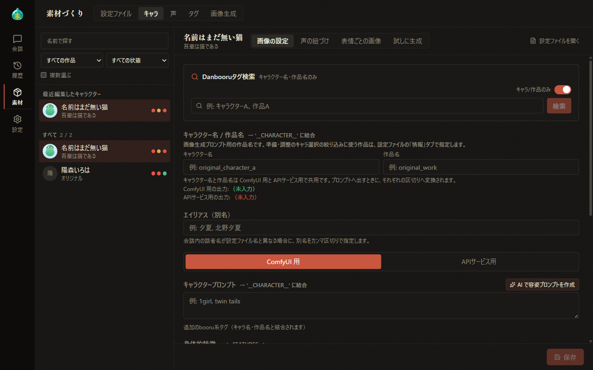
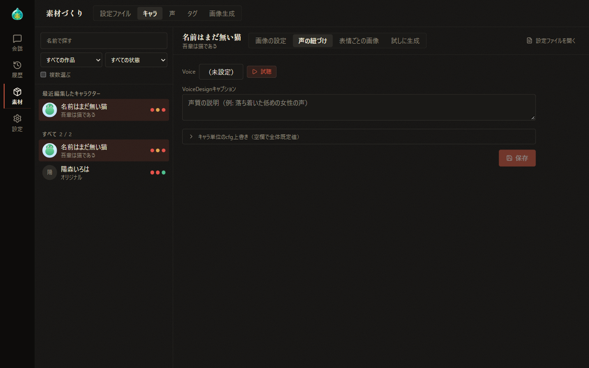
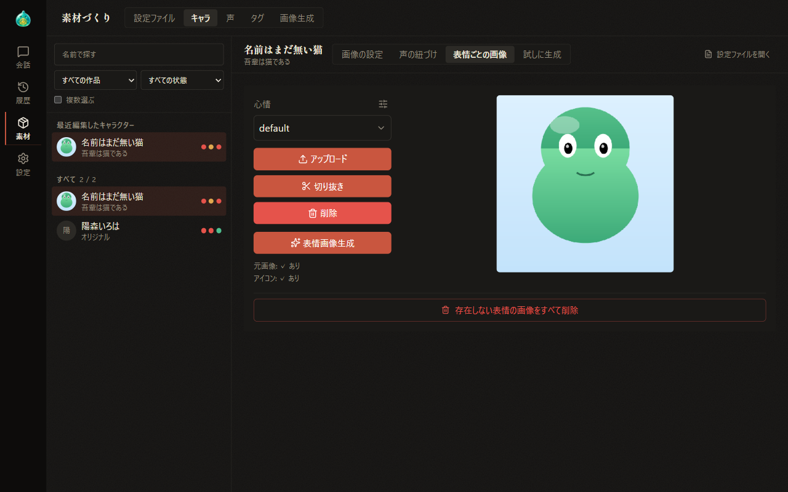
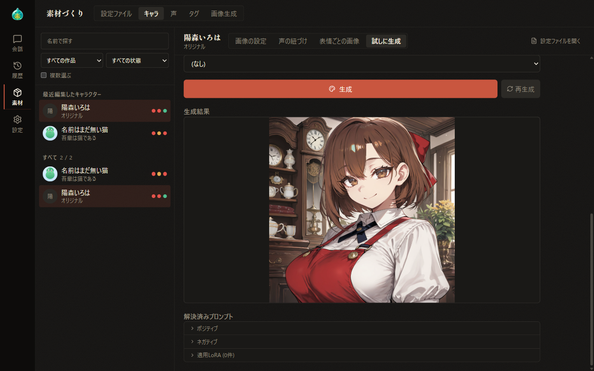

# 07-3 素材づくり：キャラ

[目次に戻る](../index.md) ／ [07 素材づくり](07-material.md)

前章: [07-2 素材づくり：AI で作る](07-material-ai-create.md) ／ 次章: [07-4 素材づくり：声](07-material-voice.md)

本章では、素材づくりの「キャラ」タブで行うキャラクターごとの画像の設定、声の紐づけ、表情ごとの画像、「試しに生成」についてご案内いたします。「キャラ」タブは、支援者機能の画像生成または読み上げが有効な場合に表示されます。

## この章の内容

1. キャラ一覧
2. 画像の設定
3. 声の紐づけ
4. 表情ごとの画像
5. 試しに生成

## 1. キャラ一覧

左側には、キャラクターの一覧が並びます。キャラクターを選択すると、右側にそのキャラクターの設定が表示されます。

- 「名前で探す」では、キャラクター名または作品名による絞り込みが可能です。その下の選択欄では、作品（「すべての作品」「作品なし」または各作品）と状態（「すべての状態」「画像設定なし」「未作成の表情あり」「声なし」）による絞り込みが可能です。「声なし」は、支援者機能の読み上げが有効な場合に表示されます。
- 一覧は、「この会話のキャラ」（表示中の会話に参加しているキャラクター）、「最近編集したキャラクター」（最近選択した 10 人）、「すべて」の順に並びます。
- 各キャラクターの右には、画像設定・表情画像・声の状態が点の色で表示されます。緑は「あり」、黄は「一部」、赤は「なし」を表します。
- 「複数選ぶ」を選択して対象のキャラクターを選び、「LoRA を設定」でまとめて設定します。

右側の上部には、「画像の設定」「声の紐づけ」「表情ごとの画像」「試しに生成」の切り替えと「設定ファイルを開く」が並びます。「声の紐づけ」は支援者機能の読み上げが有効な場合、そのほかは画像生成が有効な場合に表示されます。「設定ファイルを開く」を選択すると、「設定ファイル」タブでそのキャラクターの設定ファイルが表示されます。

画像の設定を保存しないまま別のキャラクターを選択すると、「保存して移る」「破棄して移る」「戻る」のいずれかを選択する確認が表示されます。

## 2. 画像の設定

「画像の設定」では、画像生成でそのキャラクターを描くための設定を行います。

| 項目 | 内容 |
| --- | --- |
| Danbooru タグ検索 | 画像生成に用いるタグを日本語でも検索します。結果を選択すると、タグがコピーされます。「キャラ/作品のみ」を有効にすると、キャラクター名と作品名のタグに限って検索します |
| キャラクター名 / 作品名 | 画像生成のプロンプトに用いるキャラクター名と作品名です。ComfyUI と API サービスで共用され、それぞれの出力の形式が下に表示されます。この作品名は、準備・調整の欄の絞り込みに用いる作品（設定ファイルの「情報」）とは別の項目です |
| エイリアス（別名） | 会話の中の話者名が設定ファイル名と異なる場合に、別名をカンマ区切りで指定します |
| ComfyUI 用・APIサービス用 | 以下のプロンプト類を画像生成の仕組みごとに別々に設定します |
| キャラクタープロンプト・身体的特徴 | キャラクターの外見を表すタグを記述します。「AI で容姿プロンプトを作成」を選択すると、設定ファイルの本文から AI が容姿のタグを分類ごとに作成します |
| LoRA | ComfyUI で用いる LoRA を検索して選択し、強度を指定します。「トリガーワード取得」で LoRA のトリガーワードを取得します |
| 服装設定 | 服装の名前・プロンプト・服装の LoRA を複数登録します |
| 追加ポジティブ／追加ネガティブ | 常に加えるプロンプトを記述します |
| 参照画像 | API サービスで用いる参照画像を最大 4 枚登録します。対応するモデルでは、1 枚ごとに費用（Anlas）が発生します |

画像の設定の変更は、画面下部の帯の「保存」で保存します。

## 3. 声の紐づけ

「声の紐づけ」では、読み上げに用いる声をキャラクターに紐づけます。

- **Voice**: 選択すると、検索の付いた小窓が表示され、登録済みの声または「（未設定）」を選択します。「試聴」では、保存済みの設定で声を再生します。
- **VoiceDesign キャプション**: 声質を文章で指定します（例：落ち着いた低めの女性の声）。
- **キャラ単位の cfg 上書き**: 見出しを選択すると、cfg_scale_caption と cfg_scale_speaker の欄が表示されます。空欄の場合は、全体の既定値が用いられます。

「保存」を選択すると、紐づけが保存されます。この設定はキャラクター本体に保存され、すべての会話に適用されます。声の登録は、[07-4 素材づくり：声](07-material-voice.md) にてご案内いたします。

## 4. 表情ごとの画像

「表情ごとの画像」では、表情ごとのキャラクターの画像を登録します。

心情の選択・アップロード・切り抜き・削除の操作は、[04 準備・調整：キャラクター](04-prepare-characters.md) のキャラクター画像管理と同じです。

「表情画像生成」を選択すると、表情画像を生成する小窓が表示されます。

1. 左側で、キャラクターの画像生成の設定と表情ごとのプロンプト（表情設定）を確認します。表情設定には、表情ごとに複数のプロンプトを保存します。
2. 右側で、ワークフロー（ComfyUI）または生成プリセット（API サービス）と生成数（最大 8 枚）を指定し、「実行」を選択します。
3. 生成された画像を選択し、「選択した画像を表情画像に設定」を選択すると、確認の後、切り抜きの窓が表示されます。

表情設定の「サンプルプロンプトパック取得」では、表情ごとのプロンプトの見本を取得します。取得には、支援者のログインが必要です。

## 5. 試しに生成

「試しに生成」では、キャラクターの画像設定による生成結果を確認します。

1. 「使うワークフロー」（ComfyUI）または生成プリセット（API サービス）を選択します。ここでの選択は保存されません。
2. 「このキャラの画像設定を使う」が有効な場合は、保存済みの画像の設定で生成します。保存前の編集内容は用いられません。無効にすると、別のキャラクターの選択または「プロンプトを直接入力」による指定に切り替わります。
3. 「タグ選択」で、分類ごとにタグを選択します。「直接入力」を有効にすると、タグの代わりに文を入力します。
4. 「生成」を選択します。

- 生成結果は、下部に表示されます。「再生成」を選択すると、シード値を変更して再び生成します。
- 「解決済みプロンプト」では、実際に用いられたポジティブ・ネガティブのプロンプトと適用された LoRA を確認します。
- 「プレースホルダ変換」では、場面に合わせて決まった文言を加える設定を選択します。~~詳しい内容は、AlSlime のホームページにてご案内しております。~~（現在鋭意作成中）

---

前章: [07-2 素材づくり：AI で作る](07-material-ai-create.md) ／ 次章: [07-4 素材づくり：声](07-material-voice.md)

[目次に戻る](../index.md)
