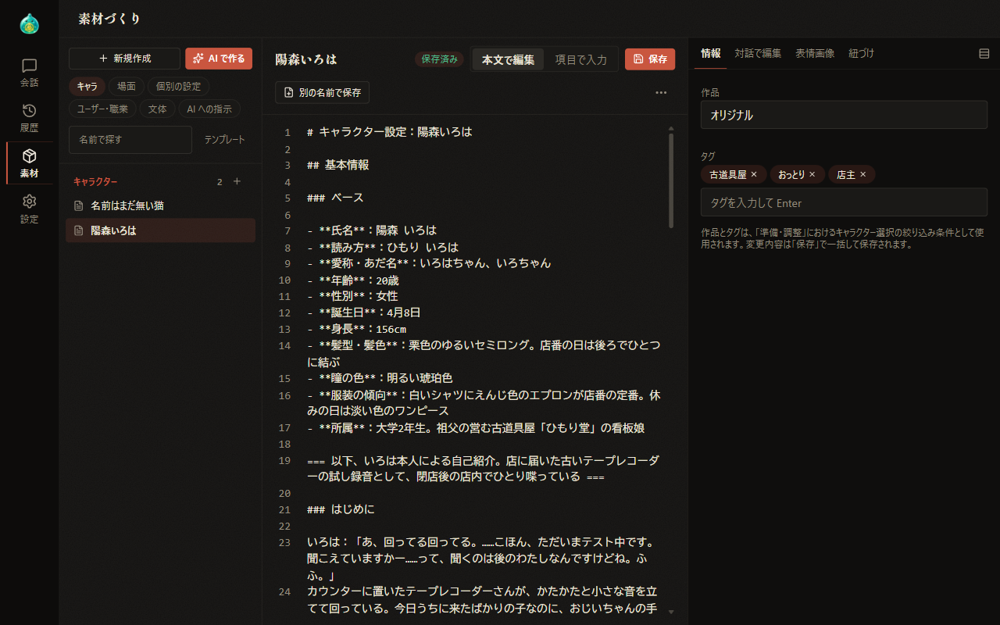
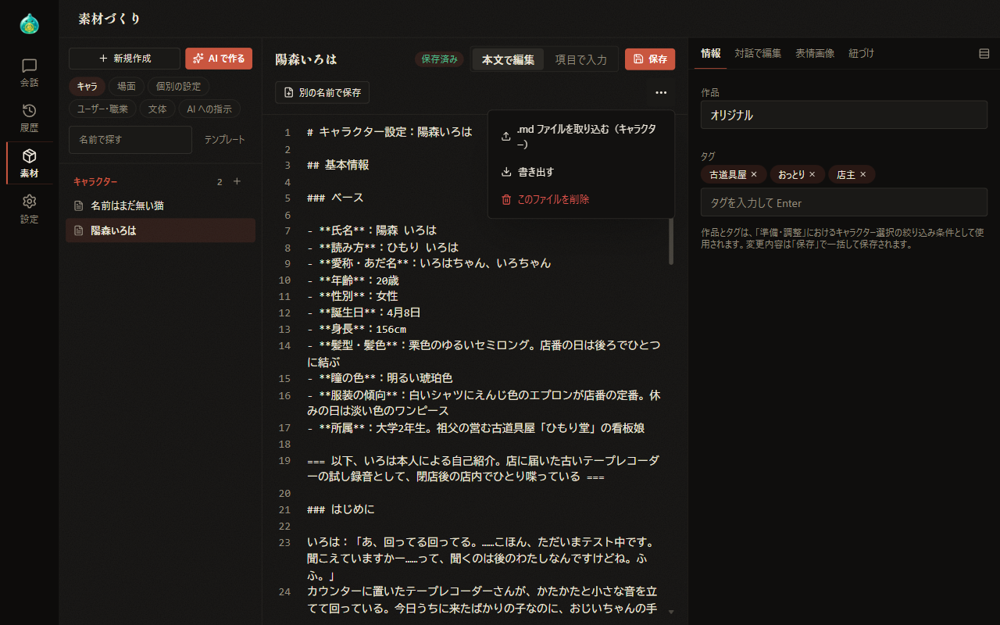
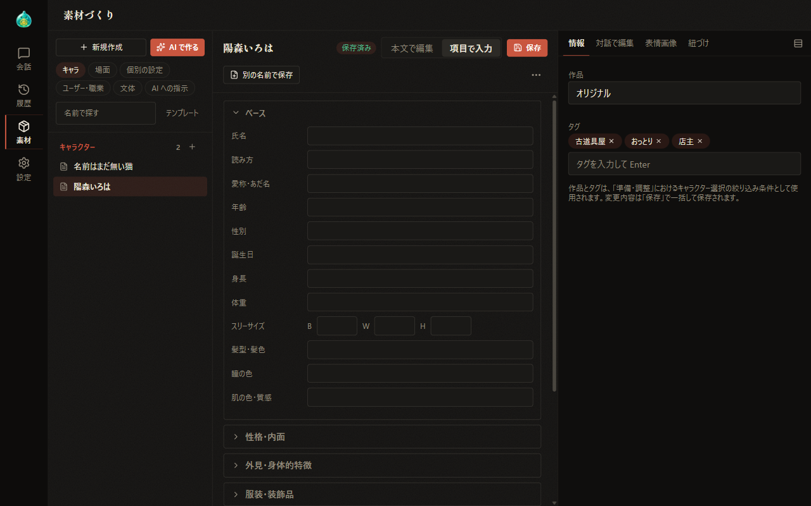
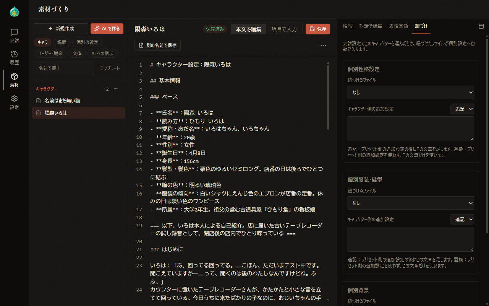
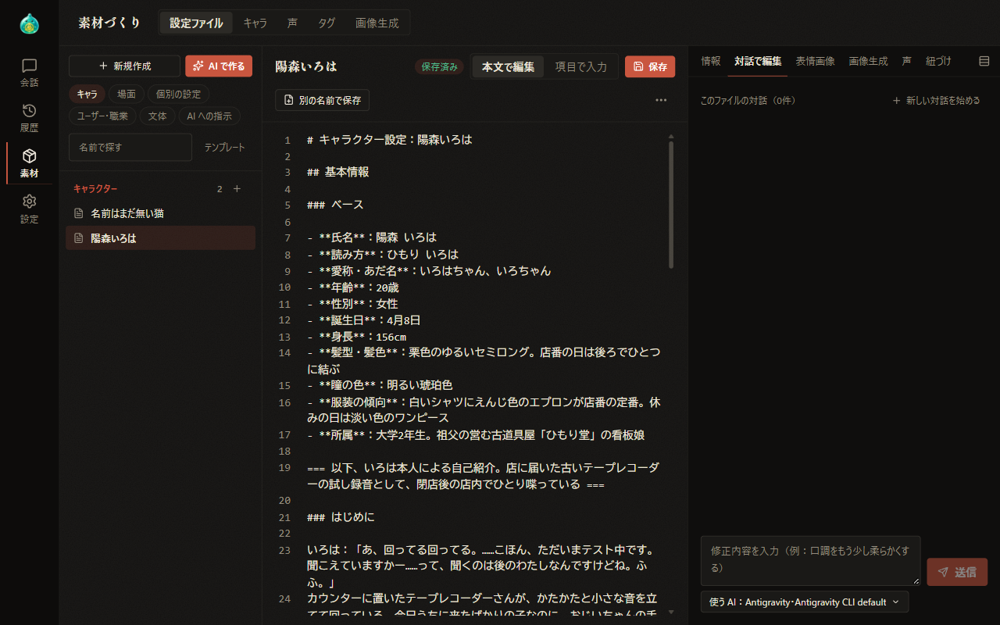
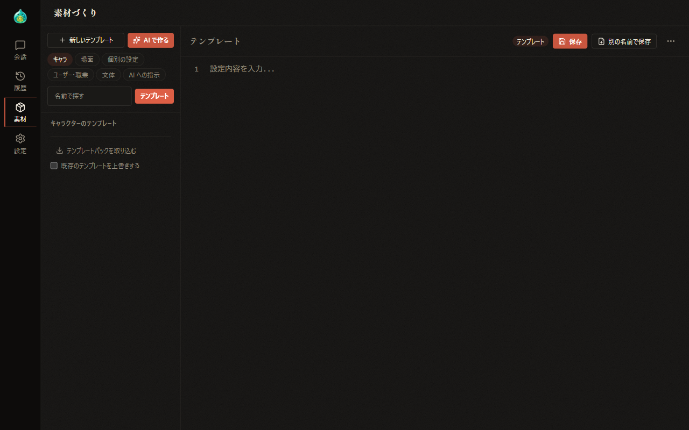

# 07-1 素材づくり：設定ファイル

[目次に戻る](../index.md) ／ [07 素材づくり](07-material.md)

前章: [07 素材づくり](07-material.md) ／ 次章: [07-2 素材づくり：AI で作る](07-material-ai-create.md)

本章では、素材づくりの「設定ファイル」タブで行うキャラクターや場面などの設定ファイルの作成と編集についてご案内いたします。

## この章の内容

1. 画面の構成
2. 一覧
3. 本文の編集と保存
4. 項目で入力
5. 付属の欄
6. テンプレート
7. AI への指示

## 1. 画面の構成

切り替え列の「素材」を選択すると、素材づくりの画面が「設定ファイル」のタブで表示されます。

画面は、次の 3 つの領域で構成されています。

- **左の一覧**: 種別ごとの設定ファイルが並びます。
- **中央の本文**: 一覧で選択したファイルの名前と内容が表示されます。
- **右の付属の欄**: キャラクターの作品とタグ、表情画像、紐づけなど、本文以外の設定を扱います。キャラクター以外の種別では「対話で編集」のみが表示され、テンプレートと AI への指示では付属の欄は表示されません。

画面の幅が狭い場合、一覧は本文の左上の「一覧」のアイコンで重ねて表示されます。本文と付属の欄は、「設定内容」と付属の各タブを並べたタブの形式に切り替わります。

## 2. 一覧

一覧の上部の札で、表示する種別のまとまりを切り替えます。

| まとまり | 含まれる種別 |
| --- | --- |
| キャラ | キャラクター |
| 場面 | 世界観・舞台・シチュエーション |
| 個別の設定 | 個別性格設定・個別服装・髪型・個別背景 |
| ユーザー・職業 | ユーザーの設定・職業設定 |
| 文体 | 文体設定 |
| AI への指示 | AIプロバイダ指示・設定自動生成指示・画像生成分析指示（画像生成分析指示は、支援者機能の画像生成が有効な場合） |

- 一覧には、種別ごとの小見出しと件数に続いてファイルが並びます。ファイルを選択すると、本文に内容が表示されます。
- 小見出しの右の「＋」を選択すると、その種別の新しいファイルの作成を開始します。ファイルが 1 件も無い種別も選択が可能です。
- 「新規作成」を選択すると、選択中の種別で既定のテンプレートの内容から新しいファイルの作成を開始します。選択中の種別の小見出しは、強調の色で表示されます。
- 「名前で探す」では、ファイル名の一部による絞り込みが可能です。
- 「AI で作る」については、[07-2 素材づくり：AI で作る](07-material-ai-create.md) にてご案内いたします。

### ファイルの追加

パソコンの .md ファイルを一覧の上へドラッグ＆ドロップすると、選択中の種別にファイルが追加されます。

- ファイルを重ねている間は、「ここに .md ファイルをドロップして追加：（種別名）」と追加先の種別が表示されます。
- 同じ名前のファイルがある場合は、「名前 (2)」の形式の名前で追加されます。
- テンプレートの一覧を表示している間と AI への指示では、ファイルの追加は行われません。

## 3. 本文の編集と保存

本文の上の帯には、ファイル名と保存の状態（「保存済み」または「保存していない変更」）が表示されます。新しいファイルの場合は、帯の名前の欄にファイル名を入力します。

| 操作 | 内容 |
| --- | --- |
| 保存 | 本文と付属の欄の「情報」「画像生成」「紐づけ」の変更をまとめて保存します。Ctrl+S キーでも保存します。同じ名前のファイルがある場合は、上書きの確認が表示されます |
| 別の名前で保存 | 表示される欄に名前を入力し、別のファイルとして保存します。画面の幅が狭い場合はアイコンのみの表示となります |
| その他の操作 | 帯の右端の「…」のアイコンで、次のメニューを表示します |

「その他の操作」のメニューには、次の項目が並びます。

- **テンプレート「名前」の内容で再作成**: 選択したテンプレートの内容で、本文を再作成します。その種別にテンプレートがある場合に表示されます。
- **.md ファイルを取り込む**: パソコンの .md ファイルを選択中の種別に追加します。項目名の後ろに、追加先の種別が括弧書きで表示されます。複数のファイルの同時指定も可能です。
- **書き出す**: 表示中の本文を .md ファイルとしてパソコンに保存します。
- **このファイルを削除**: 確認の後、表示中のファイルを削除します。

本文の編集欄では、Ctrl+F キーで検索、Ctrl+H キーで置換を行います。

保存していない変更がある状態で、別のファイルや種別へ移動しようとすると、「保存して移る」「破棄して移る」「戻る」のいずれかを選択する確認が表示されます。

## 4. 項目で入力

キャラクターの種別では、帯の「本文で編集」と「項目で入力」で編集の形式を切り替えます。「項目で入力」では、氏名・読み方・年齢などの項目が区画ごとに並び、項目を埋める形式でキャラクターの設定を作成します。

> **ご注意**
>
> 「項目で入力」は、本文の内容を読み込まず、空の項目から入力を始める形式です。「本文で編集」へ切り替える際には確認が表示され、次のいずれかを選択します。
>
> - **はい**: 項目の内容で本文を置き換えてから切り替えます。
> - **いいえ**: 項目の入力を破棄し、元の本文のまま切り替えます。
> - **キャンセル**: 項目の入力を続けます。
>
> 既存のファイルで「はい」を選択した場合も、「保存」を選択するまでは、ファイルの内容は変更されません。「項目で入力」は、新しいキャラクターを一から作成する際の利用を想定しております。

## 5. 付属の欄

付属の欄には、種別に応じて次のタブが並びます。新しいファイルでは、一度保存するまで「情報」以外のタブは選択不可となります。

| タブ | 内容 | 表示される条件 |
| --- | --- | --- |
| 情報 | キャラクターの作品とタグを設定します。作品とタグは、準備・調整の欄のキャラクター選択で絞り込みに用いられます。タグは入力欄で Enter キーを押すと追加され、札の × で削除されます | キャラクター |
| 対話で編集 | AI に修正を依頼し、本文を修正します（後述） | 保存済みのファイル |
| 表情画像 | 表情ごとのキャラクターの画像を登録します。内容は、[04 準備・調整：キャラクター](04-prepare-characters.md) のキャラクター画像管理と同じです | キャラクター |
| 画像生成 | 画像生成に用いるキャラクターの設定を行います（[07-3 素材づくり：キャラ](07-material-characters.md)） | キャラクターで、支援者機能の画像生成が有効な場合 |
| 声 | 読み上げに用いる声を紐づけます。タブの中の保存ボタンで保存します（[07-3 素材づくり：キャラ](07-material-characters.md)） | キャラクターで、支援者機能の読み上げが有効な場合 |
| 紐づけ | キャラクターに個別の設定ファイルを紐づけます（後述） | キャラクター |

- 付属の欄の見出しの右にあるアイコンを選択すると、タブで 1 つずつ表示する形式と区画を縦に並べて表示する形式が切り替わります（キャラクターのみ）。縦に並べる形式では「表情画像」が先頭となり、最初は「表情画像」のみ内容が表示されます。表示の形式と各区画の表示の状態は、ブラウザに記憶されます。
- 保存していない変更があるタブ（縦に並べる形式では区画の見出し）には、「●」が表示されます。

### 紐づけ

「紐づけ」では、個別性格設定・個別服装・髪型・個別背景のそれぞれについて、キャラクターに紐づけるファイルを選択し、キャラクター側の追加設定を入力します。

- **紐づけるファイル**: 選択欄でファイルを選択すると、次の選択欄が追加され、複数のファイルを紐づけることが可能です。選択欄の右のゴミ箱のアイコンで、選択が解除されます。
- **キャラクター側の追加設定**: 自由記述の欄と、「追記」「置換」の選択で構成されます。「追記」では準備・調整の欄の追加設定の後にこの文章が加わります。「置換」では準備・調整の欄の追加設定の代わりにこの文章のみが用いられます。

準備・調整の欄でこのキャラクターを追加または入れ替えた時点で、紐づけたファイルが個別設定に自動的に反映されます（[04 準備・調整：キャラクター](04-prepare-characters.md)）。紐づけの変更は、本文の帯の「保存」で保存します。

### 対話で編集

「対話で編集」では、表示中のファイルの修正内容を AI に伝え、本文を修正します。

1. 下部の入力欄に、修正内容（例：口調をもう少し柔らかくする）を入力します。
2. 必要に応じて、入力欄の下の「使う AI」で AI とモデルを選択します。
3. 「送信」を選択します。保存していない変更がある場合は「保存して送信」と表示され、変更を保存してから送信されます。

AI による修正が完了すると、修正後の本文がファイルに保存され、本文の表示も切り替わります。

- 「AI による本文の修正が完了しました」の下に、変わった行の数が表示されます。「元に戻す」を選択すると、送信前の本文が復元されて保存されます。「変更内容を確認」を選択すると、送信前の本文との差分が表示されます。
- 上部には、このファイルの対話の件数が表示されます。「新しい対話を始める」を選択すると、確認の後、それまでの対話の記録が消去されます。本文は変更されません。
- 送信の前に、ほかの場所でファイルが書き換えられていた場合は、上書きを防ぐため送信が中止されます。「最新の本文を再読み込み」を選択し、内容を確認してから改めて送信します。

## 6. テンプレート

一覧の「テンプレート」を選択すると、選択中の種別のテンプレートが並びます。もう一度選択すると設定ファイルの一覧に切り替わります。

- 一覧には「（種別名）のテンプレート」としてテンプレートが並び、既定のテンプレートには「既定」の札が表示されます。既定のテンプレートは、「新規作成」で作成を開始する際の内容に用いられます。
- 「新しいテンプレート」で新しいテンプレートの作成を開始し、本文の帯の「保存」または「別の名前で保存」で保存します。
- 「その他の操作」のメニューには、「既定のテンプレートにする」「このテンプレートを削除」「書き出す」が並びます。

### テンプレートパックの取り込み

テンプレートの一覧の下部にある「テンプレートパックを取り込む」を選択すると、手動作成向けのテンプレートと設定自動生成の指示の一式がインターネットから取得されて取り込まれます。

- 「既存のテンプレートを上書きする」を選択した状態で取り込むと、同じ名前のテンプレートが上書きされます。選択していない場合、同じ名前のテンプレートは変更されません。
- 取り込みが完了すると、取り込んだ件数が表示されます。
- 同じ一式は、設定の「公式サンプル」の「設定自動生成用テンプレート」でも取り込めます（[08 設定](08-settings.md)）。

## 7. AI への指示

「AI への指示」のまとまりでは、AlSlime が AI へ渡す指示のファイルを編集します。これらのファイルは書き換えのみが可能で、新規作成・削除・名前の変更は対象外です。

指示の内容を変更すると、会話や設定の自動作成の結果に大きく影響する場合があります。~~各ファイルの役割と編集の方法は、AlSlime のホームページにてご案内しております。~~（現在鋭意作成中）

---

前章: [07 素材づくり](07-material.md) ／ 次章: [07-2 素材づくり：AI で作る](07-material-ai-create.md)

[目次に戻る](../index.md)
