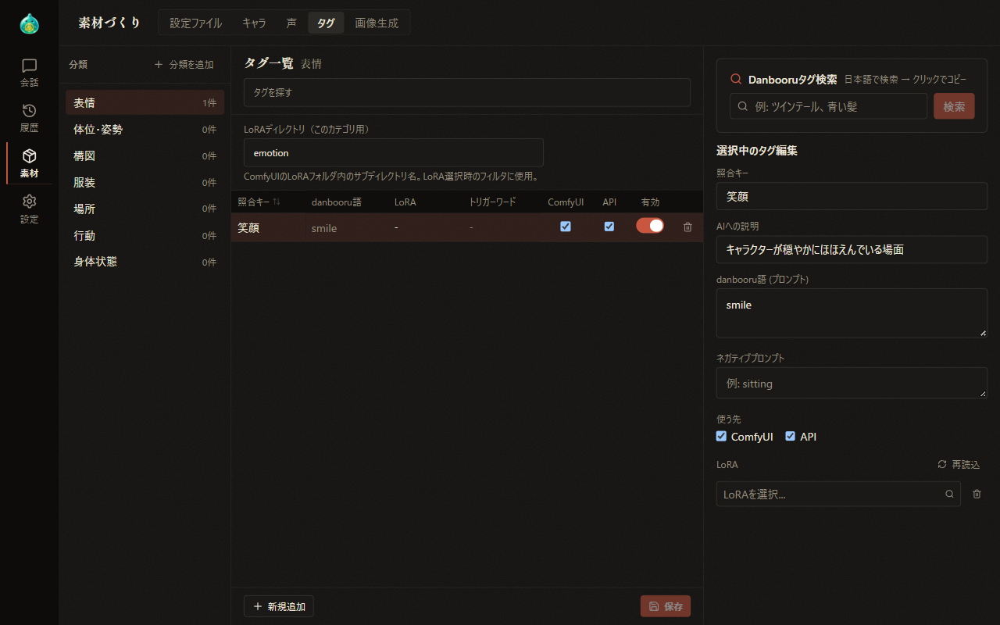
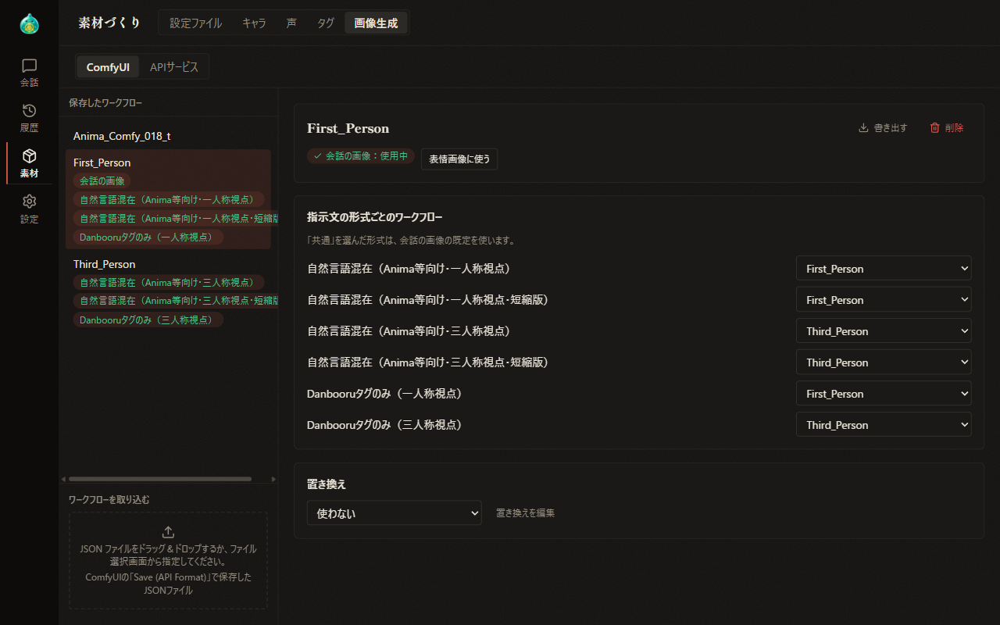
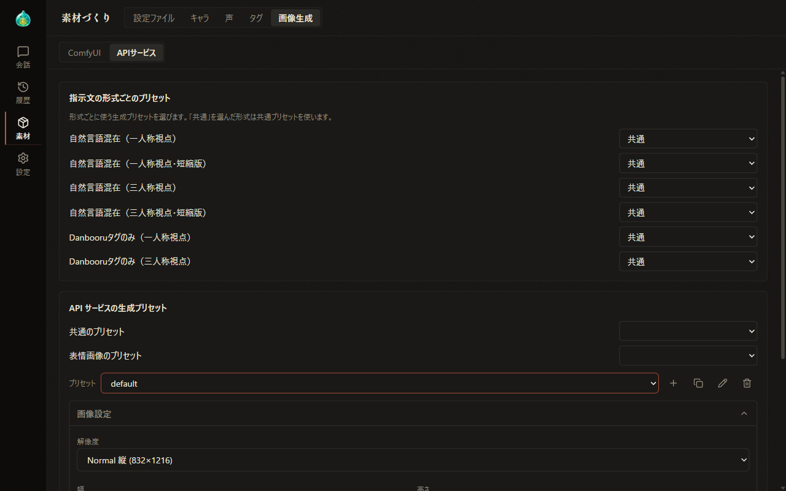

# 07-5 素材づくり：タグと画像生成

[目次に戻る](../index.md) ／ [07 素材づくり](07-material.md)

前章: [07-4 素材づくり：声](07-material-voice.md) ／ 次章: [08 設定](08-settings.md)

本章では、素材づくりの「タグ」タブと「画像生成」タブで行うタグ、ワークフロー、生成プリセットの管理についてご案内いたします。どちらのタブも、支援者機能の画像生成が有効な場合に表示されます。

## この章の内容

1. タグ
2. 画像生成：ComfyUI
3. 画像生成：API サービス

## 1. タグ

画像生成では、会話の場面を AI が分析し、当てはまるタグを選んでプロンプトを組み立てます。「タグ」タブでは、その候補となるタグを分類ごとに登録します。

### 分類とタグの表

- 左側には、表情・姿勢・構図などの分類と各分類のタグの件数が並びます。分類を選択すると、中央にその分類のタグの表が表示されます。「分類を追加」では、ID（半角英数字と _ -）と名前を入力して分類を追加します。
- 表には、照合キー・danbooru 語・LoRA・トリガーワード・使う先（ComfyUI・API）・有効が並びます。LoRA とトリガーワードの列は、ComfyUI を用いる場合に表示されます。
- 「タグを探す」では、照合キー・danbooru 語・AI への説明による絞り込みが可能です。
- 「有効」の切り替えは、保存していない変更が無い場合、その場で保存されます。
- 「新規追加」でタグの行を追加し、「保存」で表の内容をまとめて保存します。
- 「LoRAディレクトリ（このカテゴリ用）」では、LoRA を選ぶ際に候補とする ComfyUI の LoRA フォルダ内の場所を指定します。

### 選択中のタグ編集

表の行を選択すると、右側に「選択中のタグ編集」が表示されます。

| 項目 | 内容 |
| --- | --- |
| 照合キー | 場面を分析する AI がタグを選ぶ際の名前です |
| AIへの説明 | どのような場面でこのタグを用いるかを AI に伝える説明です |
| danbooru語（プロンプト） | プロンプトに加える文言です |
| ネガティブプロンプト | このタグを用いる際にネガティブプロンプトへ加える文言です |
| 使う先 | このタグを用いる画像生成の仕組み（ComfyUI・API）を選択します |
| LoRA | このタグを用いる際に適用する LoRA を選択し、強度を指定します。ComfyUI を用いる場合に表示されます |

右側の上部の「Danbooruタグ検索」では、タグを日本語でも検索します。結果を選択するとタグがコピーされます。保存していない変更がある状態で別のタグや分類へ移動しようとすると、「保存して移る」「破棄して移る」「戻る」のいずれかを選択する確認が表示されます。

## 2. 画像生成：ComfyUI

「画像生成」タブの上部の「ComfyUI」「APIサービス」で、編集する仕組みを切り替えます。現在使用している仕組みに関係なく、どちらも編集が可能です。

### 保存したワークフロー

左側には、取り込んだワークフローが並びます。各ワークフローの下には、割り当てられている用途が札で表示されます。

- **ワークフローを取り込む**: ComfyUI の「Save (API Format)」で保存した JSON ファイルを枠へドラッグ＆ドロップするか、枠を選択して指定します。名前を入力し、「追加する」で取り込みます。
- **書き出す・削除**: 選択中のワークフローを JSON ファイルとして保存または削除します。用途に割り当てられているワークフローを削除する場合は、その旨が表示されます。
- **会話の画像の既定にする**: 会話の画像生成に用いる既定のワークフローとします。
- **表情画像に使う**: 表情画像の生成に用いるワークフローとします。

### 指示文の形式ごとのワークフロー

場面を分析する際の指示文の形式（一人称視点・三人称視点など）ごとに、用いるワークフローを割り当てます。「共通」を選択した形式では、会話の画像の既定のワークフローが用いられます。

### 置き換え

「置き換え」では、場面に合わせて決まった文言をプロンプトへ加える設定（プレースホルダプリセット）を選択します。「使わない」を選択すると、置き換えは行われません。「置き換えを編集」で設定の内容を編集します。~~置き換えの仕組みと設定の方法は、AlSlime のホームページにてご案内しております。~~（現在鋭意作成中）

## 3. 画像生成：API サービス

「APIサービス」では、NovelAI などの API サービスで画像を生成する際の生成プリセットを管理します。

- **指示文の形式ごとのプリセット**: 指示文の形式ごとに、用いる生成プリセットを割り当てます。「共通」を選択した形式では、共通のプリセットが用いられます。
- **共通のプリセット・表情画像のプリセット**: 会話の画像と表情画像に用いる生成プリセットを選択します。
- **生成プリセットの編集**: 「プリセット」で編集する生成プリセットを選択し、解像度・プロンプトの構成・ステップ数などを設定します。横のアイコンで新規作成・複製・名前の変更・削除を行います。

設定によっては、API サービスの無料の範囲を超え、費用が発生する場合があります。その場合は、画面に注意が表示されます。~~各項目の詳しい意味は、AlSlime のホームページにてご案内しております。~~（現在鋭意作成中）

画像生成の設定と会話での画像生成の使い方は、[10 画像生成](10-image-generation.md) にてご案内いたします。

---

前章: [07-4 素材づくり：声](07-material-voice.md) ／ 次章: [08 設定](08-settings.md)

[目次に戻る](../index.md)
