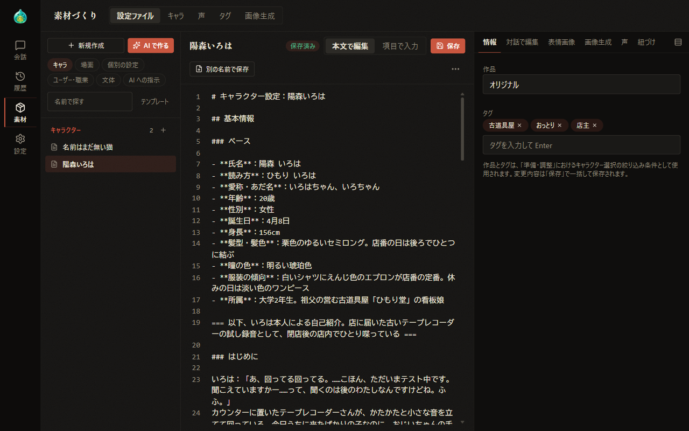

# 07 素材づくり

[目次に戻る](../index.md)

前章: [06 会話を続ける](06-continue.md) ／ 次章: [07-1 素材づくり：設定ファイル](07-material-files.md)

本章では「素材づくり」の画面の全体像と各ページの内容をご案内いたします。

## この章の内容

1. 素材づくりの画面
2. タブの種類と表示される条件
3. ほかの画面からの移動

## 1. 素材づくりの画面

切り替え列の「素材」を選択すると、素材づくりの画面が表示されます。切り替え列から表示した場合は、常に「設定ファイル」のタブが選択された状態となります。

見出しの横には、素材の種類ごとのタブが並びます。

## 2. タブの種類と表示される条件

| タブ | 内容 | 表示される条件 | 詳細 |
| --- | --- | --- | --- |
| 設定ファイル | キャラクター・場面・文体などの設定ファイルの作成と編集、AI による設定ファイルの作成 | 常に表示 | [07-1 設定ファイル](07-material-files.md)・[07-2 AI で作る](07-material-ai-create.md) |
| キャラ | キャラクターごとの画像の設定、表情ごとの画像、「試しに生成」、声の紐づけ | 支援者機能の画像生成または読み上げが有効な場合 | [07-3 キャラ](07-material-characters.md) |
| 声 | 読み上げに用いる声の登録と読み上げのテスト | 支援者機能の読み上げが有効な場合 | [07-4 声](07-material-voice.md) |
| タグ | 画像生成に用いるタグの登録と編集 | 支援者機能の画像生成が有効な場合 | [07-5 タグと画像生成](07-material-image.md) |
| 画像生成 | ワークフローと生成プリセットの管理 | 支援者機能の画像生成が有効な場合 | [07-5 タグと画像生成](07-material-image.md) |

支援者機能が無効の場合は、タブは表示されず、設定ファイルの画面のみが表示されます。支援者機能の状態が変わり、選択中のタブが対象外となった場合は、「設定ファイル」のタブに切り替わります。支援者機能については、[09 支援者機能](09-sponsor.md) にてご案内いたします。

## 3. ほかの画面からの移動

素材づくりの画面は、次の場所からも表示されます。いずれも、該当するタブと対象を選択した状態で表示されます。

- 準備・調整の欄のキャラ詳細の「設定ファイル」「画像の設定」「声の設定」「素材づくりで開く」（[04 準備・調整：キャラクター](04-prepare-characters.md)）
- 設定画面の「画像生成・読み上げ」にある「キャラを開く」「声を開く」「タグを素材づくりで開く」「ワークフローを素材づくりで開く」（[08 設定](08-settings.md)）
- クイック設定の「タグ有効/無効設定」の「素材づくりで編集」（[10 画像生成](10-image-generation.md)）

---

前章: [06 会話を続ける](06-continue.md) ／ 次章: [07-1 素材づくり：設定ファイル](07-material-files.md)

[目次に戻る](../index.md)
