# 08 設定

[目次に戻る](../index.md)

前章: [07-5 素材づくり：タグと画像生成](07-material-image.md) ／ 次章: [09 支援者機能](09-sponsor.md)

本章では、切り替え列の「設定」で表示する設定画面の使い方と各分類の設定項目についてご案内いたします。

## この章の内容

1. 設定画面の構成と保存
2. 一般
3. AI と接続
4. 会話の既定値
5. 起動・システム
6. 公式サンプル
7. アカウント
8. ヘルプ

## 1. 設定画面の構成と保存

切り替え列の「設定」を選択すると、設定画面が表示されます。左側に分類が並び、選択した分類の設定項目が右側に表示されます。切り替え列から表示した場合は、常に「一般」が選択された状態となります。入力欄の左下の「使う AI とモデル」の小窓で「モデル設定を開く」を選択した場合は、「AI と接続」が表示されます。

| 分類 | 内容 | 表示される条件 |
| --- | --- | --- |
| 一般 | 表示言語・デザイン・本文の表示・送信キーなど | 常に表示 |
| AI と接続 | 既定の AI とモデル、モデルの一覧、API の接続先、同時実行数 | 常に表示 |
| 会話の既定値 | 既定のユーザー名・生成温度・祝日、表情・項目設定・テキスト置換の管理 | 常に表示 |
| 画像生成・読み上げ | 画像生成と読み上げの設定 | 支援者機能の画像生成または読み上げが有効な場合 |
| 起動・システム | 起動設定、CLI の場所、更新の確認、システム診断 | 常に表示 |
| 公式サンプル | 設定サンプル一式と設定自動生成用テンプレートの取り込み、設定パックの取り込みと書き出し | 常に表示 |
| アカウント | 支援者機能のログインとモジュール、設定パック | 常に表示 |
| ヘルプ | 操作マニュアル、版 | 常に表示 |

画面の幅が狭い場合は、分類の一覧から項目を選択すると設定項目の表示に切り替わります。見出しの左の矢印（「分類へ戻る」）で、分類の一覧に切り替わります。

### 変更の保存

設定項目を変更すると、画面下部に「保存していない変更があります」の帯が表示されます。

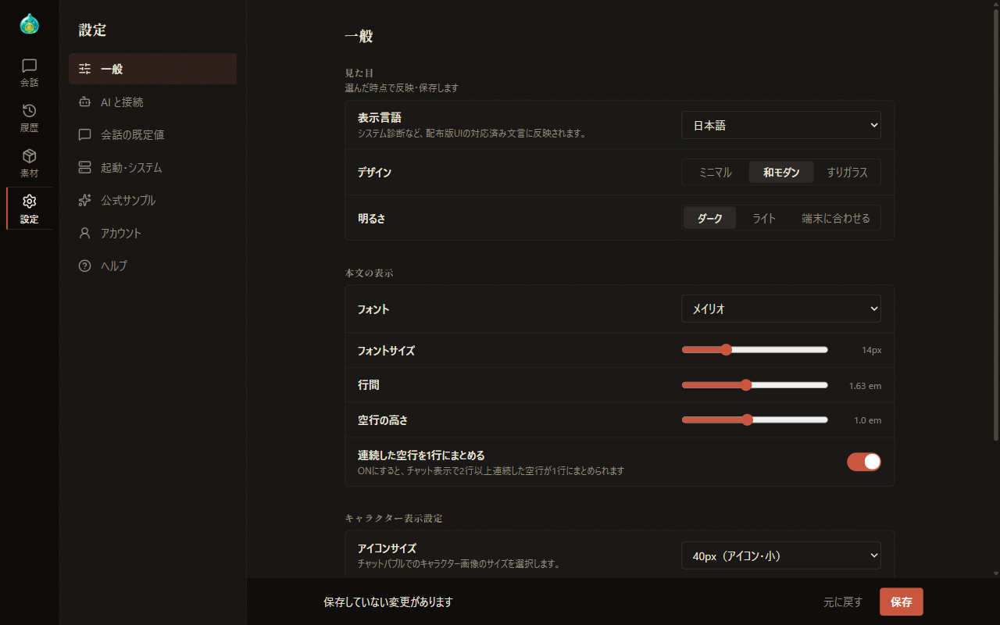

- 「保存」を選択すると、変更がまとめて保存されます。保存できなかった項目がある場合は、「次の項目を保存できませんでした：」に続けて項目名が表示されます。
- 「元に戻す」を選択すると、変更が破棄されます。
- 保存していない変更がある状態で別の分類や画面へ移動しようとすると、「保存する」「破棄する」「戻る」のいずれかを選択する確認が表示されます。

一部の項目は、帯を通さずに選択した時点で保存されます。見た目の 3 項目（表示言語・デザイン・明るさ）、「起動時に更新を自動確認する」、「管理」「開く」「実行」で表示する窓の中の操作などが該当します。

## 2. 一般

### 見た目

| 項目 | 内容 |
| --- | --- |
| 表示言語 | 日本語または English を選択します。日本語以外を選択すると、祝日情報の反映は自動的に無効となります |
| デザイン | 「ミニマル」「和モダン」「すりガラス」から選択します |
| 明るさ | 「ダーク」「ライト」「端末に合わせる」から選択します。デザインを変更しても、明るさは維持されます |

### 本文の表示

| 項目 | 内容 |
| --- | --- |
| フォント | 会話の本文と設定ファイルの本文の編集欄に用いるフォントを選択します。「デザインに合わせる」では、ミニマルはゴシック体、和モダンとすりガラスはしっぽり明朝が用いられます |
| フォントサイズ | 10〜24px の範囲で指定します |
| 行間・空行の高さ | 本文の行の間隔と、空行の高さを指定します |
| 連続した空行を1行にまとめる | 有効にすると、2 行以上続く空行が 1 行にまとめて表示されます |

### キャラクター表示設定・送信キー

- **アイコンサイズ**: 吹き出しに表示するキャラクターの画像の大きさを 40〜500px から選択します。
- **アイコンをチャットバブルの左に表示**: アイコンサイズが 100px 以上の場合に適用されます。
- **チャットの送信キー**: メッセージを送信するキー操作を選択します（[03 はじめての会話](03-first-chat.md)）。

### 背景画像

支援者機能の画像生成が有効な場合は、「背景画像」の欄が表示されます。「セッション内背景画像」を有効にすると、画像の付いた応答が画面に表示されている間、その画像が背景に表示されます。背景画像の透明度や表示範囲などの詳細は、[10 画像生成](10-image-generation.md) にてご案内いたします。

## 3. AI と接続

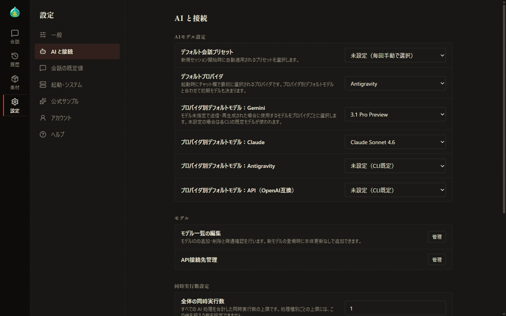

### AIモデル設定

| 項目 | 内容 |
| --- | --- |
| デフォルト会話プリセット | 新しい会話を開始する際に、自動的に読み込む会話設定プリセットを選択します。「未設定（毎回手動で選択）」の場合は、起動時に準備・調整の欄が表示されます |
| デフォルトプロバイダ | 起動時に選択される AI を選択します |
| プロバイダ別デフォルトモデル | AI ごとに、既定のモデルを選択します。「未設定（CLI既定）」の場合は、各 CLI の既定のモデルが用いられます |

### モデル一覧の編集

「モデル一覧の編集」の「管理」を選択すると、「モデル一覧の編集」の窓が表示されます。

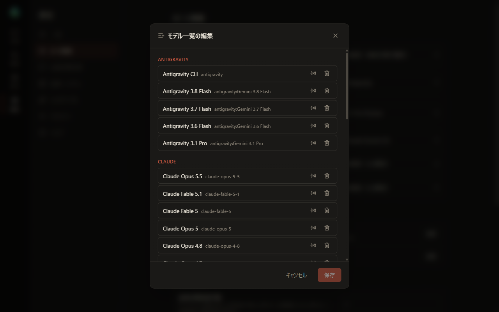

- AI ごとにモデルが並び、各モデルの電波のアイコンで疎通確認、ゴミ箱のアイコンで削除（内蔵のモデルは非表示）を行います。非表示にしたモデルは「復元」で再び表示されます。
- 下部の「モデルを追加」でモデルID・表示名・説明を入力して「追加」を選択すると、新しいモデルが一覧に加わります。新しいモデルが公開された際に、AlSlime の更新を待たずに追加する用途を想定した機能です。
- 変更は「保存」で確定します。

~~モデルの追加の詳しい方法（Thinking の指定など）は、AlSlime のホームページにてご案内しております。~~（現在鋭意作成中）

### API接続先管理

「API接続先管理」の「管理」を選択すると、OpenAI 互換の API の接続先を管理する窓が表示されます。「接続先を追加」で接続先の登録を開始します。

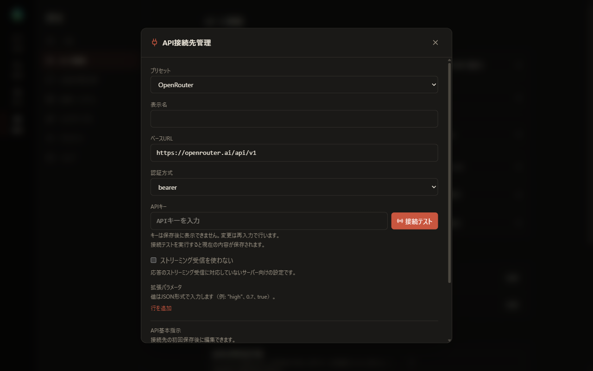

| 項目 | 内容 |
| --- | --- |
| プリセット | OpenRouter・OpenAI・DeepSeek・OpenCode Go・カスタムから選択します。選択に応じて、ベースURLなどが設定されます |
| 表示名・ベースURL・認証方式 | 接続先の名前と、接続に用いる情報です |
| APIキー | 接続先の API キーを入力します。保存後のキーは表示されず、変更する場合は改めて入力します。「接続テスト」を選択すると、入力中の内容が保存されて接続テストが実行されます |
| ストリーミング受信を使わない | 応答を少しずつ受け取る方式に対応していない接続先で有効にします |
| 拡張パラメータ | 接続先へ追加で渡す値を指定します |
| API基本指示 | 接続先への指示のファイルを表示します。接続先を一度保存した後に利用可能となります |

> **ご注意**
>
> - 従量課金のサービスでは、利用量に応じて料金が発生します。各サービスの利用条件は提供元の規約で確認します。
> - API キーは、この端末内の秘匿領域に保存されます。設定パックには含まれません。データフォルダを丸ごと複製したバックアップには含まれます（[13 データの置き場所とバックアップ](13-data.md)）。

~~各サービスのキーの取得方法は、AlSlime のホームページにてご案内しております。~~（現在鋭意作成中）

### 同時実行数設定

AI の処理を同時にいくつまで実行するかを指定します。

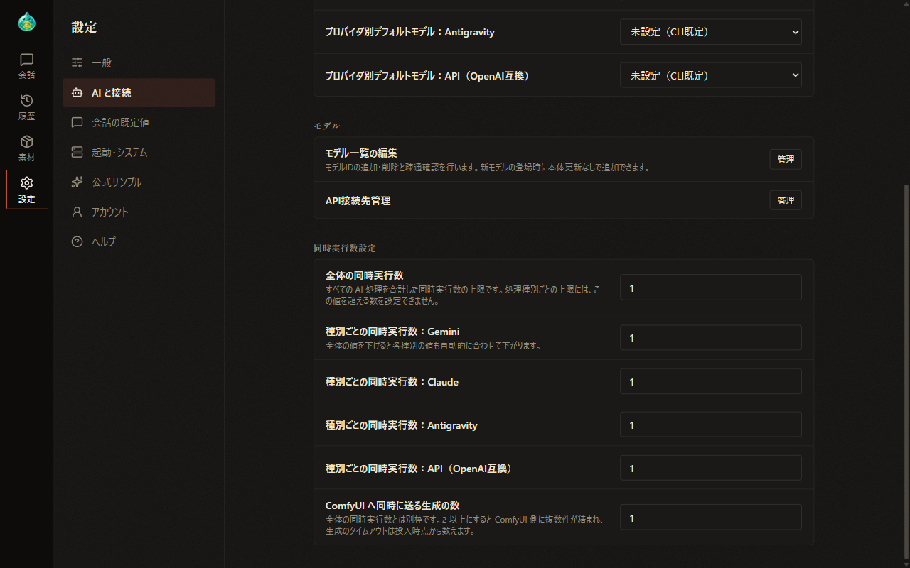

- **全体の同時実行数**: すべての AI の処理を合わせた上限です。
- **種別ごとの同時実行数**: Gemini・Claude・Antigravity・API ごとの上限です。全体の値が上限となり、全体の値を下げると、各種別の値も合わせて下がります。
- **ComfyUI へ同時に送る生成の数**: 全体の同時実行数とは別の枠で、1〜4 の範囲で指定します。

## 4. 会話の既定値

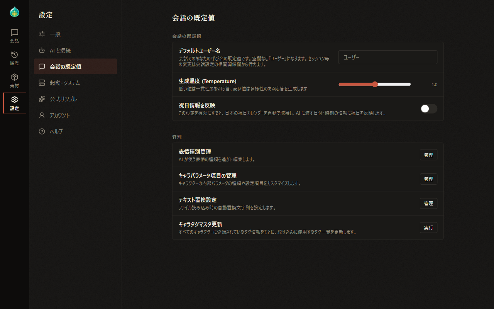

| 項目 | 内容 |
| --- | --- |
| デフォルトユーザー名 | 会話の中でのユーザーの呼び名の既定値です。空欄の場合は「ユーザー」となります。会話ごとの変更は、準備・調整の欄の相関関係で行います |
| 生成温度 (Temperature) | 0.0〜2.0 の範囲で指定します。低い値では一貫性のある応答、高い値では多様性のある応答が生成されます |
| 祝日情報を反映 | 有効にすると、日本の祝日の情報を取得し、AI に渡す日付と時刻の情報に祝日を加えます。表示言語が日本語の場合に表示されます |

### 管理

| 項目 | 内容 |
| --- | --- |
| 表情種別管理 | AI が用いる表情の種類を管理します（後述） |
| キャラパラメータ項目の管理 | 個別パラメータの項目設定を管理します（後述） |
| テキスト置換設定 | 設定ファイルの読み込み時に、決まった文字列を置き換える設定を管理します（後述） |
| キャラタグマスタ更新 | 「実行」を選択すると、すべてのキャラクターの作品とタグを調べ直し、準備・調整の欄の絞り込みの一覧を作り直します |

#### 表情種別管理

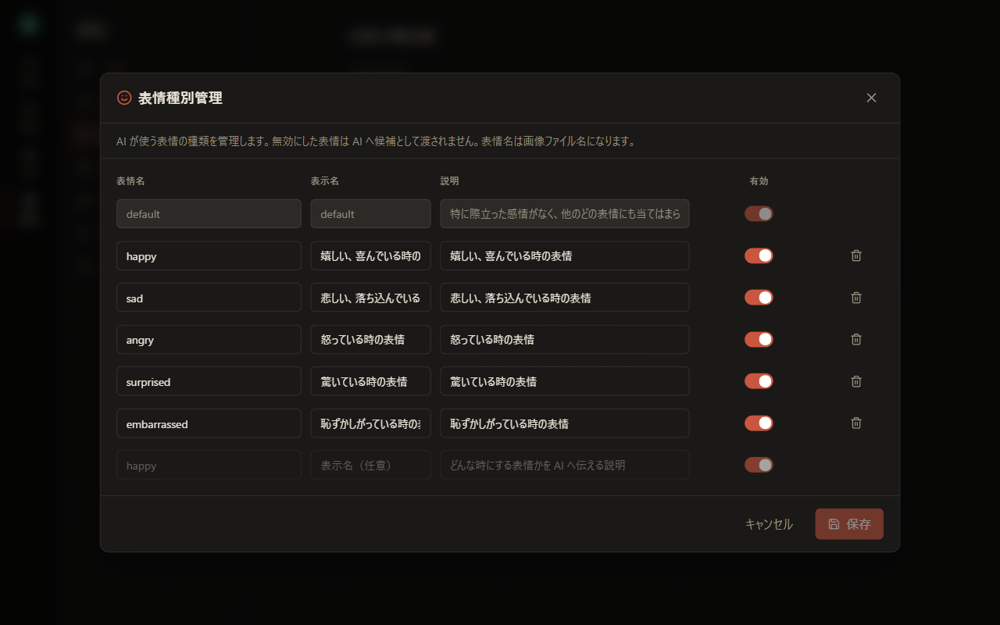

表情ごとに、表情名・表示名・説明・有効を設定します。表情名は、表情の画像のファイル名にもなります。説明は、どのような場面の表情かを AI に伝えるための文です。

無効にした表情は、AI に候補として渡されません。「default」の行は固定で、編集の対象外です。

最下部の空の行に入力すると、表情が追加されます。変更は「保存」で確定します。

#### キャラパラメータ項目の管理

「キャラパラメータ項目の管理」の「管理」を選択すると、「項目設定管理」の窓が表示されます。

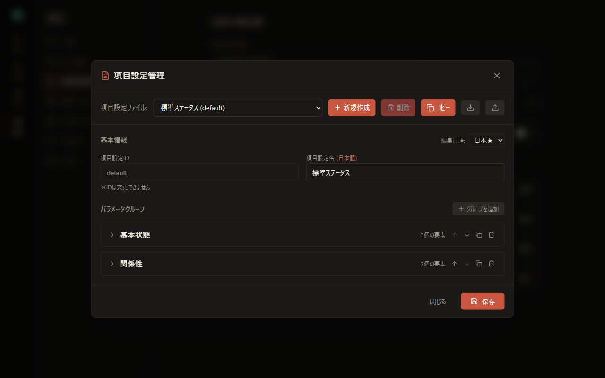

- 「項目設定ファイル」で、編集する項目設定を選択します。「新規作成」「削除」「コピー」と JSON ファイルへの書き出し・取り込みのアイコンが並びます。
- 項目設定は、パラメータグループとその中の要素（スライダーや選択肢などの項目）で構成されます。グループの見出しを選択すると、要素の一覧が表示されます。
- 変更は「保存」で確定します。

~~項目設定の詳しい作り方は、AlSlime のホームページにてご案内しております。~~（現在鋭意作成中）

項目設定の選択は、準備・調整の欄のプリセットのタブで行います（[05 準備・調整：場面・文体・プリセット](05-prepare-scene.md)）。

#### テキスト置換設定

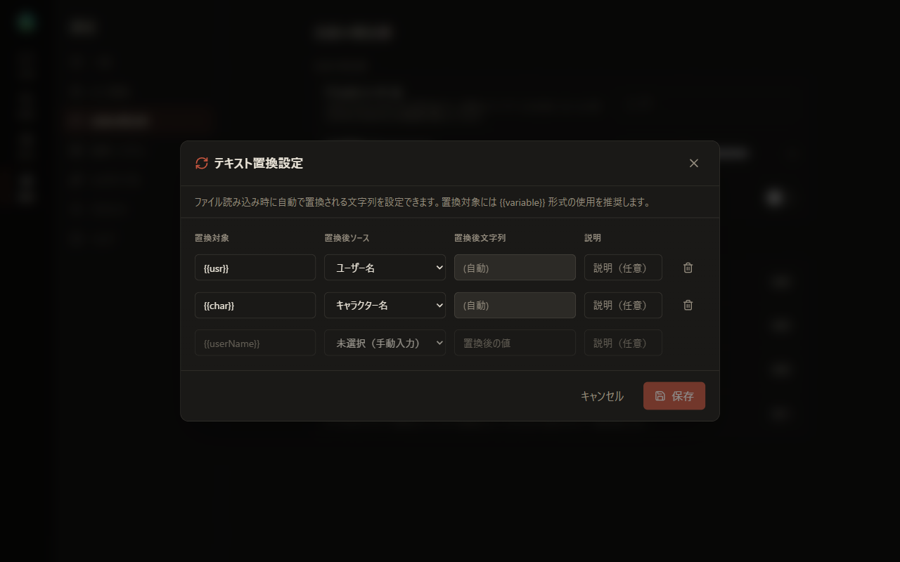

設定ファイルの中の決まった文字列を読み込みの際に置き換えます。置換対象には `{{usr}}` のように `{{ }}` で囲んだ形式を用いる運用を推奨しております。

- **置換後ソース**: 「ユーザー名」「キャラクター名」、または「未選択（手動入力）」から選択します。手動入力の場合は、「置換後文字列」に置き換える文字列を入力します。
- 初期状態では、`{{usr}}` がユーザー名、`{{char}}` がキャラクター名に置き換わる設定になっています。
- この置き換えは、ユーザーが送信する本文にも適用されます。

## 5. 起動・システム

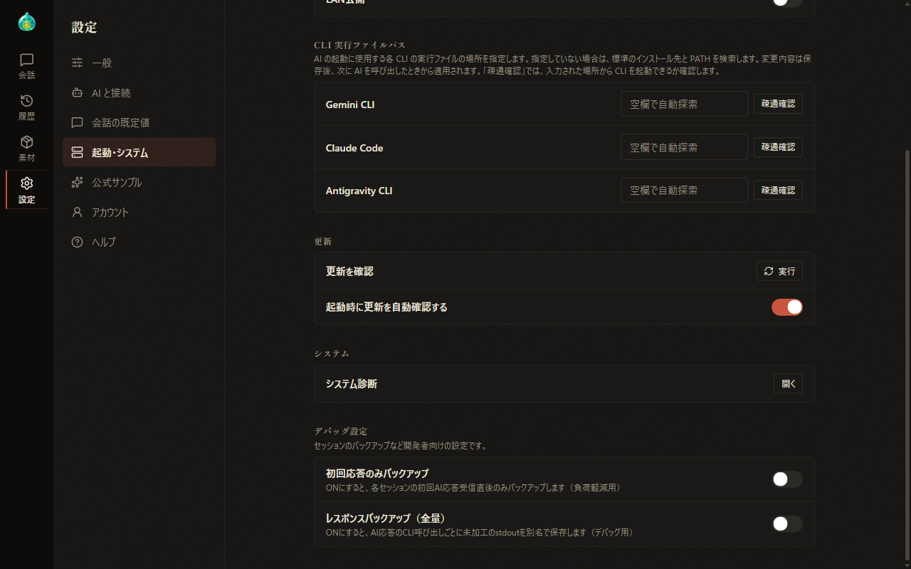

- **起動設定・CLI 実行ファイルパス**: [01 導入と起動](01-setup.md) にてご案内しております。
- **更新を確認**: 「実行」を選択すると、AlSlime 本体と支援者機能のモジュールの更新を確認します（[12 設定パックと更新](12-settings-pack-update.md)）。
- **起動時に更新を自動確認する**: 有効の場合、起動時に更新を確認します。初期設定は有効です。
- **デバッグ設定**: AI の応答の記録を残す開発者向けの設定です。

### システム診断

「システム診断」の「開く」を選択すると、AlSlime の状態をまとめて確認する窓が表示されます。

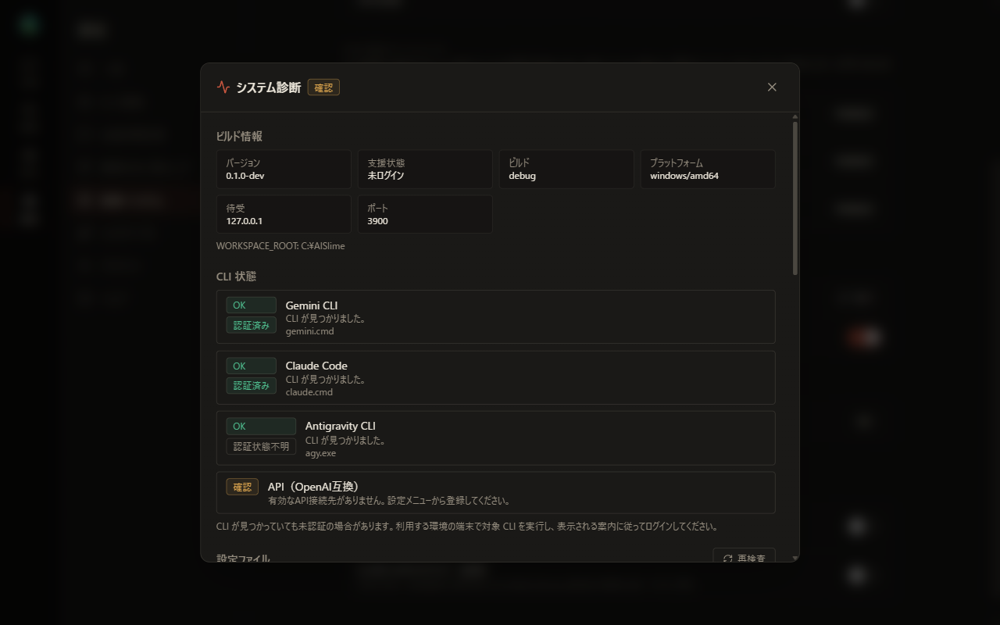

| 区画 | 内容 |
| --- | --- |
| ビルド情報 | 版・支援状態・ビルド・プラットフォーム・待受・ポート、データの場所（WORKSPACE_ROOT） |
| CLI 状態 | 各 CLI が検出されたか、認証済みかの状態と、API（OpenAI互換）の接続先の状態 |
| 設定ファイル | 各設定ファイルが読み取れるかの検査結果。「再検査」で改めて検査します |
| キャッシュ・バックアップ | キャッシュとバックアップの状態 |

CLI が検出されていても、ログインが済んでいない場合があります。その場合は、対象の CLI を端末で起動し、表示される案内に従ってログインします。トラブルの際の見方は、[14 困ったとき](14-troubleshooting.md) にてご案内いたします。

## 6. 公式サンプル

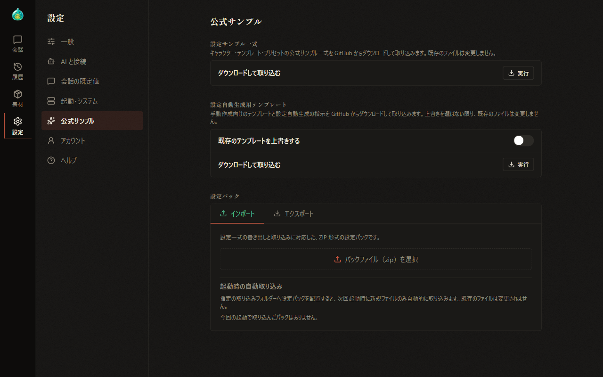

「公式サンプル」では、公式のサンプルを GitHub からダウンロードして取り込みます。

| 欄 | 内容 |
| --- | --- |
| 設定サンプル一式 | キャラクター・テンプレート・プリセットの一式です。取り込んだ時点で、設定ファイルを作成せずに会話を開始する準備が整います。既存のファイルは変更されません |
| 設定自動生成用テンプレート | 手動作成向けのテンプレートと設定自動生成の指示の一式です。「既存のテンプレートを上書きする」を有効にして取り込むと、同じ名前のテンプレートが上書きされます。無効の場合、同じ名前のテンプレートは変更されません |

各欄の「ダウンロードして取り込む」の「実行」を選択すると、取り込みが始まります。完了すると、書き込んだ件数とスキップした件数が表示されます。取得に失敗した場合は、その理由が表示されます。

下部の「設定パック」では、「インポート」と「エクスポート」で設定パックの取り込みと書き出しを行います。内容は、[12 設定パックと更新](12-settings-pack-update.md) にてご案内いたします。

## 7. アカウント

「アカウント」では、支援者機能のログインとモジュールの管理、設定パックの取り込みと書き出しを行います。内容は、[09 支援者機能](09-sponsor.md) と [12 設定パックと更新](12-settings-pack-update.md) にてご案内いたします。

## 8. ヘルプ

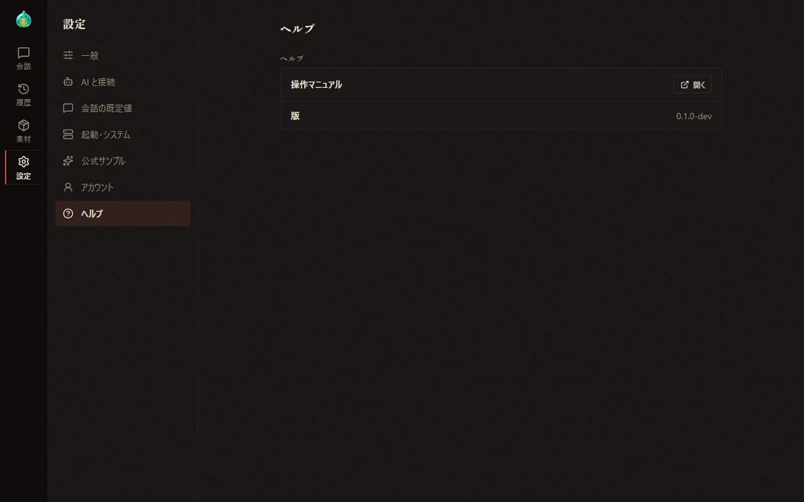

- **操作マニュアル**: 「開く」を選択すると、本マニュアルがブラウザの別のタブで表示されます。
- **版**: AlSlime 本体の版が表示されます。

---

前章: [07-5 素材づくり：タグと画像生成](07-material-image.md) ／ 次章: [09 支援者機能](09-sponsor.md)

[目次に戻る](../index.md)
