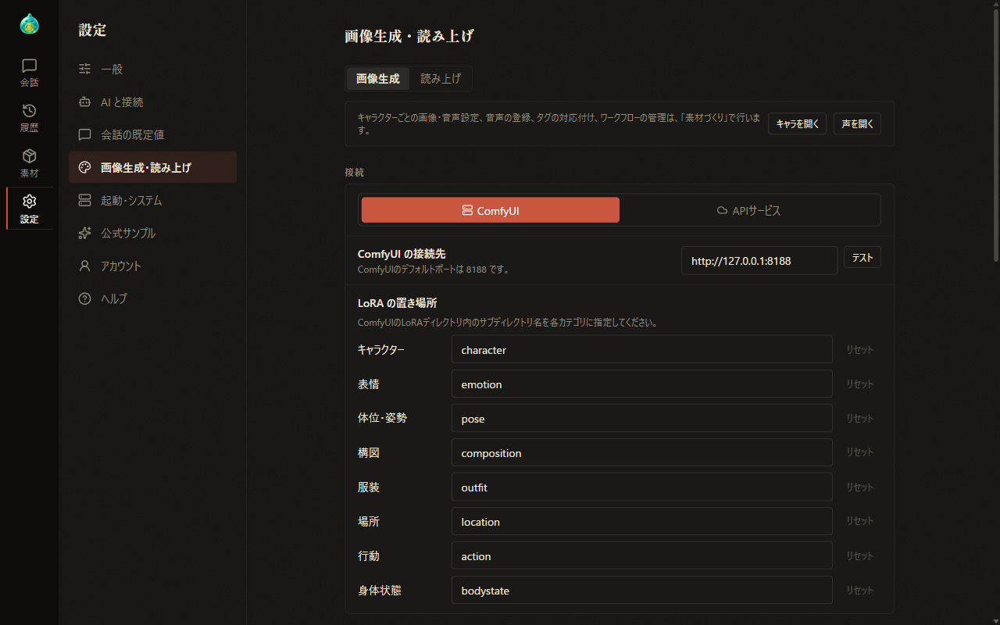
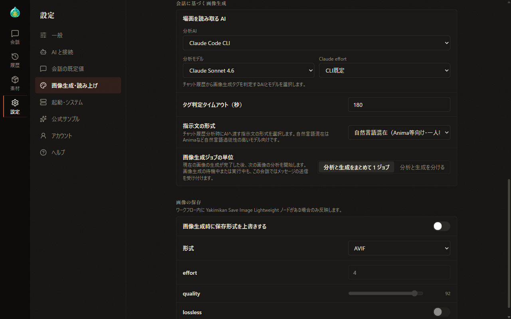
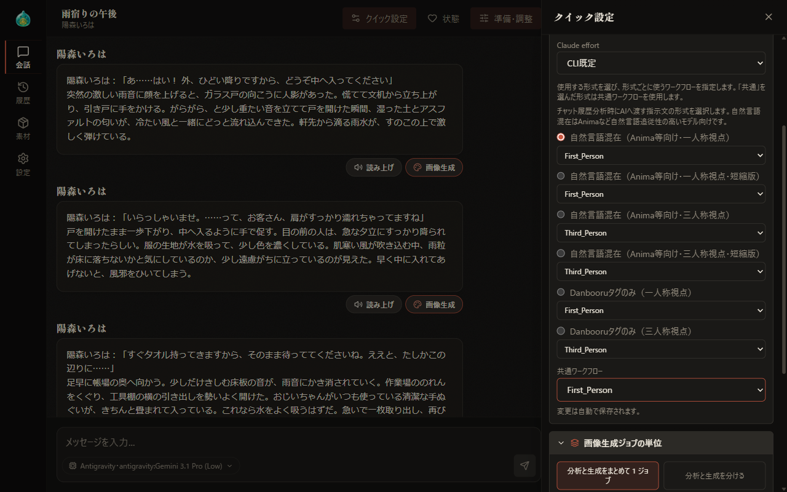
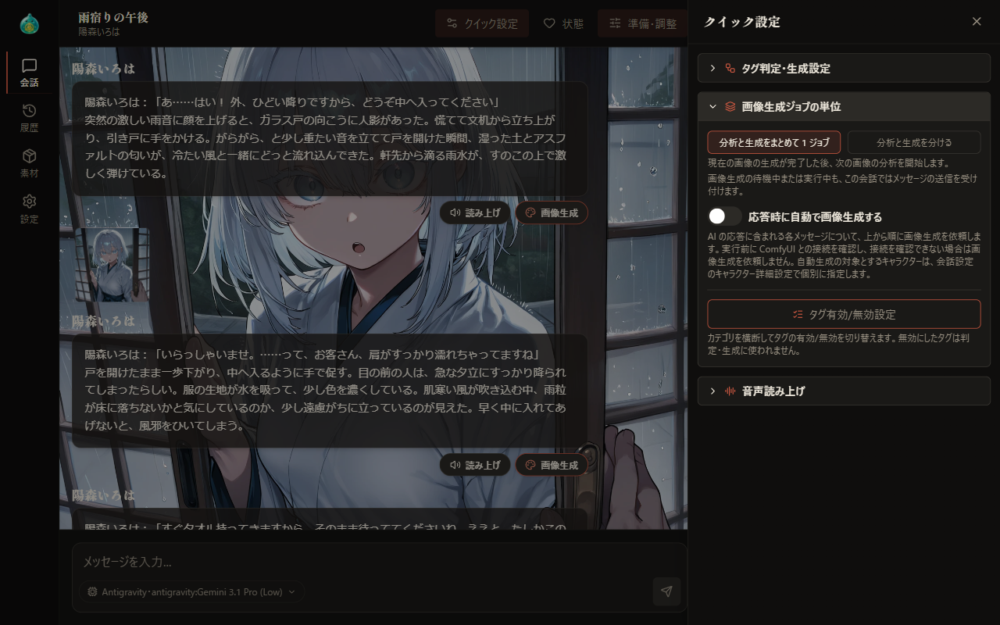
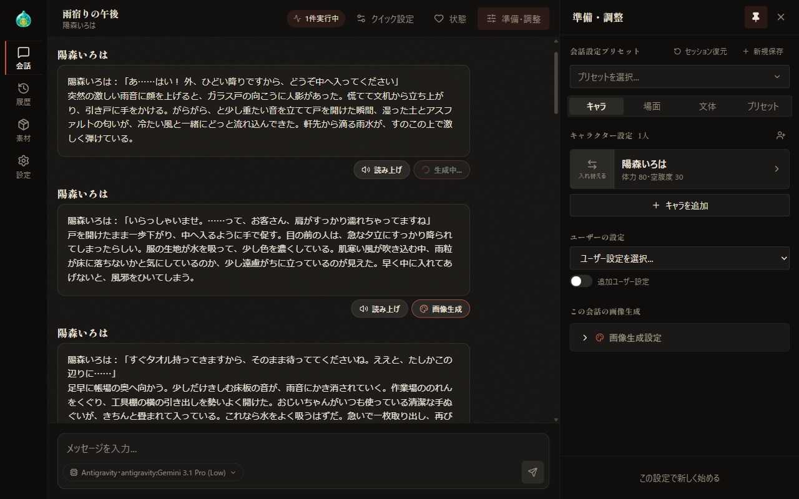
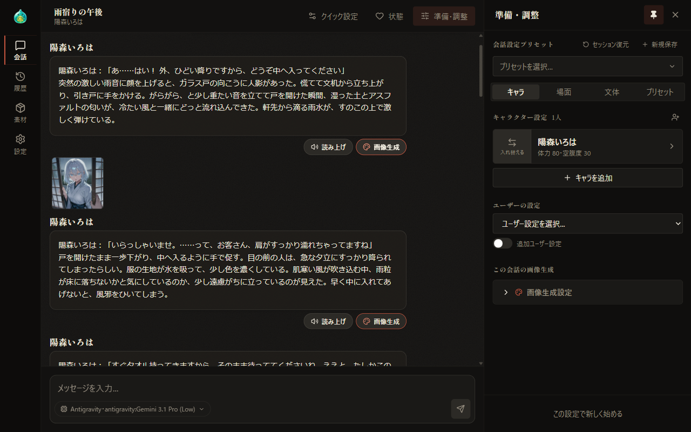
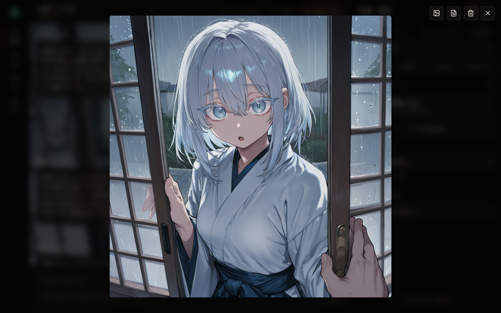
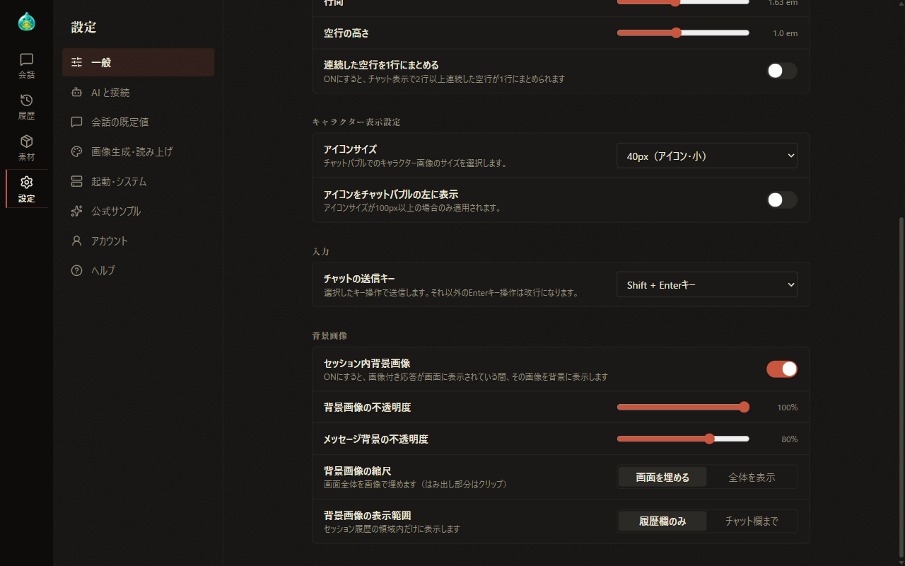
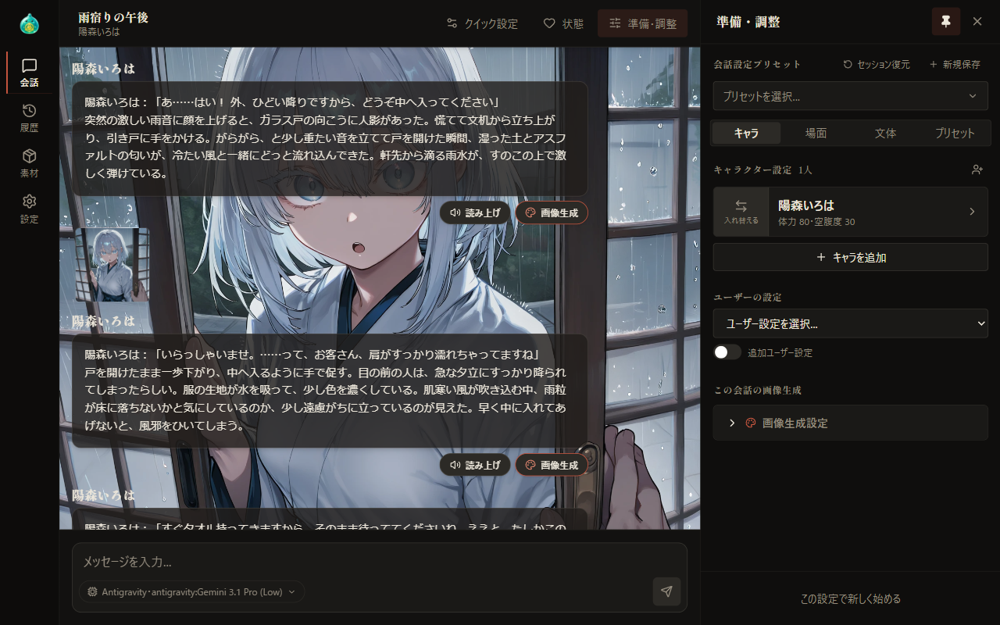
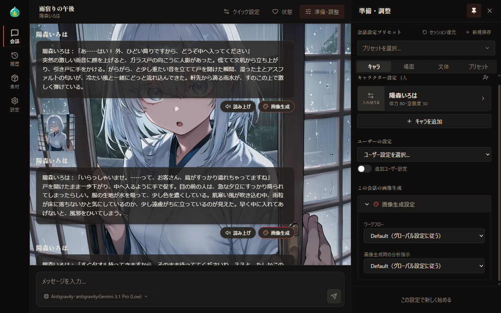

# 10 画像生成

[目次に戻る](../index.md)

前章: [09 支援者機能](09-sponsor.md) ／ 次章: [11 読み上げ](11-tts.md)

本章では、会話の場面を画像にする画像生成について、準備の流れ、設定、会話での使い方をご案内いたします。画像生成は、支援者機能の画像生成が有効な場合に使用します（[09 支援者機能](09-sponsor.md)）。

## この章の内容

1. 使い始めるまでの流れ
2. 設定画面の画像生成
3. クイック設定
4. 会話で画像を生成する
5. 応答時の自動画像生成
6. 生成した画像の表示
7. 背景画像
8. この会話の画像生成

## 1. 使い始めるまでの流れ

画像生成では、会話の場面を AI が分析してプロンプトを組み立て、ComfyUI または API サービスで画像を生成します。使い始めるまでの流れは次のとおりです。

1. 支援者機能でログインし、画像生成連携モジュールを取得します（[09 支援者機能](09-sponsor.md)）。
2. 画像生成の仕組みを準備します。
   - **ComfyUI**: ComfyUI を起動し、設定画面で接続先を指定します。~~ComfyUI の導入方法は、AlSlime のホームページにてご案内しております。~~（現在鋭意作成中）
   - **API サービス**: 設定画面で API トークンを保存し、接続テストを行います。~~API トークンの取得方法は、AlSlime のホームページにてご案内しております。~~（現在鋭意作成中）
3. 素材づくりでワークフローまたは生成プリセットとタグを用意します（[07-5 素材づくり：タグと画像生成](07-material-image.md)）。キャラクターごとの画像の設定は、素材づくりの「キャラ」タブで行います（[07-3 素材づくり：キャラ](07-material-characters.md)）。
4. 場面を読み取る AI を選択します（本章の「2. 設定画面の画像生成」）。
5. 会話の吹き出しの「画像生成」を選択します。

## 2. 設定画面の画像生成

設定の「画像生成・読み上げ」の「画像生成」で、画像生成の全体の設定を行います。読み上げも有効な場合は、上部の「画像生成」「読み上げ」で表示を切り替えます。キャラクターごとの画像の設定やタグ、ワークフローの管理は素材づくりで行い、「キャラを開く」で素材づくりの「キャラ」タブを表示します。

### 接続

欄の先頭の「ComfyUI」「APIサービス」で、使用する画像生成の仕組みを選択します。選択はその場で保存されます。

| 項目 | 内容 | 表示される条件 |
| --- | --- | --- |
| ComfyUI の接続先 | ComfyUI の接続先アドレスを入力します。「テスト」で接続を確認します。ComfyUI の既定のポートは 8188 です | ComfyUI の場合 |
| LoRA の置き場所 | ComfyUI の LoRA フォルダ内の、分類（キャラクター・表情・構図など）ごとのサブフォルダ名を指定します。「リセット」で既定の名前に切り替わります | ComfyUI の場合 |
| 接続設定 | API トークンを入力し、「トークンを保存」で保存します。「接続テスト」で接続を確認すると、プラン・Anlas の残高・無料枠・有効期限などが表示されます。「トークンを削除」で保存したトークンを削除します | API サービスの場合 |
| 使うモデル | API サービスで用いるモデルを選択します。選択はその場で保存されます | API サービスの場合 |
| 自動効果音描画 | AI が効果音の要否と文言を判断し、生成の指示に加えます | API サービスで、対応するモデルを選択している場合 |
| API サービス残高 | プラン・Anlas の残高・無料枠などを表示します。「残高を更新」で最新の値を取得します | API サービスの場合 |

### タグとワークフロー

「接続」の下の欄で、タグとトリガーワードの取得形式（アンダーバー区切り・半角スペース区切り・Anima 向けなど）を選択します。形式の選択は、ComfyUI の場合に表示されます。「タグを素材づくりで開く」「ワークフローを素材づくりで開く」で、素材づくりの該当するタブを表示します。

### 会話に基づく画像生成

| 項目 | 内容 |
| --- | --- |
| 場面を読み取る AI | 会話の履歴を分析し、画像生成に用いるタグを選ぶ AI（分析 AI）とモデルを選択します。AI によっては、考える深さ（effort など）も選択します |
| タグ判定タイムアウト（秒） | 場面の分析を待つ時間を 30〜1800 秒の範囲で指定します |
| 指示文の形式 | 場面の分析の際に AI へ送信する指示文の形式を 6 種類から選択します。自然言語混在（一人称視点・三人称視点と、それぞれの短縮版）と、Danbooru タグのみ（一人称視点・三人称視点）です。自然言語混在は、Anima など、自然な文章の指示に沿いやすいモデルに向いています。ComfyUI と API サービスで別々に設定されます |
| 画像生成ジョブの単位 | 「分析と生成をまとめて 1 ジョブ」では、現在の画像の生成が完了した後、次の画像の分析を開始します。「分析と生成を分ける」では、現在の画像の分析が完了した時点で次の画像の分析を開始し、生成の依頼は 1 枚ずつ順番に送信します |

画像生成の待機中や実行中も、その会話でのメッセージの送信は受け付けられます。

### あなたの見た目

API サービスの場合は、「あなたの見た目」の欄が表示されます。ユーザー（会話の中でのご自身）を 1 人の人物として画像に描くための設定で、会話の中でユーザーを指す呼び名、容姿のプロンプト、参照画像を設定します。項目の内容は、素材づくりのキャラクターの画像の設定と同じです（[07-3 素材づくり：キャラ](07-material-characters.md)）。参照画像は、対応するモデルでは 1 枚ごとに費用（Anlas）が発生します。この設定は、ComfyUI での生成には用いられません。

### 画像の保存

ComfyUI の場合は、「画像の保存」の欄が表示されます。「画像生成時に保存形式を上書きする」を有効にしてから、生成した画像の形式（AVIF・WebP・PNG）と画質を指定します。この設定は、画像を保存する「Yakimikan Save Image Lightweight」ノードを含むワークフローに反映されます。

## 3. クイック設定

会話画面の見出しの「クイック設定」を選択すると、画面の右側にすべての会話に共通する画像生成の設定が表示されます。各項目は、見出しを選択すると内容が表示される形式で、変更はその場で保存されます。

- **タグ判定・生成設定**: 画像生成の仕組み（ComfyUI・API サービス）、場面を読み取る AI、指示文の形式を選択します。指示文の形式ごとに、用いるワークフロー（API サービスの場合は生成プリセット）を指定します。「共通」を選択した場合は、ComfyUI では共通ワークフロー、API サービスでは共通の生成プリセットが用いられます。
- **API サービス残高**: API サービスの場合に、残高などを表示します。
- **画像生成ジョブの単位**: 設定画面と同じ選択肢に加えて、「応答時に自動で画像生成する」と「タグ有効/無効設定」が含まれます。

「タグ有効/無効設定」では、分類をまたいでタグの有効・無効を切り替えます。無効にしたタグは、場面の分析と生成に用いられません。切り替えはその場で保存されます。「素材づくりで編集」で、素材づくりの「タグ」タブを表示します。

## 4. 会話で画像を生成する

会話の吹き出しの下にある「画像生成」を選択すると、その吹き出しの場面を画像にします。

- 処理の間、そのボタンの表示が「予約中」「分析中」「生成待ち」「生成中」と切り替わります。
- 続けて別の吹き出しの「画像生成」を選択すると、予約として順番に処理されます。
- 処理中は、見出しに「1件実行中」などの札が表示されます。札を選択すると、ジョブ進行状況が表示されます（[06 会話を続ける](06-continue.md)）。
- 「画像生成」のボタンは、会話の保存後で、応答の生成中ではない場合に表示されます。
- 生成に失敗した場合や 5 分以内に完了しなかった場合は、その旨が画面に表示されます。

## 5. 応答時の自動画像生成

クイック設定の「画像生成ジョブの単位」で「応答時に自動で画像生成する」を有効にすると、応答が届いた時点で各吹き出しの画像生成が上から順に予約されます。画像生成の仕組みとの接続が確認されない場合は予約されず、その旨が表示されます。

自動画像生成の対象とするキャラクターは、準備・調整の欄の「キャラ詳細」にある「自動画像生成の対象にする」で個別に指定します（[04 準備・調整：キャラクター](04-prepare-characters.md)）。

## 6. 生成した画像の表示

生成した画像は、吹き出しの下のボタンのさらに下に小さく表示されます。

画像を選択すると、拡大して表示されます。右上の×または画像の外側を選択すると、拡大表示が終了します。

拡大表示の右上には、次のボタンが並びます。

| ボタン | 内容 |
| --- | --- |
| この画像を背景に設定 | この画像を、その吹き出しの背景の画像とします。背景画像が有効な場合に表示されます |
| ポジティブプロンプトを表示 | 生成に用いたプロンプトを表示します。API サービスの場合は、モデルやシードなどの生成の条件も表示されます |
| この画像を削除 | 確認の後、この画像を削除します |
| 閉じる | 拡大表示を終了します |

## 7. 背景画像

設定の「一般」の「背景画像」で「セッション内背景画像」を有効にすると、画像の付いた吹き出しが画面に表示されている間、その画像が会話の背景に表示されます。

| 項目 | 内容 |
| --- | --- |
| 背景画像の不透明度 | 背景画像の濃さを指定します。100% で最も濃く表示されます |
| メッセージ背景の不透明度 | 吹き出しの背景の濃さを指定します |
| 背景画像の縮尺 | 「画面を埋める」では、画面全体を画像で埋め、はみ出した部分を切り取ります。「全体を表示」では、画像全体を表示します |
| 背景画像の表示範囲 | 「履歴欄のみ」では、会話の履歴の範囲に表示します。「チャット欄まで」では、入力欄の背面まで表示し、「背景画像があるときの欄の不透明度」が追加で表示されます。縮尺が「画面を埋める」の場合に表示されます |

背景には、画面の中央に近い吹き出しの画像が表示されます。「この画像を背景に設定」で選んだ背景は、そのブラウザに記録されます。

## 8. この会話の画像生成

準備・調整の欄の「この会話の画像生成」で「画像生成設定」を選択すると、その会話だけに用いる画像生成の設定が表示されます。

| 項目 | 内容 |
| --- | --- |
| ワークフロー | この会話で用いるワークフロー（API サービスの場合は生成プリセット）を選択します |
| 画像生成時の分析指示 | この会話で用いる指示文の形式を選択します |

どちらも、既定は「Default（グローバル設定に従う）」で、クイック設定と設定画面の内容に従います。

---

前章: [09 支援者機能](09-sponsor.md) ／ 次章: [11 読み上げ](11-tts.md)

[目次に戻る](../index.md)
