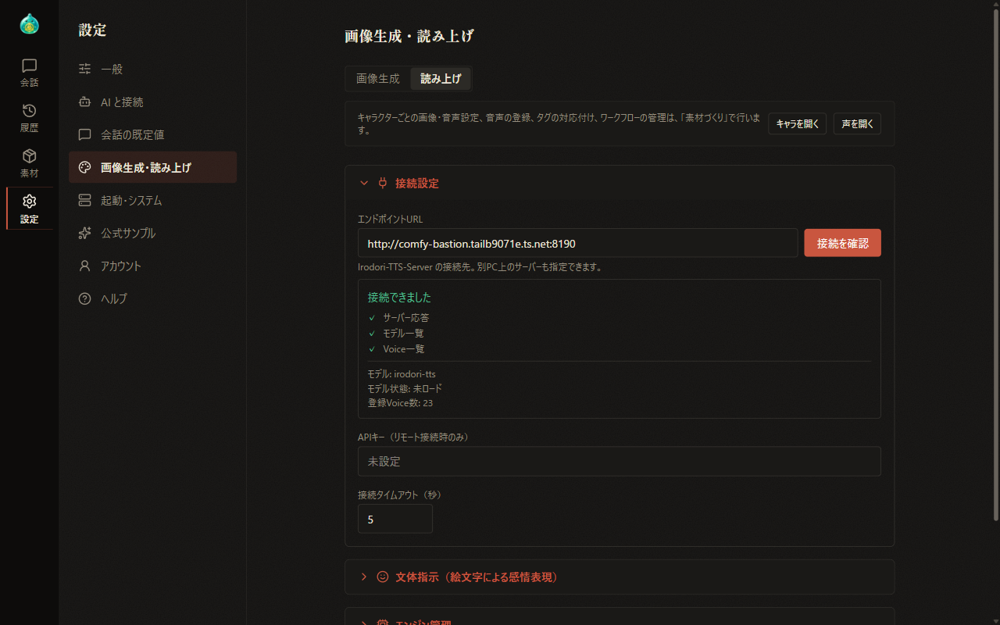
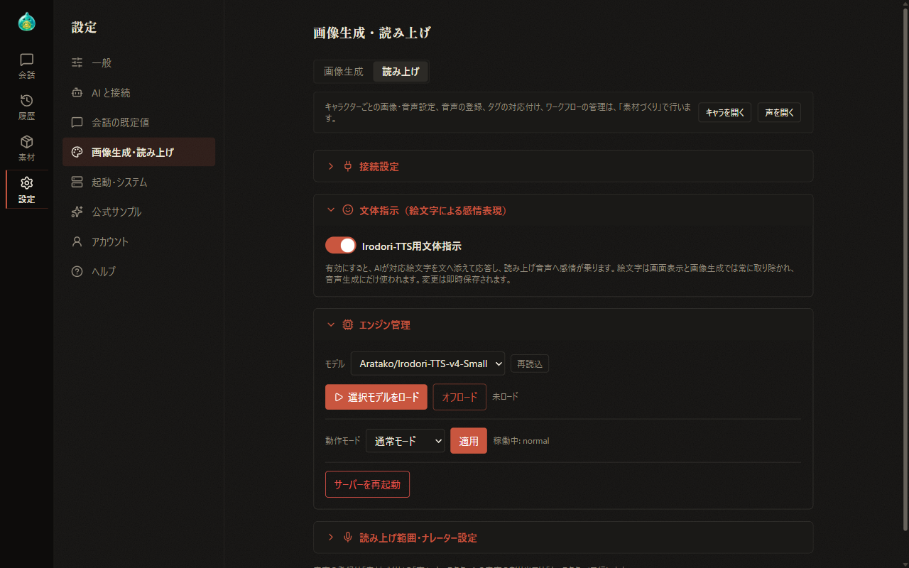
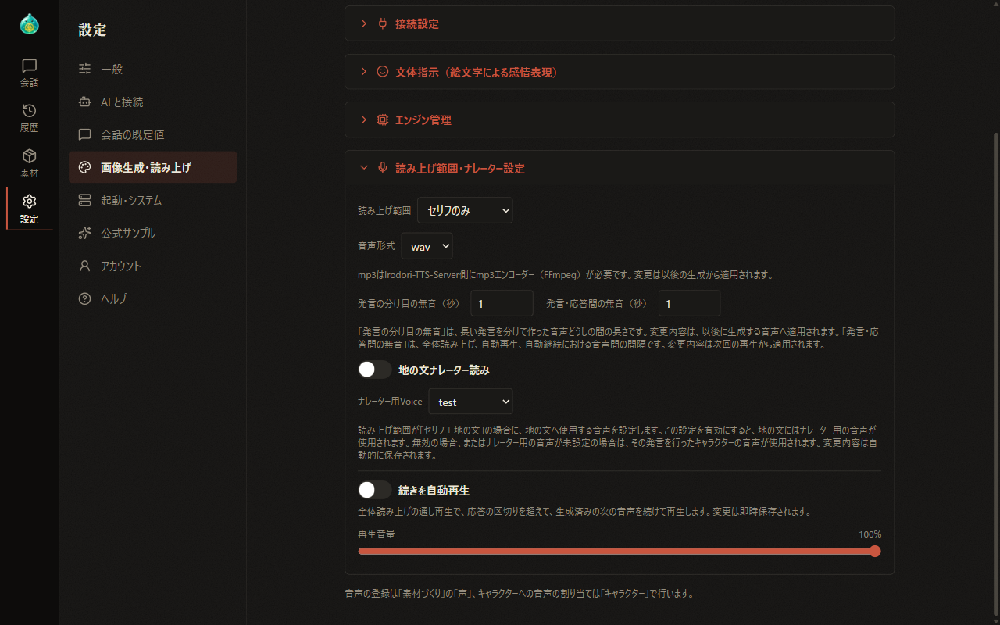
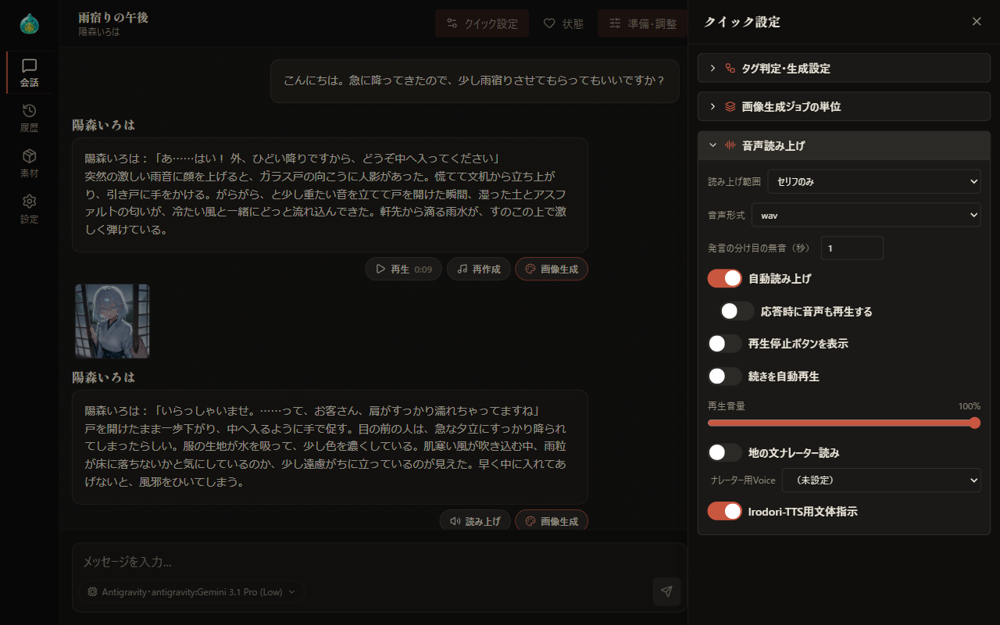
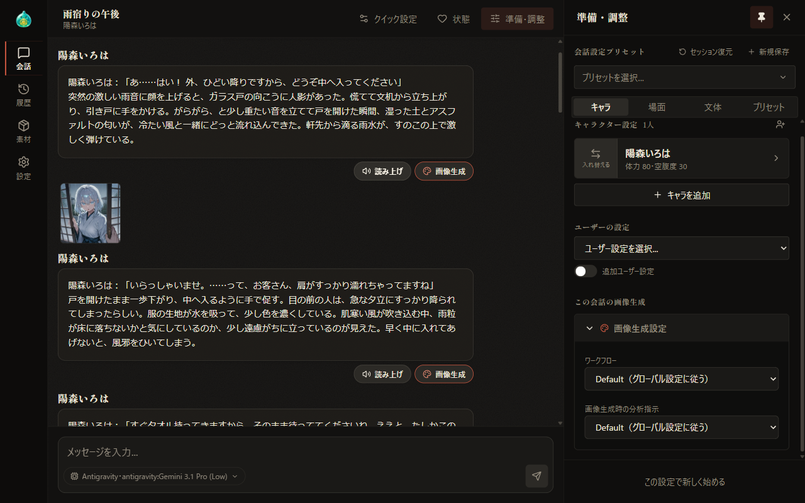
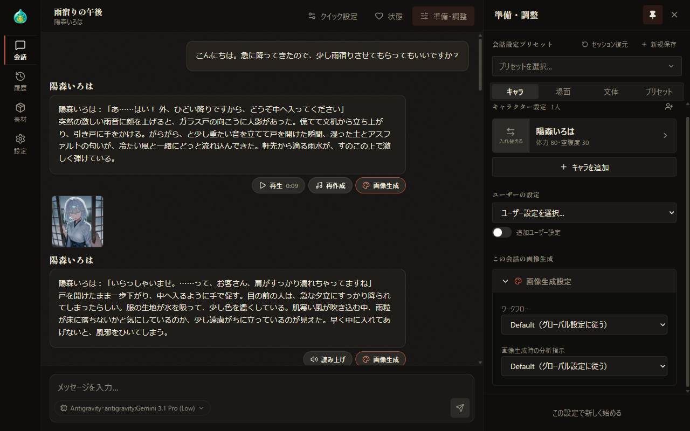
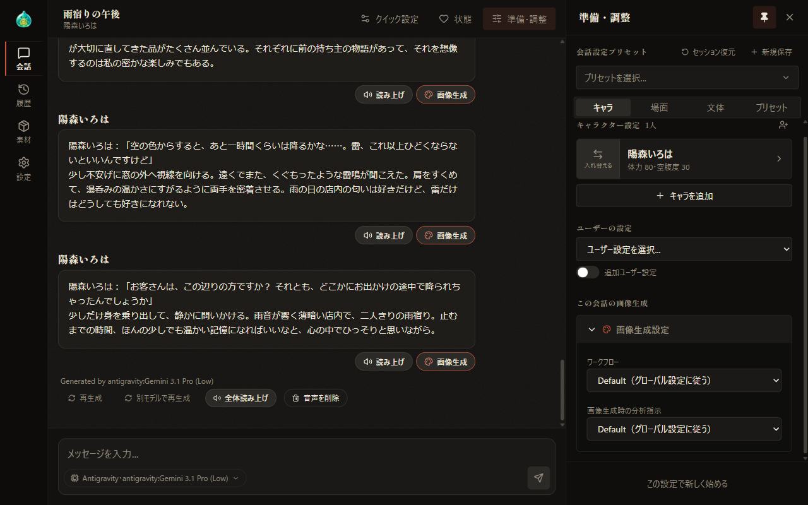

# 11 読み上げ

[目次に戻る](../index.md)

前章: [10 画像生成](10-image-generation.md) ／ 次章: [12 設定パックと更新](12-settings-pack-update.md)

本章では、キャラクターの発言を声で再生する読み上げについて、準備の流れ、設定、会話での使い方をご案内いたします。読み上げは、支援者機能の読み上げが有効で、表示言語が日本語の場合に使用します（[09 支援者機能](09-sponsor.md)）。

## この章の内容

1. 使い始めるまでの流れ
2. 設定画面の読み上げ
3. クイック設定
4. 会話を読み上げる
5. 自動読み上げ

## 1. 使い始めるまでの流れ

読み上げでは、外部のツールである Irodori-TTS-Server で音声を作成します。使い始めるまでの流れは次のとおりです。

1. 支援者機能でログインし、Irodori-TTS連携モジュールを取得します（[09 支援者機能](09-sponsor.md)）。
2. Irodori-TTS-Server を準備して起動します。~~導入方法は、AlSlime のホームページにてご案内しております。~~（現在鋭意作成中）
3. 設定画面の「接続設定」で、Irodori-TTS-Server の接続先アドレスを指定し、接続を確認します（本章の「2. 設定画面の読み上げ」）。
4. 素材づくりの「声」タブで、声を登録します（[07-4 素材づくり：声](07-material-voice.md)）。
5. 素材づくりの「キャラ」タブで、キャラクターに声を紐づけます（[07-3 素材づくり：キャラ](07-material-characters.md)）。
6. 会話の吹き出しの「読み上げ」を選択します。

GPU や VRAM の容量、画像生成との同時使用、音声モデルの倫理的な制約についてのご注意は、[09 支援者機能](09-sponsor.md) にてご案内いたします。

## 2. 設定画面の読み上げ

設定の「画像生成・読み上げ」の「読み上げ」で、読み上げの全体の設定を行います。画像生成も有効な場合は、上部の「画像生成」「読み上げ」で表示を切り替えます。各欄は、見出しを選択すると内容が表示される形式です。

### 接続設定

| 項目 | 内容 |
| --- | --- |
| エンドポイントURL | Irodori-TTS-Server の接続先アドレスを入力します。別の PC で動作しているサーバーも指定が可能です。「接続を確認」を選択すると、サーバーの応答・モデル一覧・Voice 一覧の取得結果とモデル・モデルの状態・登録済みの声の数が表示されます |
| APIキー | 別の PC のサーバーへ接続する場合に、サーバー側で設定した API キーを入力します |
| 接続タイムアウト（秒） | サーバーの応答を待つ時間を指定します |

接続設定の変更は、画面下部の帯の「保存」で保存されます。ほかの欄の変更は、その場で保存されます。

### 文体指示・エンジン管理

- **文体指示（絵文字による感情表現）**: 「Irodori-TTS用文体指示」を有効にすると、AI が対応する絵文字を文に添えて応答し、読み上げの音声に感情が加わります。絵文字は、画面の表示と画像生成では取り除かれ、音声の作成にだけ用いられます。
- **エンジン管理**: 読み上げのモデルの選択と再読込、「選択モデルをロード」「オフロード」、動作モード（通常モード・省メモリモード）の適用、「サーバーを再起動」を行います。この欄は、対応する Irodori-TTS-Server を接続している場合に表示されます。

### 読み上げ範囲・ナレーター設定

| 項目 | 内容 |
| --- | --- |
| 読み上げ範囲 | 「セリフのみ」または「セリフ＋地の文」を選択します |
| 音声形式 | wav または mp3 を選択します。mp3 には、Irodori-TTS-Server 側に FFmpeg が必要です。変更は、以後に作成する音声から反映されます |
| 発言の分け目の無音（秒） | 長い発言を分けて作成した音声どうしの間の長さです。変更は、以後に作成する音声から反映されます |
| 発言・応答間の無音（秒） | 全体読み上げや自動再生での、音声と音声の間の無音の長さです。変更は、次回の再生から反映されます |
| 地の文ナレーター読み・ナレーター用Voice | 読み上げ範囲が「セリフ＋地の文」の場合に、地の文に用いる声を指定します。無効の場合やナレーター用の声が未設定の場合は、その発言のキャラクターの声が用いられます |
| 続きを自動再生 | 全体読み上げでは応答の区切りを越えて作成済みの次の音声を連続して再生します |
| 再生音量 | 再生の音量を指定します |

## 3. クイック設定

会話画面の見出しの「クイック設定」で「音声読み上げ」を選択すると、読み上げの設定が表示されます。変更はその場で保存されます。

設定画面と共通の項目に加えて、次の項目はクイック設定にだけ含まれます。

- **自動読み上げ**: 応答が届いた時点で、応答全体の音声を作成します（本章の「5. 自動読み上げ」）。
- **応答時に音声も再生する**: 自動読み上げで作成した音声をそのまま再生します。自動読み上げが有効な場合に表示されます。
- **再生停止ボタンを表示**: 再生中に、本文の右下へ再生を停止するボタンを表示します。このボタンでは再生だけが停止し、音声の作成は継続されます。

「発言・応答間の無音」は、設定画面にだけ含まれます。

## 4. 会話を読み上げる

### 発言ごとの読み上げ

吹き出しの下の「読み上げ」を選択すると、その発言の音声を作成します。

- 作成中は、ボタンの表示が「キャンセル」に切り替わります。「キャンセル」を選択すると、作成を中止します。
- 同じ応答のほかの音声を作成している間は、「読み上げ」は無効の表示になります。

作成が完了すると、「再生」と「再作成」が表示されます。

- **再生**: 音声の長さとともに表示され、選択すると再生します。再生中に選択すると停止します。
- **再作成**: 音声を再度作成します。

### 応答全体の読み上げ

「Generated by」の表示の下に、「全体読み上げ」と「音声を削除」が並びます。

- **全体読み上げ**: 応答のすべての発言の音声を順に作成し、通して再生します。作成中は「キャンセル」に切り替わります。最新の応答に限らず、どの応答にも表示されます。
- **音声を削除**: 確認の後、その応答の音声をまとめて削除します。その応答に音声がある場合に表示されます。

全体の再生中は、ほかの読み上げのボタンは無効の表示になります。

### 読み上げられなかった場合

音声を作成しなかった発言には、理由が表示されます。主な理由は次のとおりです。

| 表示 | 内容 |
| --- | --- |
| 音声が紐づいていません | そのキャラクターに声が紐づいていません。素材づくりの「キャラ」タブの「声の紐づけ」で、声を紐づけます（[07-3 素材づくり：キャラ](07-material-characters.md)） |
| 読み上げる内容がありません | その発言に、読み上げの対象となる文がありません |
| 読み上げ音声を作れませんでした | 音声の作成に失敗しました。そのキャラクターの声の紐づけと、Irodori-TTS-Server との接続を確認します。紐づけた声が Irodori-TTS-Server に登録されていない場合にも表示されます |

## 5. 自動読み上げ

クイック設定の「音声読み上げ」で「自動読み上げ」を有効にすると、応答が届いた時点で応答全体の音声が作成されます。「応答時に音声も再生する」も有効にすると、作成した音声が順に再生されます。

---

前章: [10 画像生成](10-image-generation.md) ／ 次章: [12 設定パックと更新](12-settings-pack-update.md)

[目次に戻る](../index.md)
